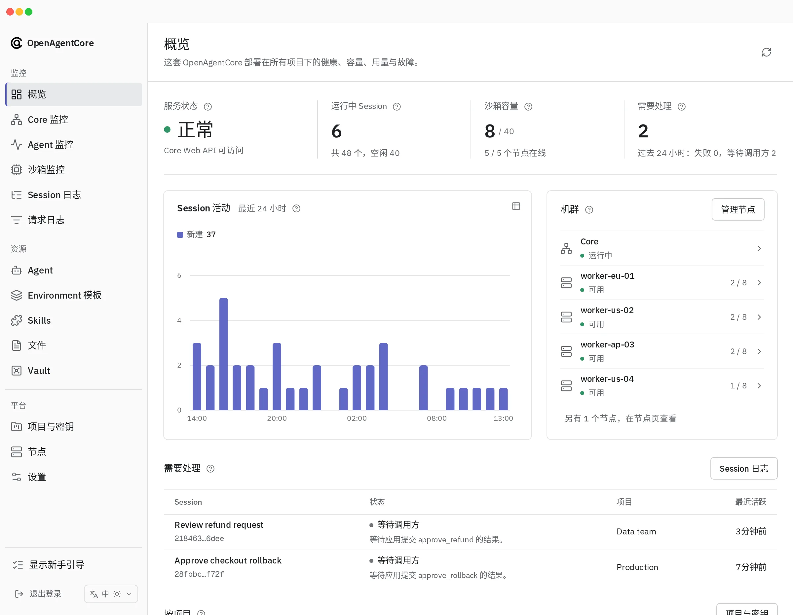
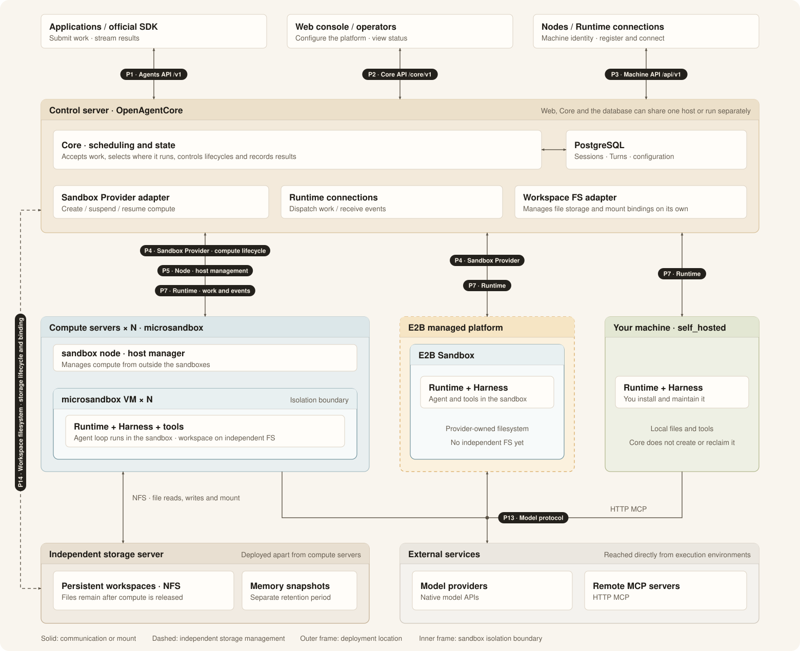

<div align="center">

<picture>
  <source media="(prefers-color-scheme: dark)" srcset="docs/assets/openagentcore-wordmark-dark.svg">
  
</picture>

开源、可自部署的 OpenAI Agents API。用官方 OpenAI SDK，在你自己的机器上用你自己的模型运行 Codex、Claude Code 或 MiniMax Code。

[](https://github.com/MiniMax-AI/OpenAgentCore/releases/latest) [](LICENSE)

[官网](https://openagentcore.dev/zh/) · [文档](https://openagentcore.dev/zh/docs/getting-started/) · [快速开始](#快速开始) · [参与贡献](CONTRIBUTING.md)

[English](README.md) · **简体中文** · [日本語](README.ja.md)

</div>

- **与 OpenAI 相同的 API。** 设置 `OPENAI_BASE_URL` 后，[官方 OpenAI SDK](https://developers.openai.com/api/docs/libraries)或直接的 HTTP 调用无需改动即可使用。
- **你的 Agent，你的模型。** 每个 Session 原生运行 Codex、Claude Code 或 MiniMax Code，并使用你配置的模型提供商。详见 [Harness 能力](https://openagentcore.dev/zh/contracts/agents-api/harness-capabilities)。
- **计算会休眠，工作区会保留。** 在 microsandbox 配合独立工作区存储时，空闲沙箱释放计算资源，并在兼容节点上带着文件恢复。E2B、Docker 以及你自己的 Linux、macOS 或 Windows 机器同样可以运行 Session。详见[沙箱提供商协议](https://openagentcore.dev/zh/docs/sandbox-provider)。
- **部件可替换。** 沙箱提供商、工作区文件系统、Harness 和模型提供商都通过[既定协议](AGENTS.md#protocols-at-every-boundary)接入。



## 快速开始

在 Linux 或 macOS 上，按[前置条件](https://openagentcore.dev/zh/docs/getting-started/install#prerequisites)准备好 Docker 后，安装 Core、Web 和 PostgreSQL：

```sh
curl -fsSL https://openagentcore.dev/install.sh | bash
```

在 Windows 上，使用 PowerShell：

```powershell
irm https://github.com/MiniMax-AI/OpenAgentCore/releases/latest/download/install.ps1 | iex
```

在 Web 中，用安装程序输出的 Core 密钥登录，配置公共地址，设置默认模型，签发项目 API 密钥，并添加沙箱容量（节点或 E2B）。每一步见[安装 Core 和 Web](https://openagentcore.dev/zh/docs/getting-started/install)。

然后用 OpenAI SDK 调用，将 `OPENAI_BASE_URL` 设为你的 API 基础地址（`https://core.example/v1`），`OPENAI_API_KEY` 设为项目 API 密钥：

```python
from openai import OpenAI

client = OpenAI()  # reads OPENAI_BASE_URL and OPENAI_API_KEY
session = client.beta.agents.sessions.create(
    environment={"type": "openai_hosted"},
    input="Create /workspace/hello.txt with a short greeting, then describe it.",
    extra_body={"agent": {"x_agents_core": {"harness": "codex"}}},
)
print(session.id)
```

[运行第一个 Session](https://openagentcore.dev/zh/docs/getting-started/quickstart)会等待结果并读回。

## 工作原理

<picture>
  <source media="(prefers-color-scheme: dark)" srcset="docs/assets/architecture-dark.svg">
  
</picture>

应用和管理员使用以下 Core API：

| API | 路径 | 调用方 |
| --- | --- | --- |
| **[Agents API](https://openagentcore.dev/zh/docs/api/public-agent-api)** | `/v1` | 你的应用，与 [OpenAI 的 Agents API](https://developers.openai.com/api/docs/guides/agents-api/overview) 协议一致 |
| **[Core API](https://openagentcore.dev/zh/contracts/agents-api/admin-api)** | `/core/v1` | 管理员，通过 Web 调用 |

持久化执行状态由 Core 保存；Runtime 在 Environment 中运行所选 Harness。各部件之间都通过既定协议连接，任何一个都可以单独替换。详见[架构](https://openagentcore.dev/zh/docs/architecture)。

## 文档

| 我想要 | 从这里开始 |
| --- | --- |
| 安装并运维 | [安装 Core 和 Web](https://openagentcore.dev/zh/docs/getting-started/install)，然后看[运维](https://openagentcore.dev/zh/docs/getting-started/operations) |
| 基于 API 开发应用 | [运行第一个 Session](https://openagentcore.dev/zh/docs/getting-started/quickstart)，然后看 [Agents API 指南](https://openagentcore.dev/zh/docs/api/public-agent-api) |
| 看一个完整的应用 | [示例](https://openagentcore.dev/zh/docs/examples) |
| 在自己的机器上运行 Agent | [自托管执行器](https://openagentcore.dev/zh/docs/getting-started/self-hosted) |
| 查看 Harness 能力和限制 | [Harness 能力](https://openagentcore.dev/zh/contracts/agents-api/harness-capabilities) |
| 了解设计 | [架构](https://openagentcore.dev/zh/docs/architecture) |
| 接入新的沙箱、Harness 或其他组件 | [开发 OpenAgentCore](https://openagentcore.dev/zh/docs/development) |

## 参与贡献与许可证

修改代码前请阅读 [CONTRIBUTING.md](CONTRIBUTING.md)。缺陷和问题请提交到 [GitHub Issues](https://github.com/MiniMax-AI/OpenAgentCore/issues)。基于 [MIT 许可证](LICENSE)发布。
