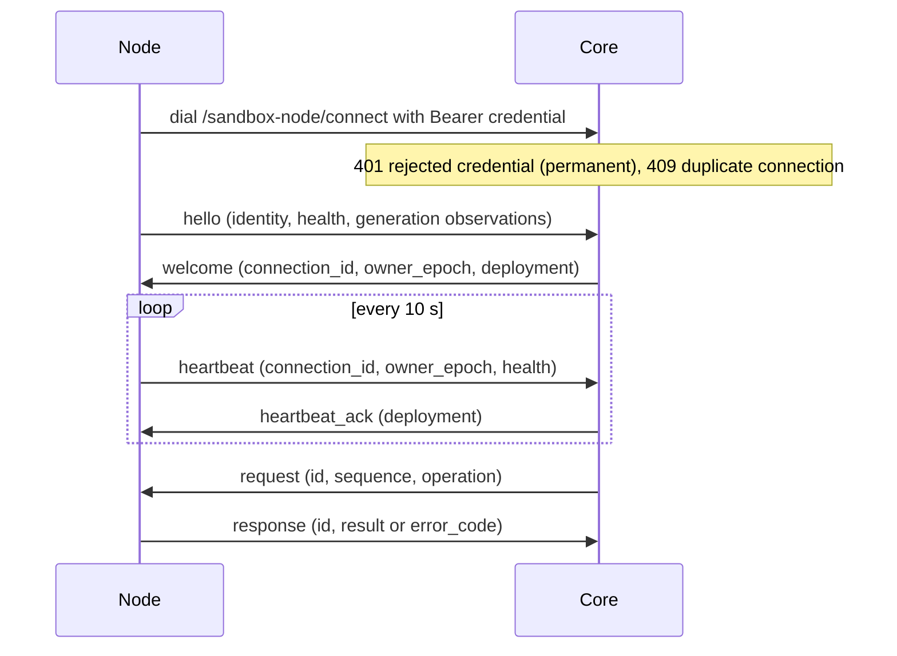
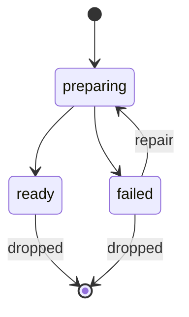
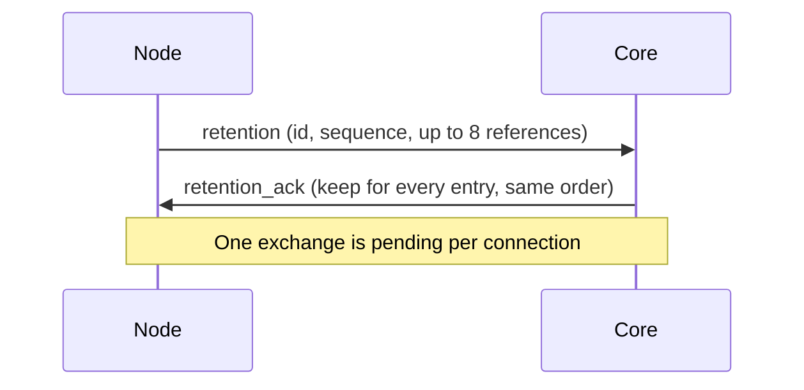

The sandbox node protocol connects Core to a Docker or microsandbox host, which runs Provider operations against its local provider and reports readiness, host measurements and the deployment generations it holds.

| | |
| --- | --- |
| Caller | Core, the only lifecycle owner; the node never retries a mutation or schedules work |
| Implementations | The sandbox node program with the Docker and microsandbox Providers |
| Code | [`services/core/internal/sandbox/node`](https://github.com/MiniMax-AI/OpenAgentCore/tree/main/services/core/internal/sandbox/node) (`wire.go`, `generation_wire.go`) |
| Transport | One WebSocket, `GET /api/v1/sandbox-node/connect`; the HTTP routes a node uses to enroll and read its configuration are in the [machine connection API](./machine-api.md#node-routes) |
| Version rule | Exact match on `node.ProtocolVersion`, see [Frames and version](#frames-and-version) |

Node-local storage, generation leases and recovery are not part of the wire protocol; the [Node installer](https://github.com/MiniMax-AI/OpenAgentCore/blob/main/deploy/node/README.md#generation-storage-and-recovery) owns them.

## Roles

| Party | Owns |
| --- | --- |
| Core | Node identity and presence, the owner epoch, the target generation, every request and its sequence, and every retention decision |
| Node | Its local provider, the generations it prepares and serves, health and host measurements, and the execution of each request against the provider |

## Frames and version

Every frame is one JSON text message whose `version` equals `node.ProtocolVersion`; both peers reject any other version, and there is no fallback decoder. Member names are exact and unique: unknown members, case aliases, duplicates and unexpected nulls are rejected. Control frames (`hello`, `welcome`, `heartbeat`, `heartbeat_ack`, `retention`, `retention_ack`) are at most 32 KiB; `request` and `response` frames at most 72 MiB. An invalid frame closes the connection.

## Connection

1. The node dials `/api/v1/sandbox-node/connect?node_id=<uuid>` on its stored Core origin (`wss` for `https`) with its node credential as a Bearer header. Core answers 401 to a rejected credential, which the node treats as permanent; any other failure, including a 403 from a proxy, is retried with bounded backoff. Core refuses a second connection for a node identity while one is opening, live or closing, with 409.
2. Within 15 seconds the node sends `hello` with its identity (`node_id`, `installation_id`, `provider`, `backend_fingerprint`, the enrolled `deployment_generation` and `specification_digest`, `max_active`, `max_retained`), its first health report and, when it can prepare and retain several deployment generations, `generation_management: true`. Core closes the connection unless the identity matches the authenticated node.
3. Core records the node's presence, then replies `welcome` with a new `connection_id`, the current `owner_epoch` and, for a generation-managing node, `deployment`: the target `generation`, its `specification_digest` and a nullable `serving_generation`. The node stores a higher owner epoch and refuses a lower one.
4. Every 10 seconds the node sends `heartbeat` with `connection_id`, `owner_epoch` and health. On each heartbeat Core authenticates the node credential again and checks the owner epoch, records the health and replies `heartbeat_ack`, with `deployment` for a generation-managing node. Either peer closes the connection after 35 seconds without a frame.

Core counts a node as online while it is connected under the current owner epoch and its last heartbeat is less than 45 seconds old. A heartbeat establishes provider readiness and the last host measurements, never Session activity. [Timeouts and limits](#timeouts-and-limits) lists every timer.

Health carries `provider_ready`, an optional fixed `diagnostic`, `observed_at`, `active_operations` (at most 32) and the host measurements that the [Runtime telemetry API](./runtime-observability-api.md#node-host-observations-and-history) reports. A node without generation management probes its provider for every report; an unready provider reports the Provider-neutral readiness class of its first failed check, from the class error the probe wraps, and the probe text, vendor detail and host paths stay on the node. A `diagnostic` in node or generation health that is not a declared class makes the frame invalid. The [nodes guide](../../docs/getting-started/nodes.md#readiness-codes) lists the classes and their causes. A generation-managing node reports readiness per generation instead, as described below.

## Provider requests

Core sends `request` frames with:

| Field | Meaning |
| --- | --- |
| `id` | New UUID per request |
| `sequence` | Increases by exactly one per request on this connection |
| `connection_id`, `owner_epoch` | The values from `welcome` |
| `deployment_generation` | The generation the allocation belongs to, separate from its compute generation |
| `operation` | One of the operations below |
| `timeout_ms` | Remaining budget, 1 to 120000 |
| `reference` | The exact `(tenant_id, environment_id, allocation_id)` |

Each operation carries its own arguments and returns the following result on success:

| `operation` | Provider method | Arguments | Successful result |
| --- | --- | --- | --- |
| `create` | `Create` | `bootstrap` | `info` |
| `info` | `GetInfo` | None | `info` |
| `renew` | `Renew` | None | `info` |
| `kill` | `Kill` | None | None |
| `command` | `RunCommand` | `command` | `command` |
| `observe` | `Observe` | `observation` | `sample` |
| `initial` | `Initial` | None | `compute` |
| `new_compute` | `NewCompute` | Positive compute `generation` and optional `snapshot` | `compute` |
| `compute` | `GetCompute` | `compute` | `state` |
| `kill_compute` | `KillCompute` | `compute` | None |
| `resume_compute` | `ResumeCompute` | `compute` | `state` |
| `command_compute` | `RunCommandCompute` | `compute` and `command` | `command` |
| `suspend` | `Suspend` | `suspend` | `state` |
| `resume` | `Resume` | `resume` | `state` |
| `delete_snapshot` | `DeleteSnapshot` | `snapshot` | None |

A request whose `connection_id`, `owner_epoch` or `sequence` does not match closes the connection. A malformed request gets an `invalid` response. A node without generation management accepts only its enrolled `deployment_generation`; a generation-managing node runs the request on that generation's provider and answers `unconfirmed` when it cannot. Core sends `create` and a `resume` that is not observe-only only to a generation that is ready on that node, and keeps at most 32 requests pending per connection.

The budget is relative: the node anchors `timeout_ms` to its own clock on receipt and consumes it while the request waits in its queue, so the hosts' clocks need not agree. Core still bounds its own wait. A full node queue closes the connection.

The `response` frame carries `id` and `connection_id`. A successful response carries the result named in the operation table, with no result field for `kill`, `kill_compute` or `delete_snapshot`. A failed response carries an `error_code`:

| `error_code` | Meaning |
| --- | --- |
| `invalid`, `ownership`, `exists`, `not_found` | `ErrInvalid`, `ErrOwnership`, `ErrExists`, `ErrNotFound` |
| `command_unconfirmed` | `ErrCommandUnconfirmed` |
| `observation_unavailable`, `runtime_not_running` | The observation outcomes |
| `unsupported` | The operation is declared unsupported; see below |
| `unconfirmed`, or any other value | The outcome is unknown |

A failed response carries no result, except an `info` that is an exact-reference `CreateSettled` receipt: a confirmed native Create that failed a later check can still prove that the attempt settled. A timeout, a lost response or a disconnect is unavailable or uncertain, never evidence of absence, and Core never replays a mutation after one; it observes the original operation instead. The [Sandbox Provider guide](../../docs/sandbox-provider.md#operation-outcomes-and-retries) defines each outcome.

Node startup and generation loading validate complete Provider operation declarations before accepting work, and the Core proxy uses the same registered declaration, so an unsupported operation rejects before node resolution or native I/O. The [operation contract](../../docs/sandbox-provider.md#explicit-operation-contracts) owns the inventory. An `unsupported` response carries an `unsupported` object with the exact method `operation` and an authored safe `reason`; the proxy checks both against the request. Missing, malformed or mismatched evidence is an unconfirmed result, never proof that a mutation was rejected. Unsupported stays distinct from observation unavailability and unknown compute or command results, and it neither settles resource ownership nor authorizes a replay.

Create bootstrap and Resume requests may carry an optional workspace filesystem binding. The node validates its tenant and Environment against the allocation reference, its immutable ObjectID, and its attachment configuration ID against the supplied configuration before forwarding it. The filesystem resolver validates adapter-native ownership. A missing binding selects owned storage; a present binding cannot fall back. Error responses may retain a Resume target only when its nonempty native ID, name, generation and snapshot provenance match the requested target; this is cleanup evidence, never successful restore.

## Generation control

A node without generation management serves only its enrolled generation, with fixed configuration, and receives no preparation or retention frames. It can report that exact generation in `Health.Generations`; a checkpoint-capable provider must do so, including its verified checkpoint qualification. `provider_ready` and the reported state must agree. A generation-managing node prepares the target generation Core announces in `welcome` and `heartbeat_ack` and keeps serving its durable serving generation while it does; target preparation is independent of the serving provider's readiness.

Its `hello` and heartbeats carry at most eight generation observations. Each names a positive signed-64-bit generation, its lowercase SHA-256 specification digest, a `ready`, `preparing` or `failed` state and an optional fixed diagnostic. The target and serving generations come first; other records rotate fairly. Eight bounds one message, not the number of generations a node may keep. An omitted observation never authorizes deletion or implies absence. A ready checkpoint-capable generation includes `checkpoint` with nonempty opaque `artifact_domain` and `execution_class` tokens, each at most 256 bytes. Unsupported providers omit it; preparing or failed generations never advertise it. Core persists the declaration with the authenticated connection and generation, and uses it only while that generation is ready on the current online connection. The [Provider contract](../../docs/sandbox-provider.md#checkpoint-transfer) defines archive and execution compatibility.

A generation is the target, the serving generation, both or neither. The node reports each held generation as `preparing`, `ready` or `failed`; a dropped generation is never prepared or used again. Local collection of a dropped generation is described in the [Node installer](https://github.com/MiniMax-AI/OpenAgentCore/blob/main/deploy/node/README.md#generation-storage-and-recovery).

Retention uses its own bounded exchange: the node asks and Core decides. The node's `retention` request names at most eight local `(generation, specification_digest)` references, a UUID, a sequence that increases by one, the current `connection_id` and the owner epoch. Core's `retention_ack` must match the complete pending request, entry order and identity included, and give an explicit boolean `keep` for every entry. One exchange is pending per connection, and a disconnect discards it. An unsolicited, replayed, stale, partial or mixed acknowledgement deletes nothing. Retention traffic never uses the Provider request queue.

## Readiness diagnostics

The readiness classes, one exported error and one code each, are authored in `services/core/internal/sandbox/node_diagnostic.go`. The shared `services/core/internal/sandbox/testdata/node-diagnostics.json` fixture checks the Go mapping, OpenAPI source annotations and generated enums, and the TypeScript client declaration. Web uses the client normalizer and checks localized messages for every declared code. Update these projections with a code change; clients read an unknown code as `provider_unavailable`.

Preparation diagnostics keep fixed typed causes. Only artifact transfer, checksum or release-provenance failures report `runtime_download_failed`; the private preparer signals that class through its exit category, without Core or the node parsing stderr. Provider, ownership, cancellation and unclassified failures keep their typed code or `provider_unavailable`. No raw provider text crosses the protocol.

## Timeouts and limits

| Value | Applies to | On expiry or excess |
| --- | --- | --- |
| 15 s | `hello` after the connection opens | The connection closes |
| 10 s | Heartbeat interval; also the write deadline of each frame | A failed write ends the connection |
| 35 s | Any frame on an open connection | Either peer closes the connection |
| 45 s | Age of the last heartbeat for an online node | Core counts the node as offline |
| 1 to 120000 ms | Request `timeout_ms` | The request fails as unavailable or uncertain |
| 32 | Pending requests per connection; `active_operations` in health | A full node queue closes the connection |
| 32 KiB | Control frames | The connection closes |
| 72 MiB | `request` and `response` frames | The connection closes |
| 8 | Generation observations per message; references per `retention` request | An omitted observation implies nothing |

## Conformance

The Go tests in [`services/core/internal/sandbox/node`](https://github.com/MiniMax-AI/OpenAgentCore/tree/main/services/core/internal/sandbox/node) cover frames, connection ordering and fencing, request budgets, generation control and Provider operations. `make check-core` runs them. The Python node installer tests in `deploy/node` cover the node side of generation preparation and collection.
