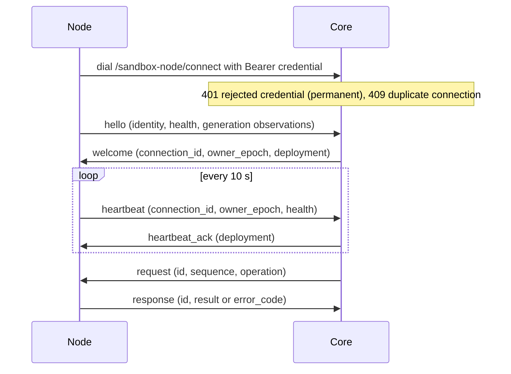
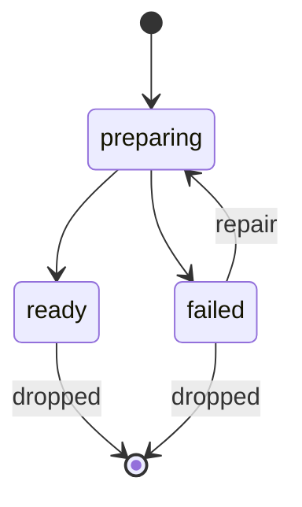
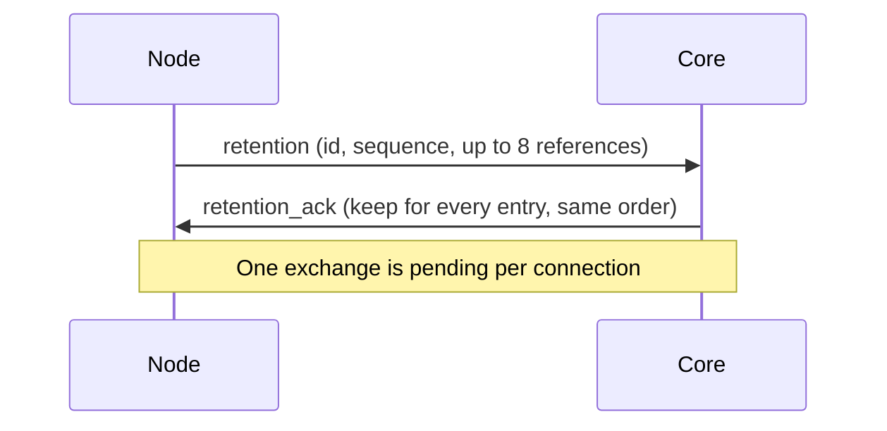

沙箱节点协议连接 Core 与 Docker 或 microsandbox 主机：主机针对其本地提供商执行提供商操作，并报告就绪状态、主机测量值及其持有的部署代次。

| | |
| --- | --- |
| 调用方 | Core，唯一的生命周期所有者；节点从不重试变更，也不调度工作 |
| 实现 | 沙箱节点程序，搭配 Docker 与 microsandbox 提供商 |
| 代码 | [`services/core/internal/sandbox/node`](https://github.com/MiniMax-AI/OpenAgentCore/tree/main/services/core/internal/sandbox/node)（`wire.go`、`generation_wire.go`） |
| 传输 | 一个 WebSocket，`GET /api/v1/sandbox-node/connect`；节点用于登记和读取配置的 HTTP 路由见[机器连接 API](machine-api.md#node-routes) |
| 版本规则 | 与 `node.ProtocolVersion` 精确匹配，见[帧与版本](#frames-and-version) |

节点本地存储、代次租约和恢复不属于线路协议，由 [Node installer](https://github.com/MiniMax-AI/OpenAgentCore/blob/main/deploy/node/README.md#generation-storage-and-recovery) 负责。

## 角色 {#roles}

| 参与方 | 负责 |
| --- | --- |
| Core | 节点身份与在线状态、所有者 epoch、目标代次、每个请求及其序号，以及每个保留决定 |
| 节点 | 其本地提供商、其准备并服务的代次、健康状态与主机测量值，以及针对提供商执行每个请求 |

## 帧与版本 {#frames-and-version}

每个帧都是一个 JSON 文本消息，其 `version` 等于 `node.ProtocolVersion`；两端都会拒绝任何其他版本，并且没有回退解码器。成员名必须精确且唯一：未知成员、大小写别名、重复项和意外的空值都会被拒绝。控制帧（`hello`、`welcome`、`heartbeat`、`heartbeat_ack`、`retention`、`retention_ack`）最多为 32 KiB；`request` 和 `response` 帧最多为 72 MiB。无效帧会关闭连接。

## 连接 {#connection}

1. 节点在其存储的 Core 源地址上发起对 `/api/v1/sandbox-node/connect?node_id=<uuid>` 的连接（对于 `https` 使用 `wss`），并以 Bearer 请求头发送节点凭据。Core 对被拒绝的凭据返回 401，节点将其视为永久性拒绝；其他任何失败（包括代理返回的 403）都会使用有界退避进行重试。当某个节点身份已有一个连接正在建立、存活或关闭时，Core 会以 409 拒绝第二个连接。
2. 节点须在 15 秒内发送 `hello`，其中包含节点身份（`node_id`、`installation_id`、`provider`、`backend_fingerprint`、已登记的 `deployment_generation` 和 `specification_digest`、`max_active`、`max_retained`）、首次健康报告；如果节点能够准备并保留多个部署代次，还包含 `generation_management: true`。除非身份与已认证节点匹配，否则 Core 会关闭连接。
3. Core 记录节点的存在状态，然后回复 `welcome`，其中包含新的 `connection_id` 和当前 `owner_epoch`；对于支持代次管理的节点，还包含 `deployment`：目标 `generation`、其 `specification_digest` 和可空的 `serving_generation`。节点保存更高的所有者 epoch，并拒绝更低的值。
4. 节点每 10 秒发送一次 `heartbeat`，其中包含 `connection_id`、`owner_epoch` 和健康状态。对于每次心跳，Core 都会再次认证节点凭据并检查所有者 epoch，记录健康状态并回复 `heartbeat_ack`；对于支持代次管理的节点，回复中还包含 `deployment`。任一端连续 35 秒未收到任何帧时都会关闭连接。

只要节点在当前所有者 epoch 下保持连接，并且最近一次心跳距今不足 45 秒，Core 就会将该节点计为在线。心跳会确立提供商的就绪状态和最近的主机测量值，但绝不表示 Session 活动。[超时与限制](#timeouts-and-limits)列出所有计时器。

健康报告包含 `provider_ready`、可选的固定 `diagnostic`、`observed_at`、最多为 32 的 `active_operations`，以及 [Runtime 遥测 API](runtime-observability-api.md#node-host-observations-and-history) 报告的主机测量值。未启用代次管理的节点每次报告时都会探测其提供商；未就绪的提供商会报告其首个失败检查所属的、与提供商无关的就绪类别，该类别取自探测所包装的类别错误；探测文本、厂商细节和主机路径保留在节点上。节点或代次健康状态中的 `diagnostic` 若不是已声明的类别，该帧即无效。[节点指南](../../../docs/zh/getting-started/nodes.md#readiness-codes) 列出了这些类别及其原因。支持代次管理的节点则按下文所述按代次报告就绪状态。

## 提供商请求 {#provider-requests}

Core 发送包含以下内容的 `request` 帧：

| 字段 | 含义 |
| --- | --- |
| `id` | 每个请求使用新的 UUID |
| `sequence` | 在此连接上，每个请求恰好递增 1 |
| `connection_id`、`owner_epoch` | `welcome` 中的值 |
| `deployment_generation` | 分配所属的部署代次，与其计算代次相互独立 |
| `operation` | 下列操作之一 |
| `timeout_ms` | 剩余预算，范围为 1 到 120000 |
| `reference` | 精确的 `(tenant_id, environment_id, allocation_id)` |

每个操作都携带自己的参数，并在成功时返回以下结果：

| `operation` | 提供商方法 | 参数 | 成功结果 |
| --- | --- | --- | --- |
| `create` | `Create` | `bootstrap` | `info` |
| `info` | `GetInfo` | 无 | `info` |
| `renew` | `Renew` | 无 | `info` |
| `kill` | `Kill` | 无 | 无 |
| `command` | `RunCommand` | `command` | `command` |
| `observe` | `Observe` | `observation` | `sample` |
| `initial` | `Initial` | 无 | `compute` |
| `new_compute` | `NewCompute` | 大于零的计算 `generation` 和可选的 `snapshot` | `compute` |
| `compute` | `GetCompute` | `compute` | `state` |
| `kill_compute` | `KillCompute` | `compute` | 无 |
| `resume_compute` | `ResumeCompute` | `compute` | `state` |
| `command_compute` | `RunCommandCompute` | `compute` 和 `command` | `command` |
| `suspend` | `Suspend` | `suspend` | `state` |
| `resume` | `Resume` | `resume` | `state` |
| `delete_snapshot` | `DeleteSnapshot` | `snapshot` | 无 |

只要 `connection_id`、`owner_epoch` 或 `sequence` 中任一值不匹配，请求就会关闭连接。格式错误的请求会得到 `invalid` 响应。未启用代次管理的节点仅接受其登记的 `deployment_generation`；支持代次管理的节点在对应代次的提供商上运行请求，无法运行时回复 `unconfirmed`。Core 仅向节点上已就绪的代次发送 `create` 和非 observe-only 的 `resume`，并且每条连接最多保留 32 个待处理请求。

预算采用相对计时：节点收到请求时以自己的时钟为基准锚定 `timeout_ms`，并在请求排队等待期间持续消耗该预算，因此各主机的时钟无需保持一致。Core 仍会限制自身等待时长。节点队列已满时会关闭连接。

`response` 帧包含 `id` 和 `connection_id`。成功响应携带操作表中指定的结果；对于 `kill`、`kill_compute` 或 `delete_snapshot`，响应不含结果字段。失败响应携带一个 `error_code`：

| `error_code` | 含义 |
| --- | --- |
| `invalid`、`ownership`、`exists`、`not_found` | `ErrInvalid`、`ErrOwnership`、`ErrExists`、`ErrNotFound` |
| `command_unconfirmed` | `ErrCommandUnconfirmed` |
| `observation_unavailable`、`runtime_not_running` | 对应的观察结果 |
| `unsupported` | 该操作被声明为不支持；见下文 |
| `unconfirmed` 或任何其他值 | 结果未知 |

失败响应不携带结果，唯一的例外是作为精确引用 `CreateSettled` 回执的 `info` 结果：即便已确认的原生 Create 在后续检查中失败，仍可证明该尝试已有确定结果。超时、响应丢失或断连属于不可用或不确定情况，绝不能证明资源不存在；发生这些情况后，Core 绝不重放变更操作，而是改为观察原始操作。[沙箱提供商指南](../../../docs/zh/sandbox-provider.md#operation-outcomes-and-retries) 定义了每种结果。

节点启动和代次加载会在接受工作前验证完整的提供商操作声明，Core 代理使用同一份已注册声明，因此不支持的操作会在节点解析或原生 I/O 之前被拒绝。操作清单由[操作契约](../../../docs/zh/sandbox-provider.md#explicit-operation-contracts)维护。`unsupported` 响应包含一个 `unsupported` 对象，其中有精确的方法 `operation` 和经作者编写且安全的 `reason`；代理会将两者与请求进行核对。证据缺失、格式错误或不匹配会得到 `unconfirmed` 结果，而绝不会证明变更操作被拒绝。`unsupported` 始终不同于观察不可用，也不同于计算或命令结果未知；它既不确定资源所有权，也不授权重放。

Create 引导和 Resume 请求可携带可选的工作区文件系统绑定。节点在转发前校验其租户及 Environment 与分配引用一致、ObjectID 不可变且有效，以及挂载配置 ID 与所传配置一致。文件系统解析器负责适配器原生所有权校验。未提供绑定时选择自有存储；已提供绑定时不得回退。错误响应仅可保留原生 ID 非空且名称、代次、快照来源均匹配请求的 Resume 目标；这仅为清理证据，不代表恢复成功。

## 代次控制 {#generation-control}

未启用代次管理的节点只服务其登记的代次，配置固定，并且不会收到准备或保留帧。它可以在 `Health.Generations` 报告该精确代次；支持检查点的提供商必须报告，并包含已验证的检查点资格。`provider_ready` 必须与报告的状态一致。支持代次管理的节点会准备 Core 在 `welcome` 和 `heartbeat_ack` 中通告的目标代次，并在此期间继续服务其持久化的服务代次；目标代次的准备独立于服务提供商的就绪状态。

节点的 `hello` 和心跳最多携带八条代次观察记录。每条记录指定一个正值的有符号 64 位代次编号、其小写 SHA-256 规范摘要、`ready`、`preparing` 或 `failed` 状态，以及可选的固定诊断信息。目标代次和服务代次的记录排在前面，其余记录公平轮换。八条记录限制的是单条消息，而不是节点可保留的代次数量。省略某条观察记录绝不会授权删除，也不会暗示不存在。 支持检查点的 ready 代次携带 `checkpoint`，包含非空且不透明的 `artifact_domain` 和 `execution_class` token，各最多 256 字节。不支持的提供商省略该字段；preparing 或 failed 代次不声明它。Core 将声明与已认证连接和代次一起持久化，仅在当前在线连接的该代次仍 ready 时使用。[提供商契约](../../../docs/zh/sandbox-provider.md#checkpoint-transfer) 定义归档与执行兼容性。

一个代次可以是目标代次、服务代次、两者兼是或两者皆非。节点将所持有的每个代次报告为 `preparing`、`ready` 或 `failed`；已丢弃的代次不会再被准备或使用。已丢弃代次的本地回收见 [Node installer](https://github.com/MiniMax-AI/OpenAgentCore/blob/main/deploy/node/README.md#generation-storage-and-recovery)。

保留使用独立且有界的交换：由节点询问，由 Core 决定。节点的 `retention` 请求最多指定八个本地 `(generation, specification_digest)` 引用、一个 UUID、一个每次递增 1 的 `sequence`、当前 `connection_id` 和所有者 epoch。Core 的 `retention_ack` 必须与完整的待处理请求匹配，包括条目顺序和身份信息，并为每个条目给出显式布尔值 `keep`。每条连接只能有一个交换处于待处理状态，断连会将其丢弃。任何未经请求、重放、过期、不完整或混合的确认都不会删除任何内容。保留流量从不使用提供商请求队列。

## 就绪诊断 {#readiness-diagnostics}

就绪类别编写于 `services/core/internal/sandbox/node_diagnostic.go`，每个类别对应一个导出错误和一个代码。共享的 `services/core/internal/sandbox/testdata/node-diagnostics.json` 测试夹具检查 Go 映射、OpenAPI 源注释和生成的枚举，以及 TypeScript 客户端声明。Web 使用客户端规范化器，并检查每个已声明代码的本地化消息。代码变更时要同步更新这些投影；客户端将未知代码读作 `provider_unavailable`。

准备诊断使用固定的类型化原因。只有制品传输、校验和或版本来源验证失败才会报告 `runtime_download_failed`；私有准备器通过退出类别指示这一类失败，Core 和节点都不解析 stderr。提供商故障、所有权故障、取消和未分类故障保留其类型化代码，或使用 `provider_unavailable`。协议中不会传输任何提供商原始文本。

## 超时与限制 {#timeouts-and-limits}

| 值 | 适用于 | 到期或超出时 |
| --- | --- | --- |
| 15 秒 | 连接打开后的 `hello` | 连接关闭 |
| 10 秒 | 心跳间隔；也是每个帧的写入截止时间 | 写入失败会结束连接 |
| 35 秒 | 已打开连接上的任意帧 | 任一端关闭连接 |
| 45 秒 | 在线节点最近一次心跳的时长 | Core 将该节点计为离线 |
| 1 到 120000 毫秒 | 请求的 `timeout_ms` | 请求以不可用或不确定结束 |
| 32 | 每个连接的待处理请求数；健康状态中的 `active_operations` | 节点队列已满时关闭连接 |
| 32 KiB | 控制帧 | 连接关闭 |
| 72 MiB | `request` 和 `response` 帧 | 连接关闭 |
| 8 | 每条消息的代次观察记录数；每个 `retention` 请求的引用数 | 缺失的观察记录不代表任何含义 |

## 一致性测试 {#conformance}

[`services/core/internal/sandbox/node`](https://github.com/MiniMax-AI/OpenAgentCore/tree/main/services/core/internal/sandbox/node) 中的 Go 测试覆盖帧、连接顺序与围栏、请求预算、代次控制和提供商操作，由 `make check-core` 运行。`deploy/node` 中的 Python 节点安装程序测试覆盖代次准备与回收的节点侧。
