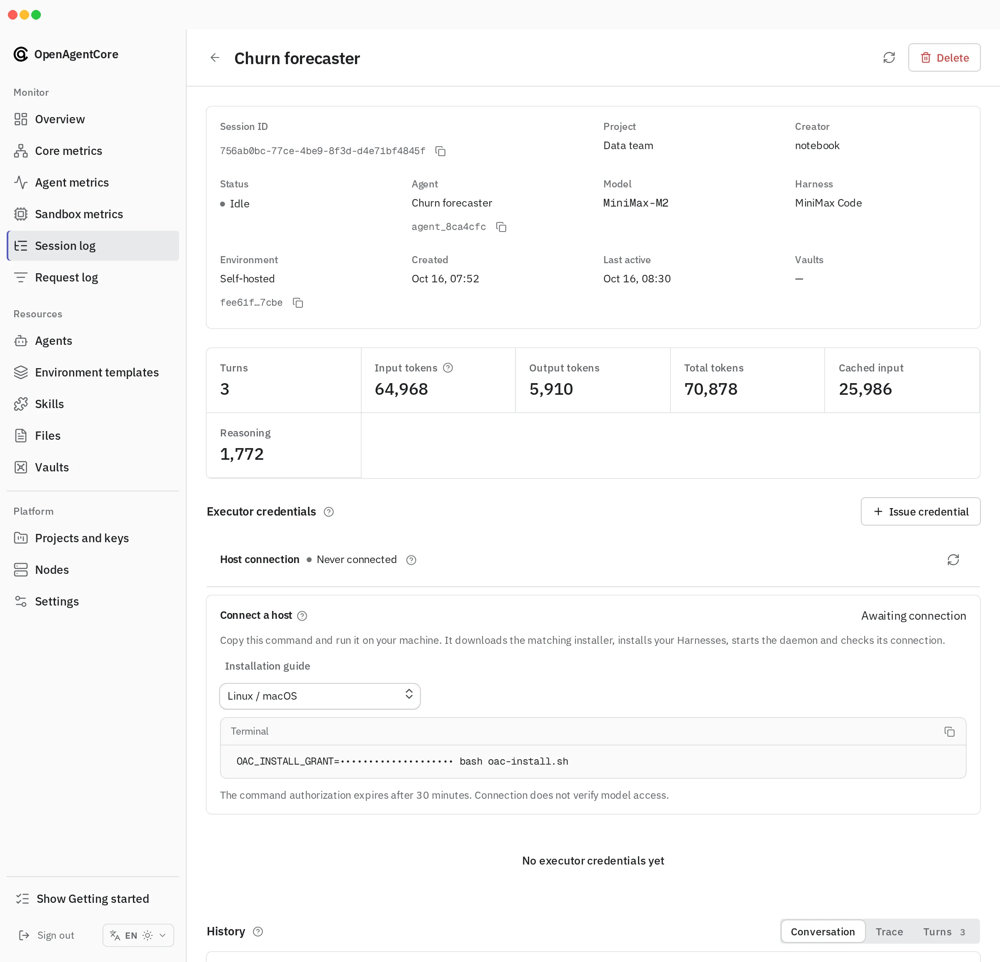

A `self_hosted` Session runs on a machine your application owns, such as a workstation, VM or container, instead of a sandbox Core manages. This guide is for application developers who connect such a machine with `oac-daemon` and keep it running.

The application creates the Session through `/v1` and receives a command that installs `oac-daemon`, starts it and connects it to Core. Web shows the same command on the Session's page; it is optional. Core never creates, stops or reclaims the machine.

> [!WARNING]
> The daemon is not a sandbox. Tools run with the permissions of the account that starts it and can reach whatever that account can. Use a container or VM when you need isolation; see [Runtime and outer isolation](../concepts.md#runtime-and-outer-isolation).

The Session brings its own model provider; the installation default never applies ([why](../../contracts/agents-api/model-execution.md#saved-defaults-and-precedence)). The machine gets an executor credential that works for this one Environment and nothing else.

## Platforms

| Platform | Codex | Claude Code | MiniMax Code |
| --- | --- | --- | --- |
| Linux amd64 | Supported | Supported | Supported |
| macOS arm64 | Supported | Supported | Supported |
| Windows amd64 | Supported | Supported | Not supported |

The installer brings its own pinned Node.js and Harness versions (listed in [`scripts/build-native-installer.mjs`](https://github.com/MiniMax-AI/OpenAgentCore/blob/main/scripts/build-native-installer.mjs)) and leaves other installations of those tools untouched. On a platform without a matching installer, the command fails.

The download depends on the Harnesses you install. The installer (9 MiB) and Node.js (59 MiB) are always needed, plus 121 MiB for Codex, 99 MiB for Claude Code or 23 MiB for MiniMax Code, so a Session with one Harness downloads 90 to 189 MiB. Free space is needed on the disk that holds the Runtime home and the installation directory:

| | One Harness | All three |
| --- | --- | --- |
| Free space at the peak | about 0.7 GiB | about 1.1 GiB |
| Installed size, once per machine and version | about 560 MiB | about 940 MiB |

Components install once per machine and version, in `components/<version>` under the Runtime home, and every Session of that version on the machine shares them. They are read-only, which prevents accidental changes; all Sessions run as the same account, so `start` verifies the components and refuses changed ones. Another Session of the same release downloads only the 9 MiB installer, installs no component again and adds only its own small directory. The peak is the installed size plus the archive being unpacked (121 MiB for Codex); each archive is deleted once its component is installed.

The machine needs:

- HTTP or HTTPS access to Core, and to the release download host unless Core carries an offline copy of this platform's installer (an offline installation carries only Linux amd64);
- Bash for environment setup and MiniMax Code tools; on Windows, Git Bash, which Claude Code also requires;
- Python and pip when the Session's packages need them;
- any system packages your setup needs. The daemon never runs apt, sudo or another elevation command, so install them through the host's normal administration.

No administrator privileges or Docker are needed. The Unix download command also uses `curl`, `tar`, `gzip` and a SHA-256 tool. Windows needs its system `tar.exe`; the command checks for it before downloading. The Runtime home must allow executable files to run. On a Unix `noexec` mount, choose another absolute directory with `OAC_RUNTIME_HOME` before running the command.

## Connect a machine

1. Choose an absolute workspace path on the target machine. Create a Session with that path and the application's Project API key:

   ```python
   import os
   from openai import OpenAI

   client = OpenAI()  # reads OPENAI_BASE_URL and OPENAI_API_KEY
   session = client.beta.agents.sessions.create(
       environment={
           "type": "self_hosted",
           "workspace_directory": os.environ["EXECUTOR_WORKSPACE"],
       },
       extra_body={
           "agent": {"model": os.environ["MODEL_NAME"], "x_agents_core": {"harness": "codex"}},
           "x_agents_core": {"model_provider": {
               "protocol": "responses",
               "base_url": os.environ["MODEL_BASE_URL"],
               "api_key": os.environ["MODEL_API_KEY"],
           }},
       },
   )
   installation = session.model_dump()["x_agents_core"]["installation"]
   print(installation["commands"]["posix"])  # use "powershell" on Windows
   ```

2. Run the command on the target machine with the account that should run the tools. It downloads the installer matched to this Core, verifies its checksum, asks which Harnesses to install and where, downloads Node.js and the selected Harnesses, installs them, creates the workspace if needed, starts the daemon and checks its connection.
3. Send a Turn. A connected machine proves only authentication; the first Turn checks the Harness and the model.

In Web, open the Session and copy the command under **Connect a host**.



Keep the command private: it carries a short-lived [installation grant](../../contracts/agents-api/environment-executor-credentials.md#installation-grant) that claims the machine's credential. The command passes the grant in the `OAC_INSTALL_GRANT` environment variable, never as an argument. On Linux and macOS it starts with a space so shells that skip space-prefixed commands leave it out of history. PowerShell has no such rule: its history file (`ConsoleHost_history.txt`) keeps the whole command, grant included, until you clear it, although the grant stops working after 30 minutes. When it has expired, read the Session again or copy a fresh command from Web.

The installer reports three results:

| Result | Meaning |
| --- | --- |
| **Installation** | The selected Harnesses passed their readiness checks |
| **Daemon connection** | Core confirmed the daemon's authenticated connection |
| **Model configuration** | Not checked; the first Turn uses the Session's model provider |

<details>
<summary>If the download stops</summary>

The installer checks the grant before it downloads a Harness, so an expired command costs only the 9 MiB installer. Each archive download resumes after a reset, fails only when it stalls (no data for 60 seconds) and gives up after five attempts; rerun the command to continue where it stopped. An unfinished archive stays in `native-download/<version>` under the Runtime home until a later run completes it, and downloads of other versions are removed. A component already installed on this machine is not downloaded again. Installations on one machine take turns installing components: the later one prints a waiting line and fails after 10 minutes. If a shared component was modified, `install` and `start` fail and name its directory: stop the installations that use it, delete that directory (the files are read-only: `chmod -R u+w <directory> && rm -rf <directory>`, or `Remove-Item -Recurse -Force <directory>` in PowerShell) and run the install command again. Disk space is checked before downloading, extracting and copying components. If a download or installation is interrupted, rerun the command: it clears unfinished temporary copies while preserving completed components, credentials and the workspace. If the command expires, copy a fresh one from the Session.

</details>

If the connection is not confirmed within 45 seconds, the installer prints the path of the daemon's log. The daemon keeps reconnecting. Fix the cause and run the install command again with the same installation directory, copying a fresh one from Web if it has expired: completed components and the credential are kept and a running daemon is reused. Do not remove the workspace or the Session to retry.

### Options for automation

Append these to the command:

| Option | Effect |
| --- | --- |
| `--non-interactive` | Never prompt; missing input fails |
| `--harness codex,claude,minimax` | Harnesses to install, comma-separated. Must include the Session's Harness |
| `--install-dir ABS` | Installation directory. It must be missing, empty or hold an installation; any other non-empty directory is refused. Default: `environments/<environment-id>` under `~/.oac`, or under `OAC_RUNTIME_HOME` when set |
| `--capability-directory ABS` | Where [capability snapshots](#local-capability-directories) are stored. Default: `capabilities` in the installation directory |
| `--tool-env-file ABS` | A JSON file of string variables for tools and MCP servers; see [explicit local tool environment](../../contracts/agents-api/environments.md#explicit-local-tool-environment) |

The workspace is fixed when the Session is created. For a different workspace, create another Session.

## Operate the installation

The installation's `bin/oac-daemon` finds its own installation. Use it for:

| Command | Effect |
| --- | --- |
| `oac-daemon start` | Validate the installed Harnesses and start the daemon in the background |
| `oac-daemon status` | Show the local profile and process; not the connection |
| `oac-daemon logs -n 100`, `oac-daemon logs -f` | Print or follow the daemon log |
| `oac-daemon stop` | Stop the daemon |
| `oac-daemon uninstall` | [Remove the machine](#remove-a-machine) |

The installed `bin/oac-daemon` ignores `OAC_RUNTIME_HOME` and always acts on its own installation. Nothing restarts the daemon after a reboot: run `bin/oac-daemon start` again, which keeps the installation, credential and history. Check the connection under **Host connection** on the Session's page in Web, or with the [connection status](../../contracts/agents-api/environment-executor-credentials.md#connection-status).

To add a Harness, run the install command again (a fresh copy from Web if it has expired) with the same installation directory and the Harness to add. The installer checks the existing contents, adds only missing components and keeps the Harnesses already installed. Restart a running daemon afterwards so it discovers the new Harness.

Stopping the daemon, cancelling a Turn or deleting the Session never removes the machine's workspace, native history or capability snapshot. An installation from another daemon version, or one whose files were changed, is refused. The installer never upgrades, repairs or migrates it. To use the Session on a new directory, [reconnect it](#reconnect-an-existing-session).

## Rotate or revoke

In Web, the Session's **Executor credentials** list the machine's credential:

| Action | Effect |
| --- | --- |
| **Rotate** | The credential gets a new secret; the old secret stops working at once. On a revoked credential the action is **Restore** |
| **Revoke** | The credential stops working at once |

To reconnect after a rotation, stop the daemon with `oac-daemon stop`, replace the JSON at its configured credential-file path with the new credential, and run `oac-daemon start`. Do not run `install` again over the existing installation, and rotate the existing credential rather than issuing a second one, which [cannot connect](../../contracts/agents-api/environment-executor-credentials.md#revoked-or-rotated-credential).

In an archived Project, credentials cannot be issued or rotated; revocation remains available. Operators can manage credentials with the Core key; see the [credential contract](../../contracts/agents-api/environment-executor-credentials.md#core-key-routes).

## Reconnect an existing Session {#reconnect-an-existing-session}

The install command claims the Session's machine credential once, and a second claim ends in `This Session's machine credential is already claimed by another installation`. That happens when you run the command in a different directory, on another machine, after the installation directory was lost, or when the directory holds an installation of another Core build or Session, which the installer refuses to change. Rerunning the command in the original directory always works.

To reconnect the Session without the original directory, rotate its credential and install from an extracted distribution into a new directory:

1. In Web, open the Session and choose **Rotate** in **Executor credentials**. Save the credential JSON it returns.
2. Download `<base>/<platform>.tar.gz` and `<base>/<platform>-<component>.tar.gz` for `node` and each Harness you install (`codex`, `claude` or `minimax`), and extract them into one directory. `<base>` is the first URL of the install command (it ends with the Core version) and `<platform>` is `linux-amd64`, `darwin-arm64` or `windows-amd64`, matching the rows of [Platforms](#platforms).
3. Run the installer as in [Install from an extracted distribution](#install-from-an-extracted-distribution) with the Session's `remote_url`, Environment ID, workspace and the saved credential file.

Or create a new Session and run its command.

## Remove a machine {#remove-a-machine}

Run the installation's own command:

```sh
"$HOME/.oac/environments/<environment-id>/bin/oac-daemon" uninstall
```

On Windows PowerShell:

```powershell
& "$HOME\.oac\environments\<environment-id>\bin\oac-daemon.exe" uninstall
```

It stops the daemon, lists what it deletes and asks for confirmation. It deletes only what an installation owns inside its directory (`bin`, `daemon`, `capabilities`, `runtime`, `initialization` and `packages`, with their credential file and native history) and then the directory itself if nothing else is left in it. Anything else in the directory stays, and so do the workspace and any credential file or capability directory outside the installation; the command names each one it keeps. The shared components in the Runtime home are deleted with the last installation of that version on the machine; otherwise the command says how many other installations still use them. An installation directory deleted by hand is forgotten, and components nothing uses are removed, at the next install or uninstall on the machine. Unfinished downloads in `native-download` are never touched; delete that directory to reclaim the space. Where nothing is installed it says so and exits 0. If a file cannot be deleted, the command names it and can be run again once it is released. On Windows, the final deletion finishes a few seconds after the command exits.

Then, in Web, open the Session and choose **Revoke** in **Executor credentials**, or **Delete** the Session; Core keeps accepting the machine's credential until you do.

The Session's install command cannot connect the machine again: its credential stays claimed in Core. To reconnect the Session, choose **Rotate** and [install from an extracted distribution](#reconnect-an-existing-session), or create a new Session.

After a Session is deleted or its credential is revoked or rotated, the daemon started with `start` prints why in `connect.log` (see `oac-daemon logs`) and exits. Starting it again prints the same reason. To reconnect it, follow [Rotate or revoke](#rotate-or-revoke) or [Reconnect an existing Session](#reconnect-an-existing-session); to remove it, run `uninstall`.

## Reference {#reference}

### Local capability directories {#local-capability-directories}

A self-hosted Session may supply `capability_directories` alongside its workspace:

```python
environment = {
    "type": "self_hosted",
    "workspace_directory": os.environ["EXECUTOR_WORKSPACE"],
    "capability_directories": [os.environ["EXECUTOR_CAPABILITIES"]],
}
```

Paths are absolute in the machine's own syntax (Unix, Windows drive or UNC); the daemon checks them, not Core. Fill these directories before the daemon connects. They are ordinary paths visible to the daemon; naming one does not mount it or create a sandbox.

Use `x_agents_core.environment` for the same Project-owned Skills, Plugin archives, files, packages, setup commands or Template used by a managed Session:

```python
session = client.beta.agents.sessions.create(
    agent_id=agent_id,
    environment=environment,
    extra_body={"x_agents_core": {
        "model_provider": model_provider,
        "environment": {"environment_template_id": template_id},
    }},
)
```

The same extension works with `environment={"type": "openai_hosted"}`. Do not repeat a field in both `environment` and the extension. Setup runs with the daemon's account permissions. Deployment model keys are never sent to your machine.

Before the first Turn the daemon copies these sources into a snapshot. Reconnecting reuses the snapshot even after you edit the sources; a new Session takes a new snapshot. The [preparation contract](../../contracts/agents-api/environments.md#runtime-capability-preparation) lists fields, merge rules, snapshot behavior and failures.

### Install from an extracted distribution {#install-from-an-extracted-distribution}

The same installer accepts an already extracted distribution and a credential file issued by an operator, without the install command:

```sh
./oac-daemon install --non-interactive --harness codex \
  --install-dir "$HOME/.oac/my-runtime" \
  --remote 'wss://core.example/api/v1/agent-daemon/ws' \
  --environment-id '11111111-2222-4333-8444-555555555555' \
  --workspace "$HOME/workspace" \
  --credential-file "$HOME/executor-credential.json"
"$HOME/.oac/my-runtime/bin/oac-daemon" start
```

Use the Session's `remote_url` and Environment ID. The distribution is the directory described in [Reconnect an existing Session](#reconnect-an-existing-session): `oac-daemon` and `bundle.json` from the platform archive, and `components/` from the archives of `node` and each selected Harness. A component not yet installed on this machine is copied from the distribution, and one that is already installed is used as it is. A component missing from both fails with the name of the archive to extract; this mode never downloads. In PowerShell, run `.\oac-daemon.exe` with native absolute paths. The installation directory must be missing, empty or hold an installation. This mode needs an existing workspace and does not start the daemon until you run `start`.
