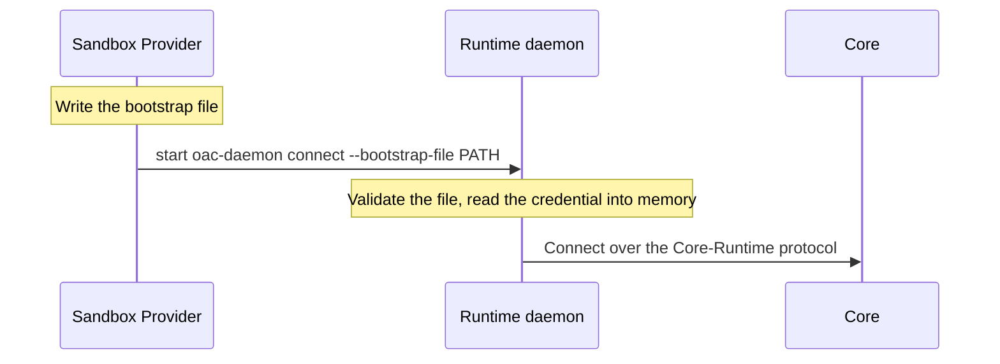

The Runtime bootstrap protocol connects a Sandbox Provider to the managed Runtime it starts. The Provider hands the Runtime one bootstrap file, which is the Runtime's only authentication input for that launch.

| Property | Value |
| --- | --- |
| Caller | The Sandbox Provider. Go Providers build the input with `sandbox.Bootstrap.RuntimeConnection()` in [`runtime_bootstrap.go`](https://github.com/MiniMax-AI/OpenAgentCore/blob/main/services/core/internal/sandbox/runtime_bootstrap.go); SDK helpers forward the serialized object unchanged. |
| Implementations | The Runtime, and the Providers listed under [Reference implementations](#reference-implementations) |
| Code | [`internal/runtimebootstrap`](https://github.com/MiniMax-AI/OpenAgentCore/blob/main/internal/runtimebootstrap/bootstrap.go): the type and validator |
| Transport | A JSON file whose absolute path is passed to `oac-daemon connect --bootstrap-file` |
| Version rule | The exact `version` ([Launch input](#launch-input)) |

## Responsibilities and readiness

| Party | Owns | Never does |
| --- | --- | --- |
| Sandbox Provider | The account, mounts and workspace; delivering the file; the Runtime's resource and Environment binding settings; starting the daemon as the unprivileged Runtime account | Reads or writes the Runtime's private authentication store |
| Runtime | Validating the input, authentication and the connection | Accepts a second authentication source for the same launch |

A successful launch proves only the handoff: an authenticated connection, prepared capabilities and execution readiness are separate observations under the [Core–Runtime protocol](./runtime-protocol.md), and the [Sandbox Provider protocol](./sandbox-provider.md#four-distinct-readiness-facts) lists what each one proves.

Self-hosted executors and operator-provisioned devices get their daemon identity in other ways; the [machine connection API](../contracts/agents-api/machine-api.md#credentials) lists every credential source. All of them enter the same Runtime execution loop.

## Startup order



## Launch input

Deliver one JSON object in a regular file that only the Runtime account and trusted provisioning processes can read (mode 0600 on managed Linux), and pass its absolute path:

```sh
oac-daemon connect --bootstrap-file /home/runtime/runtime-bootstrap.json
```

| Field | Meaning |
| --- | --- |
| `version` | The exact bootstrap version, `runtimebootstrap.Version` |
| `core_url` | HTTP(S) machine API base ending in `/api/v1`, without credentials, query or fragment |
| `device_id` | Canonical nonzero UUID of the daemon identity Core issued |
| `credential` | Nonempty daemon credential Core issued, without whitespace or NUL |

The decoder rejects unknown, duplicate, missing and case-aliased fields, other versions and documents larger than `runtimebootstrap.MaxBytes`. Errors never include submitted values. A missing or malformed file fails before the daemon connects.

The file is the only authentication input for this launch: the daemon refuses to combine it with self-hosted enrollment options, and reads the credential into memory without saving it to a stored profile. Credentials never go in command arguments, environment variables or receipts. The provider keeps the file for process restarts and removes it only during explicit cleanup of the resources it owns.

## Timeouts and limits

| Value | Applies to | On breach |
| --- | --- | --- |
| 16 KiB (`runtimebootstrap.MaxBytes`) | The bootstrap document | The decoder rejects it, and the daemon fails before it connects. |

## Reference implementations

| Provider | Delivery |
| --- | --- |
| Docker | Writes the file into the Runtime's owned home volume. |
| microsandbox, E2B | Deliver the file before launching the same command. |

## Verification

`go test ./internal/runtimebootstrap ./apps/daemon/internal/cli` covers the input contract, the exclusivity of credential sources and restart behavior. Provider tests verify delivery and file permissions without relying on the Runtime's private storage.
