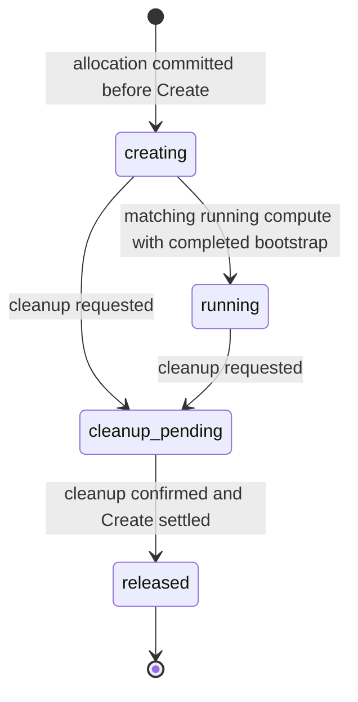
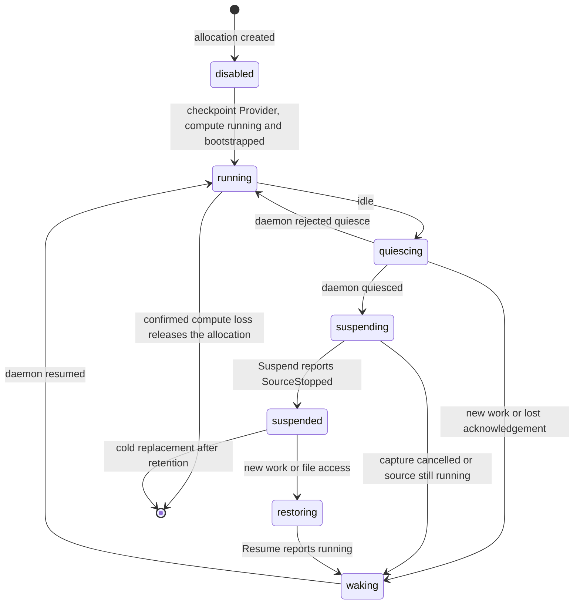
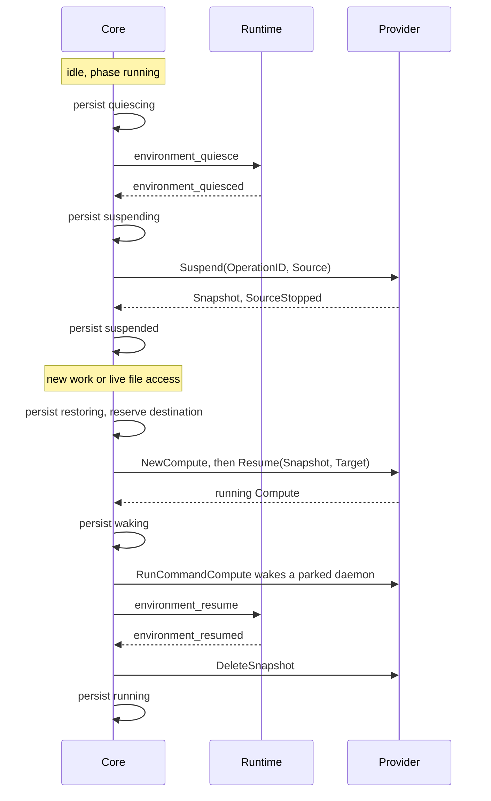

The Sandbox Provider protocol connects Core to the adapter that supplies compute for Core-managed (`openai_hosted`) Environments and runs the bounded bootstrap that starts the Runtime daemon in it. This page is for adapter authors: it says what a Provider implements and what it may rely on Core to do. Docker, microsandbox and E2B implement it.

| | |
| --- | --- |
| Caller | Core's runtime manager and execution Worker |
| Implementations | Docker and microsandbox (node adapters) and E2B (direct adapter); see [Reference adapters](#reference-adapters) |
| Code | [`SandboxProvider`](https://github.com/MiniMax-AI/OpenAgentCore/blob/main/services/core/internal/sandbox/sandbox_provider.go) in `sandbox_provider.go`, with the setup-time `ConfigurationAdapter` |
| Transport | A direct adapter is called in process. A node adapter runs on a sandbox node and receives the same calls over the [sandbox node protocol](../contracts/agents-api/node-generation-protocol.md#provider-requests) |
| Version rule | The in-process interface has no wire version. The sandbox node protocol and each helper protocol require an exact version match |

| Term | Meaning |
| --- | --- |
| Environment | Durable execution place owned by Core; see [Environments and Templates](../contracts/agents-api/environments.md) |
| Allocation | One Core-owned compute lease for an Environment, identified by `Reference` |
| Deployment | The single deployment-wide provider selection; see [Sandbox deployment](../contracts/agents-api/sandbox-deployment.md) |

## Implement a Provider

1. **Read the contract.** Implement every method, support the required operations and declare a decision for each of the others in [Implement the interface](#implement-the-interface).
2. **Write the adapter package** under `services/core/internal/sandbox/<kind>`: native SDK calls, ownership checks, identity translation, private configuration and, for a node adapter, its node-local construction. Assert `var _ sandbox.SandboxProvider = (*YourAdapter)(nil)`. An out-of-process helper lives in `services/core/tools/<kind>-provider`.
3. **Register the kind** once, following [Register the provider kind](#register-the-provider-kind). Registration is explicit construction, not an init-time plugin registry.
4. **Label owned resources** with the provider ownership labels in the [Runtime names](https://github.com/MiniMax-AI/OpenAgentCore/blob/main/CONTRIBUTING.md#openagentcore-runtime-names) table, and never accept older label names as a fallback.
5. **Run the contract suite** with `make check-sandbox-provider-contract`; see [Conformance](#conformance).
6. **Run native acceptance** against real compute, then `make check`.
7. **Document the adapter** next to it, like the [reference adapters](#reference-adapters).

## Roles

| Party | Owns | Never does |
| --- | --- | --- |
| Core | Durable Environment, allocation, placement and cleanup state; lifecycle serialization; every decision to create, suspend, restore or release | Calls an operation the Provider declared unsupported, or releases an allocation on an offline node, a timeout or an empty read |
| Sandbox Provider | Compute for an allocation, the bounded Runtime bootstrap, native identity and ownership checks, and the receipts Core needs to observe and clean up | Runs Environment initialization, Skills, Plugins, MCP setup, initial files, execution or Files, or locates a resource by a bare native ID, name or path |
| Runtime | Capability preparation and Turn execution, over the [Core–Runtime protocol](./runtime-protocol.md) after the Provider hands it its identity through the [Runtime bootstrap](./runtime-bootstrap.md) file | Allocates or destroys compute |

Isolation belongs to the provider's infrastructure, not the daemon; see [Runtime and outer isolation](./concepts.md#runtime-and-outer-isolation). Use the vendor's maintained SDK behind a thin adapter.

## Implement the interface

`sandbox_provider.go` holds the Core–Sandbox Provider protocol: the `SandboxProvider` interface for allocation, checkpoint and observation, its request and result types, and the setup-time `ConfigurationAdapter` with its typed errors. Value types that Core also uses beyond this boundary, such as `DeploymentSpec` and `CallFence`, live in their own files of the same package. Every method is required at compile time, and `ProviderOperations()` declares which ones the Provider supports. Five operations are always supported:

| Operation | Purpose |
| --- | --- |
| `Create` | Create compute for a `Reference` and run the bounded daemon bootstrap |
| `GetInfo` | Observe current compute without changing it |
| `Renew` | Extend a native lease, or only observe when the backend has none |
| `Kill` | Reclaim the allocation's compute and retained resources |
| `RunCommand` | Run a bounded command in the allocation's compute |

A backend without a native renewable lease, such as Docker, still keeps Core's hosted expiry and cleanup requirements. Every adapter implements `RunCommand` and its tests exercise it, but Core's orchestration does not call it; only the node transport forwards it. Confidential command input travels in `Command.Stdin`, never in arguments or logs, and the result keeps byte order, bounded output and the actual exit status.

`Bootstrap.Workspace` and `ResumeRequest.Workspace` optionally carry an external workspace binding; the Provider obligations for it are in [Attachment](./workspace-provider.md#attachment).

### Explicit operation contracts

Every provider returns a complete `ProviderOperations()` declaration with one entry for each `SandboxProvider` method except `ProviderOperations` itself. The interface's method set is the operation inventory, and `sandbox.ValidateOperations` checks the declaration against it. The groups in the table below are lists in the protocol file, and a test keeps them equal to that method set, so a new method must join one of them.

| Operations | Requirement | Responsibility |
| --- | --- | --- |
| `Create`, `GetInfo`, `Renew`, `Kill`, `RunCommand` | Supported | Allocation lifecycle and bounded commands |
| `Observe` | Explicit decision | Ownership-checked read-only observation of one allocation |
| `Initial`, `NewCompute`, `GetCompute`, `Suspend`, `Resume`, `ResumeCompute`, `KillCompute`, `DeleteSnapshot`, `RunCommandCompute` | The same decision for every checkpoint method; supported only by a `nodes` registration | Exact compute incarnations, capture and restore, retained-source resume and cleanup |

`Initial` and `NewCompute` construct compute references without allocating, `ResumeCompute` thaws only the same resident instance after an aborted pause, and `RunCommandCompute` runs a bounded command in one exact compute incarnation. Core uses `RunCommandCompute` to wake a parked daemon after a restore ([`runtime_compute_wake.go`](https://github.com/MiniMax-AI/OpenAgentCore/blob/main/services/core/internal/execution/runtime_compute_wake.go)).

Each declaration entry is `state: supported` with no reason, or `state: unsupported` with an authored reason code. Missing, zero, unknown or unsafe entries fail validation. Adding a method to `SandboxProvider` requires an explicit decision and implementation in every adapter; never supply a base type or generate blanket unsupported implementations.

An unsupported method returns `providercontract.UnsupportedError` before any native I/O. The error names the exact operation and a safe code, never a native message, resource identity, endpoint or credential. An empty result, a nil error, `Unavailable` or an unknown mutation outcome never stands in for unsupported, and the five required methods can never return it.

Each adapter owns one `Operations()` function, shared by its instance and its registration. `providers.ValidateBinding` checks both against the interface and each other, and Runtime admission and node generation loading also reject incomplete providers. Callers check the declaration with `providercontract.Require` before they call an operation, never a type assertion.

`Observe` reads one allocation and never renews, starts, prepares or stops compute; see [Runtime observability](../contracts/agents-api/runtime-observability.md).

Contract tests call every method declared unsupported with no native client configured, require its matching error and zero result, and reject incomplete or contradictory declarations. Supported behavior still needs native and lifecycle tests.

### Identity and resource ownership

`Reference` is the exact `(TenantID, EnvironmentID, AllocationID)` tuple. Core persists a fresh allocation ID before `Create`; it is not the Environment ID. The adapter also binds resources to its installation, and never locates or authorizes a resource by a bare native ID, display name, guessed path or unverified label. Every mutation, read and cleanup verifies the same ownership.

Core serializes lifecycle operations and keeps the allocation after any uncertain mutation, so the adapter must keep enough native identity and receipts for observation and cleanup. A failed call may return both `Info` and an error: keep reference-bound settlement evidence without turning the failure into success. Never silently create a replacement resource, overwrite credentials or switch to a new allocation after a conflict.

`Info.ProviderID` and `Info.State` describe compute. Core treats compute as `running` only with the matching `Reference` and a native identity; other native states can be observed without claiming readiness. `BootstrapComplete` says the bootstrap reached its final mutating step. `CreateSettled` proves that the original attempt can no longer change resources; it does not mean success:

- `State="absent"` with the matching `Reference` and `CreateSettled=true` is an explicit creation-absence receipt, with no native ID or completed bootstrap.
- `ErrNotFound`, an empty listing, a timeout or a successful `Kill` alone never proves that an in-flight Create cannot appear later.
- Core can also settle creation from a matching running resource with a completed bootstrap. Until it has such evidence or an explicit receipt it keeps the creation unknown, even when a cleanup attempt sees no resources.

Microsandbox closes initial Create admission before returning a creation-absence receipt; its [helper protocol](https://github.com/MiniMax-AI/OpenAgentCore/blob/main/services/core/tools/microsandbox-provider/README.md#create-and-bootstrap) defines the durable allocation-lock barrier. Ordinary `GetCompute` absence does not close admission.

`Kill` owns cleanup of the allocation's compute and retained resources, including partial bootstrap storage, and never removes another tenant's resource on a name collision. Core releases durable ownership only after confirmed cleanup and settled creation. Closing an Executor or cancelling a Harness never deletes an Environment, its workspace or its allocation.

### Operation outcomes and retries

Every call receives a bounded context. Expiry or cancellation ends the caller's wait; it proves no rollback, stop, cleanup or absence. An adapter or transport never detaches untracked mutations or replays a timed-out command.

| Operation | Confirmed result | Failure or unknown result | Recovery |
| --- | --- | --- | --- |
| `Create` | Matching compute and bootstrap evidence; execution still needs Runtime preparation | Invalid or foreign configuration rejects; a duplicate returns `ErrExists`; a transport failure may hide created resources | Observe the original `Reference`. Never replay `Create`, even with a new credential. Keep partial resources for owned cleanup |
| `GetInfo` | Current compute observation without change | `ErrNotFound` is only a missing observation; an error is not proof of absence | Repeat a bounded read; never turn it into create, start or renew |
| `Renew` | The native lease extended, or an observation for a provider without leases | A timeout may hide an extension; stopped or missing compute stays so | Observe, then let the reconciler renew the same allocation. Never revive compute or fabricate a lease expiry |
| `Kill` | Owned compute and retained storage removed; repeated confirmed absence succeeds | An error keeps ownership and cleanup intent; an ownership mismatch never deletes foreign resources | Retry cleanup of the same `Reference` after outstanding creation or mutation is fenced; never release the owner early |
| `RunCommand`, `RunCommandCompute` | Collected output and actual exit code; a nonzero exit is a settled command failure | Missing native completion is `ErrCommandUnconfirmed`; partial output is not success | Never replay. Keep the owner and reclaim before reuse when completion cannot be proved |

`ErrInvalid`, `ErrOwnership`, `ErrExists`, `ErrNotFound`, `ErrComputeUnconfirmed` and `ErrCommandUnconfirmed` keep their defined meanings. An unclassified native or transport error is unknown, never permission to retry a mutation. Core never reads provider diagnostics as lifecycle truth or exposes native error text or credentials; the node transport maps errors to fixed codes, and direct SDK details stay private.

Checkpoint support adds `Compute` generation, name and ID and `SnapshotIdentity`; persist operation IDs and the provider's snapshot provenance unchanged. `ObserveOnly` on suspend or resume observes the previous attempt and never starts another capture or restore. `ResumeCompute` only thaws the retained source and never cold-starts a stopped one. Cleanup targets the exact compute incarnation and snapshot, not whatever instance now has the same name. `GetCompute` returns `ErrNotFound` only when the owning node has verified that the exact incarnation no longer exists; an instance with the same name and another native ID is `ErrOwnership`, and an unreachable node or backend is an unknown result. A `ComputeState.Status` of `stopped` or `crashed` means the adapter verified that the exact incarnation’s process no longer exists; its record or disks can remain until `KillCompute` removes them. `paused`, `running` without a Runtime connection, and unknown states do not establish termination. Read [`runtime_compute.go`](https://github.com/MiniMax-AI/OpenAgentCore/blob/main/services/core/internal/execution/runtime_compute.go) and its failure tests before declaring checkpoint support.

### Four distinct readiness facts

| Fact | Evidence | Does not establish |
| --- | --- | --- |
| Compute available | Provider observation for the owned allocation | An authenticated Runtime connection or prepared capabilities |
| Runtime connected | Gateway authentication and the exact Environment and device binding | Completed preparation or a usable Harness |
| Capabilities prepared | Successful common Runtime preparation with the fixed configuration | Acceptance or completion of a Turn |
| Execution admitted | Qualified Harness capabilities and the executor and Turn acceptance path | A completed input, cancellation or reclaimed compute |

Hosted and self-hosted Environments use the same Runtime preparation; a provider never implements a competing one.

## Register the provider kind

`sandbox/providers/registry.go` is the only registration table. Each entry binds the adapter's specification and resource validators, its `sandbox.ConfigurationAdapter`, the deployment mode (`nodes` or `direct`), its `sandbox.DeploymentPolicy` (disk limits, the Runtime input and the default size setup proposes), the operation declaration and a node-local (`BuildLocal`) or direct (`BuildDirect`) constructor. `providers.Build` and `providers.BuildDirect` construct adapters without allocating compute. There is no init-time registration or plugin loading.

A new provider takes these steps:

1. Implement the operation contracts in the adapter package, with native contract tests.
2. Add its specification and resource validators.
3. Implement `sandbox.ConfigurationAdapter` over a typed native configuration. `DecodeInput` strictly parses the separate public `configuration` and write-only `credential` objects of a request. `Encode` produces whitelisted public selectors, read-only observations and separate secret bytes, and never passes request JSON through. `Decode` restores stored selectors, and keeps access to owned resources, without remote admission or new template validation. `Normalize` copies its input before changing it. `ResolveChange`, `Equal` and `WithCredential` own inheritance, identity and credential composition. `Requirements` declares whether a credential and a public Core origin are required, and which setup operations are supported: `Discovery` for `DiscoverConfiguration`, `SelectionDiscovery` for `DiscoverSelection` and `CredentialVerification` for `VerifyCredential`. `DiscoverConfiguration` validates the query and returns a safe catalog, never a mutation or an admission decision, while Core keeps authorization, input limits and deadlines. `DiscoverSelection` resolves a candidate's omitted native values before commit, and `VerifyCredential` verifies a credential's access to owned resources without mutation. Both receive the candidate's `sandbox.DirectConfig` and build any native client for that call only. A node provider accepts only an empty public object, rejects credentials and returns Unsupported for every setup operation and for credential replacement.
4. For a node adapter, export from its package the `BuildLocal` constructor, the typed `native` object it decodes and the native files it adds to the shared node artifacts. Node-local settings, such as host paths, live only in that object; resources and the Runtime release are read from the node configuration's `specification`.
5. Register its constructor, policies, configuration adapter and operation declaration in `providers/registry.go`. Its key is the provider kind, which also labels the Provider's observations, and checkpoint support reads this entry. The generated projections combine each registered mode and deployment policy with the shared field bounds in `sandbox/deployment_contract.go`: the installer reads them from `deploy/node/node_spec.py`, and the TypeScript client and Web from `packages/agents-client/src/deployment-contract.ts`, so Web reads these declarations instead of comparing provider kinds. Regenerate both with `go run ./services/core/cmd/specification-contract -write`.
6. Supply the distribution artifacts for the adapter and its helper, and offer the provider to operators through the registered configuration contract.
7. Web's setup step, deployment summary and client projection name each provider. Add the new provider to `apps/web` until the protocol declares configuration fields.

A node configuration, `sandbox.NodeConfig`, holds `provider`, `generation`, `installation_id`, `core_url`, `specification` and the adapter's opaque `native` object. `providers.Build` validates `provider`, `generation`, `installation_id` and `specification`, and passes the configuration with ephemeral `sandbox.LocalOptions` to `BuildLocal`, which decodes `native` strictly. The caller explicitly selects standalone registration or single-provider execution with `Standalone`, or generation-owned execution with a canonical absolute node state directory in `GenerationStateDirectory`. Missing or mixed contexts are rejected. The adapter owns generation-specific native preparation and readiness checks. Microsandbox binds helper leases to the installation, generation and specification digest, then checks the pinned image after platform, capacity and artifact readiness.

### Registration validation

`providers.ValidateRegistration` is the single wiring check. Lookup, constructor binding and the generated projections run it before any configuration callback or constructor. An unknown provider name stays invalid input; a malformed registration returns a safe `providercontract.ErrContract` that includes no submitted configuration or native diagnostics.

- A `nodes` registration has only `BuildLocal`, and a `direct` registration only `BuildDirect`; missing, mixed or unknown modes are rejected.
- The specification and resource validators, the configuration adapter and a complete operation declaration are mandatory, so an incomplete registration cannot publish a partial projection. A declared default size must pass the adapter's resource validator.
- The Runtime input policy either accepts the pinned Runtime or gives the adapter's fixed reason for rejecting it, never both.
- Checkpoint is admitted only for a `nodes` registration, because the common lifecycle suspends only node allocations; registration rejects a `direct` Provider that declares it. A registration carries no suspension values: Core applies its one [suspension policy](#suspension) to every Provider that declares checkpoint support.

The configuration adapter must be non-nil, including its concrete value. Every `ConfigurationRequirements` field needs an explicit valid decision: `Credential` and `PublicOrigin` are `Required` or `NotRequired`, and `Discovery`, `SelectionDiscovery` and `CredentialVerification` use the shared supported or unsupported declaration with a safe reason. A new requirement field needs an explicit validation update and never inherits an existing decision. Requiring a credential does not promise the `VerifyCredential` operation. These checks establish complete registration, not correct native SDK behavior; constructor and adapter contract tests still apply.

### Configuration storage and construction

Preview and persistence use `providers.Normalize` and `providers.Describe`. `providers.DiscoverSelection` resolves omitted native values before commit, and the complete specification is validated again at persistence. `providers.ResolveChange` owns configuration inheritance, and comparisons use normalized selectors, so preview, retry and commit share the same defaults. The store owns transactions, credential encryption, generation fencing, resource ownership and generic object storage: only the adapter interprets `provider_config` and `provider_metadata`, and `provider_credential` holds ciphertext bound to the installation and generation. Retained generations keep their original public configuration and metadata and compose the current credential through the adapter, so a credential replacement never rewrites a retained selector. Database constraints check object structure, not the registration list.

A direct adapter with a credential verifies all retained generations and allocation references before a key is replaced. The common `sandbox.CallFence` excludes native calls and waits for helper completion, including calls whose callers timed out; execution invokes the prepared verification and fencing callbacks without branching on a vendor.

Vendor deployment validation and SDK setup stay at the construction boundary, and construction never creates an Environment. For node-local adapters `sandbox.Built` returns the provider, probe, installation identity, backend fingerprint and specification digest, and a `Quiescent` check when a helper can outlive its caller; generation collection waits for it. The factory also returns its close function. `execution.RuntimeProvider` binds the adapter to its kind, installation ID, backend fingerprint, generation, mode and node ownership; the database owns the selection, and the in-memory copy is never another authority. Docker and microsandbox run on nodes, and E2B is constructed directly. The node proxy exposes checkpoint operations only for a backend whose registered declaration supports them, and common lifecycle code admits suspension through the checkpoint declaration, never through a provider name.

The backend fingerprint identifies a native resource namespace, not capacity. Core keeps deployment generations so that owned allocations keep resolving to their original backend; never repoint retained allocations at a replacement backend.

### Distribution artifacts and process paths

Each node adapter's registration owns its typed `NodeArtifacts` declaration, the shared node artifacts plus the native files its package exports: logical distribution path, release filename suffix and installation role (`node`, `runtime`, `policy` or `image`). Registration rejects missing declarations, unsafe paths and unknown roles. `go run ./services/core/cmd/provider-artifacts -write` generates the shared Web catalog and Python projection. Run the command without `-write` to check freshness. Distribution packaging, Web availability and node installation read this projection; adding a provider's payload does not add a provider-name branch to those consumers.

The launcher supplies `sandbox.ProcessPaths` from the [derived process environment](./configuration.md). Core reads these paths once and passes them to direct construction and setup operations. They are fixed distribution properties, not deployment settings or user-selectable helper paths. Each adapter resolves its own relative helper and state locations; E2B uses `e2b/oac-e2b-provider` and `e2b/`. Missing or nonabsolute roots fail before helper execution. Provider construction and discovery never read process environment variables.

## What Core guarantees to a Provider

An adapter implements none of this, but it relies on it. The code-level mechanics are in [Core implementation constraints](https://github.com/MiniMax-AI/OpenAgentCore/blob/main/services/core/IMPLEMENTATION.md#hosted-sandboxes).

- Core commits the allocation, its daemon credential digest and the Session binding before it calls `Create`. Only a fresh allocation receipt permits `Create`; retries and a Core restart observe the same `Reference` and never replay `Create` or rotate the credential.
- Each node has one serial lifecycle worker, so calls for one node never run concurrently; E2B allocations share one worker. A stuck Provider on one node never stalls another.
- Core never infers bootstrap completion from an engine or provider name; the adapter qualifies it through `Info.BootstrapComplete`.
- Core calls `Kill` only after it has revoked the device's authority, settled pending input and requested cancellation. Temporary provider outages, unknown `Create` results and stopped compute never prove a permanent failure.
- Core releases an allocation only after confirmed cleanup of its compute and volumes and proof that the original `Create` settled. Until then it keeps cleanup ownership, also after an absence observation, and bounded scans continue to catch late resources without another `Create`. This applies after public Session deletion too.
- Core never releases an allocation on an offline node, a timeout or an empty read, and takes no lifecycle action on a node that is not [online](../contracts/agents-api/node-generation-protocol.md#connection). Retained ownership needs exact provider evidence: a socket path, a missing instance or an empty listing never proves cleanup or authorizes a replacement.
- Placement is automatic and callers cannot choose a node. An active allocation keeps its original node, even while it is offline. After confirmed release, eligible retained Sessions can reserve compatible capacity again, including on another node. Source teardown must be confirmed before active capacity is released, and unknown operations keep their reservations. The [deployment contract](../contracts/agents-api/sandbox-deployment.md#generation-ownership-and-rollout) owns waiting, ordering and generation selection.
- Between Turns, Core observes that connected compute is still its Session's running allocation. The check changes nothing. Running compute never expires, and an unreachable, stopped or missing instance without [confirmation](#confirmed-compute-loss) never authorizes discarding retained workspace or history or selecting replacement compute.
- Core suspends the idle allocations of every Provider that declares checkpoint support, under one [suspension policy](../contracts/agents-api/sandbox-deployment.md#suspension-policy).
- Disabling the provider stops new hosted admission and bootstrap but never blocks cancellation, function results or input retry outcomes of existing Sessions.

An allocation moves to `cleanup_pending` when its Session is deleted or archived, its Environment fails or expires, or an administrator resets the deployment. `released` requires `CreateSettled`; see [Identity and resource ownership](#identity-and-resource-ownership).

## Checkpoint lifecycle

A Provider that declares the checkpoint operations (`Initial`, `NewCompute`, `GetCompute`, `Suspend`, `Resume`, `ResumeCompute`, `KillCompute`, `DeleteSnapshot`, `RunCommandCompute`) lets Core suspend an idle allocation to a snapshot and restore it on the same or another compatible node. Core records the allocation's `compute_phase`; it is `disabled` for a Provider that does not declare checkpoint support, and the other phases move as follows. Deletion, archive, reset and retention expiry release the allocation from any phase after the cleanup described in [What Core guarantees to a Provider](#what-core-guarantees-to-a-provider).

The suspend and wake flows call the Provider in this order. Core persists each phase before the effect it describes.

### Suspension

Core suspends an allocation after initialization completes, when no root or Subagent Turn is queued, in progress or waiting, no input or file operation is pending, and real activity has been idle for the policy's idle timeout. A Session need not have run a Turn. Capacity pressure can suspend an already idle node allocation earlier, after the inactivity grace in [Timeouts and limits](#timeouts-and-limits), when compatible waiting demand exists. It never interrupts an active Turn or releases capacity before the ordinary quiesce, capture and source-stop proofs complete. If suspension cannot make capacity usable, the waiting request keeps its original deadline.

A Provider relies on these rules:

- Core persists quiesce, capture and restore intent before the effect, and only a fresh receipt performs a capture or restore. Recovery observes the exact attempt with `ObserveOnly` and never retries an unknown creation, capture or restore.
- Before acknowledging a planned suspension, the daemon closes admission and drains native cleanup, output receipts and file work. A lost quiesce acknowledgement may thaw the same source through `ResumeCompute` but never authorizes capturing it.
- Queued work and live Environment file access wake a suspended Environment; history and published Artifact reads do not. A PID and start-time fenced local control signal, sent with `RunCommandCompute`, wakes the parked daemon, which authenticates again before admitting work.
- A retained checkpoint resumes on its original node when it is eligible, or on another eligible node through [checkpoint transfer](#checkpoint-transfer). Core owns the snapshot's retention deadline, and the daemon has no timer for it.
- A consumed snapshot never rolls a running generation back. Consumed artifacts and old compute are deleted, so suspension cycles never build a chain of writable disks.
- Deletion, revocation and retention expiry win over wake, up to the final database compare-and-swap. Unknown cleanup identities are kept until owned resources are confirmed absent.
### Checkpoint transfer

A checkpoint-capable generation reports `CheckpointCompatibility`: opaque `ArtifactDomain` and `ExecutionClass` tokens. Every verified `SnapshotIdentity` carries the same qualification. Core compares these values without interpreting CPU features, filesystem paths or storage implementations. A restore destination must be online and ready for the allocation's immutable deployment generation, match both tokens, and have active capacity plus a retained slot when moving from another node. The allocation, Device and Session identities remain unchanged. The Session and deployment transaction commits the destination route, placement and exact restore intent before target-side native work. No capacity or compatible destination leaves the retained snapshot owned until its configured deadline. The target must already hold that exact generation; Core does not automatically prepare historical generations on new nodes. During upgrades, retain eligible nodes and their generation providers until their checkpoint retention obligations end.

`Suspend` may report `SourceStopped` only after publishing a verified full archive durably, stopping the exact source compute and settling source-local capture and cleanup obligations. Core persists the snapshot before marking it suspended; native absence alone is insufficient. `Suspend.ObserveOnly` may finish archive publication and source cleanup for an already verified snapshot of the same operation, but cannot capture another snapshot or stop a source that has resumed running. If a previously published archive is missing or damaged, `ObserveOnly` may return its exact durable ownership receipt with `Status: unknown` and `SourceStopped: false` for cleanup; that receipt proves neither current archive usability nor source absence. `Resume` still verifies the archive before execution. After the source-settlement barrier, source-node unavailability does not prevent restoration. Deletion and ordinary expiry can transfer an idle suspended allocation's cleanup route to an online node in the same artifact domain; deletion does not require execution-class compatibility. The cleanup destination must already serve the same immutable generation and have retained capacity. Without such a node, cleanup stays pending and ownership is not released; operators must restore an eligible node or its capacity. An unknown running or restoring writer never moves merely because its node is unreachable.

Recovery uses `Resume.ObserveOnly` for the persisted target and operation. `RestoreAttemptClosed` is an exact operation ID, not a generic absence flag: the adapter may return it only after durably closing an attempt that never entered native execution and fencing every late request for that ID. An adapter may also close a durably admitted attempt when it can prove that its current invocation failed before dispatching native restoration. The microsandbox adapter does this only when the fresh request's wire deadline expires before native dispatch; archive corruption, qualification errors and opaque SDK failures do not authorize an automatic retry. Core then persists a new operation ID before attempting execution. Once native restoration has been dispatched, an unknown outcome retains the same target, ownership and original retention deadline; a missing native listing, helper death or timeout does not authorize replay. Such a restore can remain unavailable until explicit deletion or ordinary retention expiry, and pending inputs can reach their public deadline while waiting. User deletion still requires exact native settlement before resources and ownership can be released.

The microsandbox adapter requires an explicit private `checkpoint_root`, outside every guest-accessible filesystem. Its directory is mode `0700`; a private namespace marker identifies the actual archive store. The default installation creates a node-local private store. Cross-node restoration requires operators to mount the same private store on each participating node; mount paths may differ. Runtime state directories and workspace bindings are never used to infer this root. The adapter verifies the archive, external filesystem identity and native execution class again before restoration. Restored RAM and file descriptors do not promise continuity of external TCP connections or replay safety for application side effects.

### Cold replacement after checkpoint retention

Snapshot retention bounds compute resources, not the lifetime of an eligible retained Session. After the deadline, Core can clean up the allocation without terminating the Session only when its independent filesystem object is ready, initialization is complete, the Session and Environment remain nonterminal, and the previous authenticated Runtime has a persisted `retained_native_history` declaration. The capability and native recovery obligations are defined by the [Core–Runtime protocol](runtime-protocol.md). Filesystem retention alone is insufficient.

Capacity pressure never shortens checkpoint retention. Until its configured deadline, a suspended allocation keeps its snapshot and retained slot; unavailable capacity or an incompatible node does not authorize cold replacement. Pending requests retain their original input deadline. After retention expires, the ordinary expiry cleanup must confirm resource deletion before another allocation can reserve that slot; files and qualified native history remain retained.

Core confirms the original creation is settled and all owned compute and snapshots are cleaned up before releasing allocation and placement ownership. The old device's authority is revoked before replacement admission. Until Create, Kill or DeleteSnapshot has a confirmed outcome, it keeps ownership and admits no replacement writer. A recoverable Session and Environment remain disconnected with the same filesystem object and initialization result. Archive, reset and deletion take precedence and cannot be undone by a wake request.

New input or live Environment file access reserves a new allocation on a compatible node and bootstraps a fresh Runtime device. Preparation reuses the same filesystem and completed initialization rather than replaying initialization. Execution resumes the same native Session from retained history after validating the replacement Runtime's declaration. Missing or invalid native history fails explicitly; Core never substitutes a new native Session or replays completed input. History and published Artifact reads do not reserve compute. This path does not preserve VM memory, background processes or open connections, and it does not qualify an undeclared Runtime, Harness or filesystem combination. It also provides no node-level drain, failover from an unreachable writer, concurrent writers, multi-active Core, autoscaling or snapshot replication.

### Confirmed compute loss

Running compute has no retention deadline, so a host crash or reboot would otherwise leave its allocation owned indefinitely. After the owning node is online again, `GetCompute` returning `ErrNotFound` or a verified `stopped` or `crashed` status for the exact persisted incarnation releases a checkpoint-capable allocation in compute phase `running` only when all of these hold: the original creation is settled, the incarnation has a native ID, no capture, restore or rollback intent is recorded, no authenticated Runtime connection exists for the allocation's device, and the Session meets the conditions for [cold replacement](#cold-replacement-after-checkpoint-retention). Core then calls `KillCompute` for that exact incarnation. Only its confirmed result permits one Session-locked commit that rechecks the compute revision and those conditions, revokes the device and releases the allocation and placement. The Session, Environment, pending input, native Session identity and filesystem remain, and new input or live file access continues as in cold replacement.

Every other observation keeps ownership and its diagnostic: a `paused`, `running` or unknown native status, an identity mismatch, a timeout or transport error, an unknown creation, a recorded restore, a live Runtime connection, owned workspace storage, incomplete initialization, a terminal Session or a missing `retained_native_history` declaration. A failed `KillCompute` changes nothing, and a concurrent archive, deletion or compute transition prevails. Core never acts while the node is offline, because it has no authority to stop compute without the node. Continuation retains the filesystem and uses the recorded native Session ID; a Harness resume error fails execution rather than creating another native Session. Core does not replay interrupted or completed input. [OpenAI compatibility](../contracts/agents-api/index.md) records the qualified continuation cases, including crashes immediately after completion acknowledgement. Completeness of arbitrary crash-damaged native history remains unqualified; identity checks do not detect a truncated but parseable history tail.

## Timeouts and limits

| Value | Applies to | On expiry or excess |
| --- | --- | --- |
| Bounded context | Every Provider call | Ends the caller's wait and proves no rollback, stop, cleanup or absence. The adapter never detaches untracked mutations or replays a timed-out command |
| Idle timeout and snapshot retention | Checkpoint-capable allocations, set by the [suspension policy](../contracts/agents-api/sandbox-deployment.md#suspension-policy) | At the idle timeout Core begins [suspension](#suspension). When retention ends Core cleans up the snapshot and, for a qualified Session, replaces the compute through [cold replacement](#cold-replacement-after-checkpoint-retention) |
| 15 s | Inactivity of an idle node allocation before capacity-pressure suspension | Core can suspend it ahead of the idle timeout when compatible waiting demand exists |
| 50 MiB plus 32 bytes (`MaxCommandInputBytes`) | `Command.Stdin` | The command is invalid |

The online window and the other node timers are in the [sandbox node protocol](../contracts/agents-api/node-generation-protocol.md#timeouts-and-limits).

## Conformance

E2B template and endpoint validators in the installer and Go adapter consume the shared [selector fixtures](https://github.com/MiniMax-AI/OpenAgentCore/blob/main/services/core/internal/sandbox/e2b/testdata/configuration-selectors.json). Extend these cases with any validation change so both entry points accept the same selectors.

Run `make check-sandbox-provider-contract` while developing. It runs the shared [`contracttest`](https://github.com/MiniMax-AI/OpenAgentCore/tree/main/services/core/internal/sandbox/contracttest) suite through real adapter boundaries with controlled native failures, plus the adapter and node transport tests; `make check` includes the same packages. Call the public failure runner with native-side fixtures instead of a fake `SandboxProvider`, and keep tests for foreign ownership, unknown mutation results, cancellation, no automatic replay, failed cleanup and reference-bound settlement.

Node tests separately cover disconnect and reconnect fencing and cleanup after a lost Create response. Helper protocols and the [sandbox node protocol](../contracts/agents-api/node-generation-protocol.md) require an exact version match.

Native acceptance proves what fixtures cannot: creation, lease behavior, owned partial cleanup, declared isolation and limits, and snapshots where supported. The opt-in Docker lifecycle and recovery tests use `AGENTS_RUNTIME_DOCKER_TEST_IMAGE`; the SDK helpers use `make check-e2b-provider` and `make check-microsandbox-provider`. Mocked compute proves neither reclamation nor isolation.

## Reference adapters

| Kind | Adapter | Helper and adapter rules | Operator guide |
| --- | --- | --- | --- |
| Docker (node) | [`sandbox/docker`](https://github.com/MiniMax-AI/OpenAgentCore/tree/main/services/core/internal/sandbox/docker) | Node proxy in [`sandbox/node`](https://github.com/MiniMax-AI/OpenAgentCore/tree/main/services/core/internal/sandbox/node) | [Docker adapter](#docker-adapter) |
| microsandbox (node) | [`sandbox/microsandbox`](https://github.com/MiniMax-AI/OpenAgentCore/tree/main/services/core/internal/sandbox/microsandbox) | [`tools/microsandbox-provider`](https://github.com/MiniMax-AI/OpenAgentCore/blob/main/services/core/tools/microsandbox-provider/README.md) | [Add and manage nodes](./getting-started/nodes.md) |
| E2B (direct) | [`sandbox/e2b`](https://github.com/MiniMax-AI/OpenAgentCore/tree/main/services/core/internal/sandbox/e2b) | [`tools/e2b-provider`](https://github.com/MiniMax-AI/OpenAgentCore/blob/main/services/core/tools/e2b-provider/README.md) | [Sandbox deployment](../contracts/agents-api/sandbox-deployment.md#e2b-configuration); application-managed templates in [`deploy/e2b`](https://github.com/MiniMax-AI/OpenAgentCore/blob/main/services/core/deploy/e2b/README.md) |

## Docker adapter

The Docker Sandbox Provider ([`sandbox/docker`](https://github.com/MiniMax-AI/OpenAgentCore/tree/main/services/core/internal/sandbox/docker)) runs every Runtime image, whichever Harness it serves, with the same container settings ([`container_options.go`](https://github.com/MiniMax-AI/OpenAgentCore/blob/main/services/core/internal/sandbox/docker/container_options.go)):

- user 1000:1000, read-only root filesystem, all capabilities dropped, `no-new-privileges`, the [seccomp profile](#seccomp-profile) and AppArmor `unconfined`;
- the node’s configured network and extra hosts ([node configuration](./configuration.md#docker-node-configuration));
- CPU and memory from the deployment specification, a 128-process limit and a 128 MiB `/tmp` tmpfs;
- two named volumes labelled with the installation, tenant, Environment and allocation: `<name>-home` at `/home` and `<name>-environment` at `/environment`, whose `workspace` subdirectory is also mounted at `/workspace`. The Docker Engine must support volume subpath mounts;
- with the configured `nested_sandbox` option, Docker's `/proc` masks are lifted (`/sys/firmware` and `/sys/devices/virtual/powercap` stay masked) and the container runs an init process.

Create refuses to reuse retained volumes that have no container. It copies the [Runtime bootstrap](./runtime-bootstrap.md) file to `/home/runtime/runtime-bootstrap.json` (mode 0600, UID 1000) and the `/environment` workspace, staging, initialization and package directories into the container, then starts `oac-daemon connect --profile default --bootstrap-file /home/runtime/runtime-bootstrap.json`. When the created container does not have the configured CPU, memory and exact image, Create returns the error with `CreateSettled`. Docker has no lease, so Renew only reads the container state. Kill checks the ownership labels of the container and both volumes before removing any of them, then confirms that all three are gone.

The node uses the explicit Unix socket in its [provider configuration](./configuration.md#docker-node-configuration) and ignores `DOCKER_HOST`. No Docker socket, host home or Core credential is mounted into a Runtime.

### Seccomp profile

[`seccomp.json`](https://github.com/MiniMax-AI/OpenAgentCore/blob/main/services/core/deploy/codex/seccomp.json) is the Moby default profile at [revision 65adc7e](https://github.com/moby/profiles/blob/65adc7e022c97f55e45c054ff012988027733b87/seccomp/default.json) (Apache-2.0, see [seccomp.LICENSE](https://github.com/MiniMax-AI/OpenAgentCore/blob/main/services/core/deploy/codex/seccomp.LICENSE); upstream file SHA-256 `785b2429264afba4d594320337cb17f144f3c7d51585f9805eef72e28f4f9334`) with one appended rule that allows `clone`, `unshare`, `setns`, `mount`, `umount2` and `pivot_root`. The distribution ships this file to every Docker node as `runtime/seccomp.json`.
