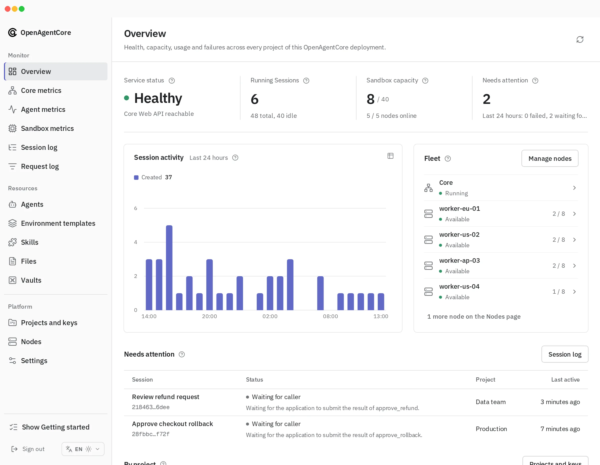

Web is the administrator console of one OpenAgentCore deployment. Administrators use it to watch health, capacity, usage and failures, inspect each Project's resources and execution history, and manage Projects, keys, nodes and deployment settings. Applications do not use Web; they call Core's Agents API (`/v1`) with their own Project API keys.

## Sign in

[Sign in](../getting-started/install.md#sign-in-to-web) with the deployment's [Core key](../getting-started/operations.md#core-key); the console has no user accounts. The browser keeps only a session cookie, and the [console server](./console-server.md) sends the Core key to Core on its behalf; [sign-in](./console-server.md#sign-in) describes how long a session lasts.

Signing in opens the Overview. While any step is still to do, its **Getting started** checklist leads through four steps in any order: sandboxes ready, a default model provider, a Project with an active key, and a first Session. An optional tour of the console opens from it.

## Console pages

| Group | Page | Purpose |
| --- | --- | --- |
| Monitor | Overview | Service status, running Sessions, sandbox slots and work needing attention; 24-hour Session activity; Core and its nodes as a topology, each with a popover glance; Needs attention: failed Sessions and Sessions waiting for their caller, active in the last 24 hours, each with its one-line reason; usage by Project |
| Monitor | Core metrics | The Core process: CPU and resident memory against their limits, execution slots and the Turn queue, connected daemons, database latency and pool, background jobs |
| Monitor | Agent metrics | Requests, errors, duration, tokens, models, tools, Agents and API keys over 1 h, 6 h, 24 h or 7 d |
| Monitor | Sandbox metrics | Node capacity; **Automatic suspension** when supported; **Recorded compute** lifecycle state shown separately from hosted Runtime CPU and memory observations across Projects |
| Monitor | Request log | Recent HTTP requests to Core, their status, elapsed time and safe error codes; [scope and retention](../../contracts/agents-api/admin-api.md#request-log) |
| Monitor | Session log | Every Session, and each Session's read-only conversation, trace and Turns with the classified reason of a failure and its next step; a self-hosted Session's page also manages its executor credentials and gives the command that connects a host |
| Resources | Agents, Environment templates, Skills, Files, Vaults | Inspection and permitted deletion, with the Project and the creating key of each resource |
| Platform | Projects and keys | Create, rename and archive Projects; issue and revoke keys; each Project's usage, write history and how to call the API |
| Platform | Nodes | Inspect and remove microsandbox or Docker nodes; each node's readiness, capacity and allocations, with the automatic suspension policy when supported, active and retained slots, and elapsed time in each compute phase |
| Platform | Settings | **Sandbox and scheduling**, **Workspace storage**, **Models and credentials**, and **Service and deployment**; see [configuration](../configuration.md#runtime-settings-web) |

Missing data is shown as missing (—), never as zero. [Console API usage](./console-api-usage.md) lists what each page reads and how its figures are bounded.

## What administrators do here

| Task | Where |
| --- | --- |
| Give the installation an HTTPS address | Set `OAC_PUBLIC_URL` and point a reverse proxy at Web; see [Make Core reachable](../getting-started/install.md#configure-the-domain-and-https) |
| Choose the sandbox backend (microsandbox, E2B or Docker), the sandbox size and Runtime, or reset the backend | **Settings → Sandbox and scheduling**; see [change the sandbox configuration](../getting-started/nodes.md#change-the-sandbox-configuration) |
| Add or remove execution nodes | **Settings → Sandbox and scheduling → Add node**; removal remains in **Nodes**; see the [nodes guide](../getting-started/nodes.md) |
| Set the default model of a harness | **Settings → Models and credentials**; see [default models](../configuration.md#default-models) |
| Create a Project and issue its API keys | **Projects and keys**; see [Projects and API keys](../getting-started/operations.md#projects-and-api-keys) |
| Issue, rotate or revoke a self-hosted executor's credential, or copy its install command | The Session's page in the **Session log**; see [self-hosted executors](../getting-started/self-hosted.md) |
| Delete a resource, for example a leaked Credential | The resource's row in its list, or its page; Files are deleted from the Files list. The public deletion rules apply |

Installation creates no Project or key. Opening the console neither allocates compute nor calls a model, and an installation may have zero nodes. Web never starts a Session or sends input. Archiving a hosted Session requests cancellation and reclamation; [administrator authority](../concepts.md#what-administrators-can-and-cannot-do) state what administrators can and cannot do.

The deployment's sandbox backend serves hosted Sessions. An application's `self_hosted` Runtime, including one in its own E2B account, is a separate path that the sandbox configuration does not change.

A loopback public address (`local_only`) keeps nodes and remote applications from reaching Core. The console stays reachable at its own address and [warns about it](./console-api-usage.md#provenance-and-monitoring).

## More

- [Console server](./console-server.md): request boundary, sign-in, settings and verification.
- [Console API usage](./console-api-usage.md): the Core routes each page uses.
- [Web package](https://github.com/MiniMax-AI/OpenAgentCore/blob/main/apps/web/README.md): developing the console.
- [Administrator API](../../contracts/agents-api/admin-api.md): the `/core/v1` routes behind the console.

OpenAgentCore Web is available under the [MIT License](https://github.com/MiniMax-AI/OpenAgentCore/blob/main/LICENSE).
