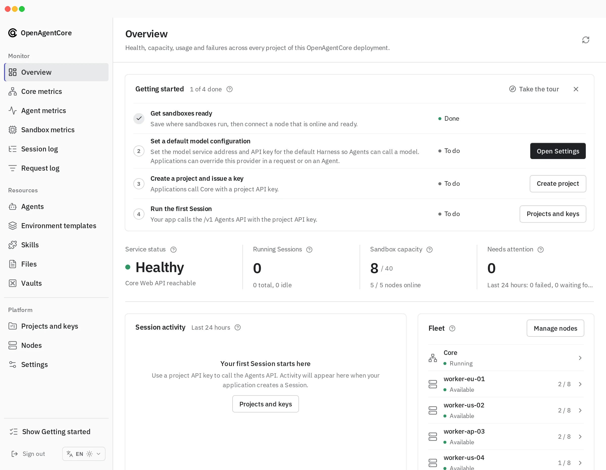
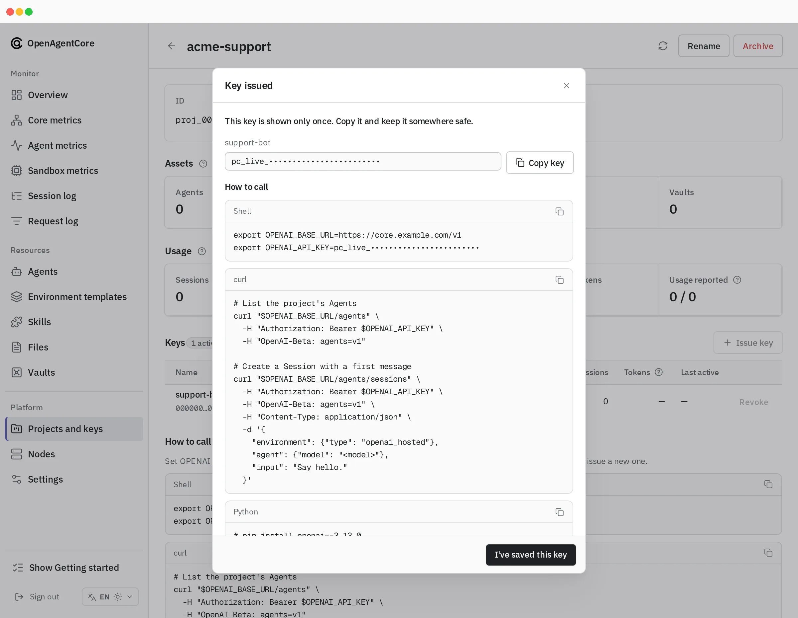
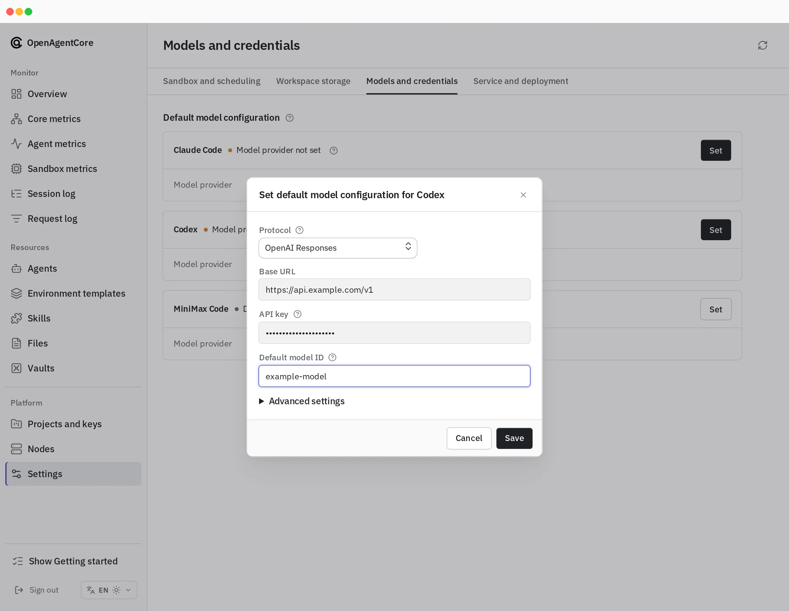
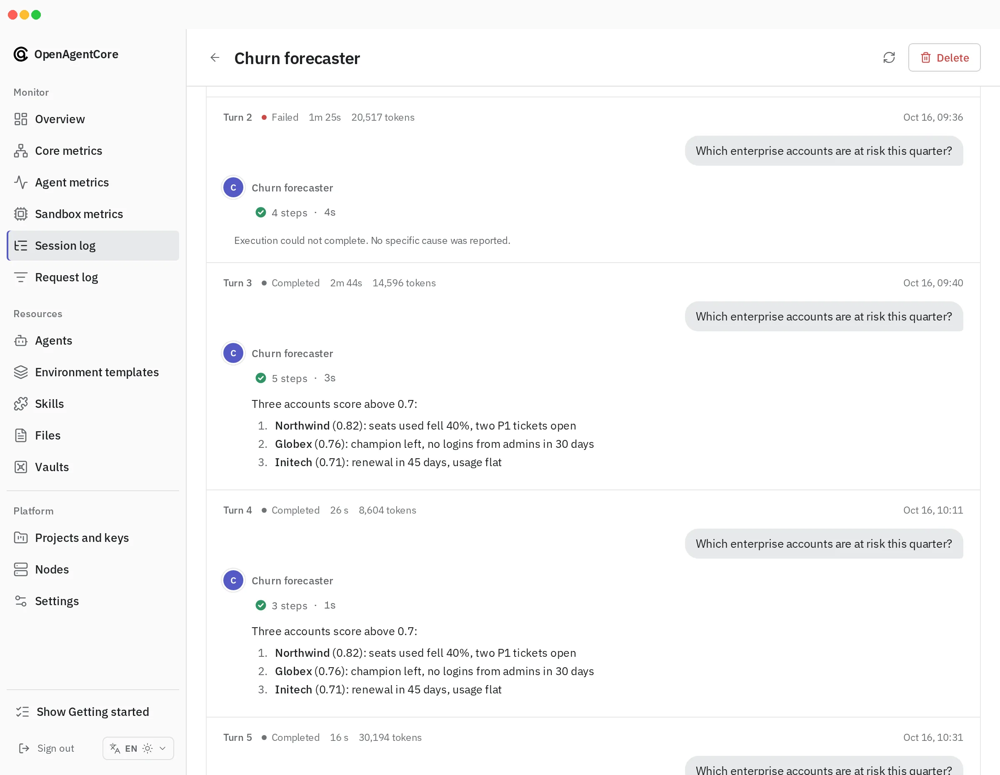
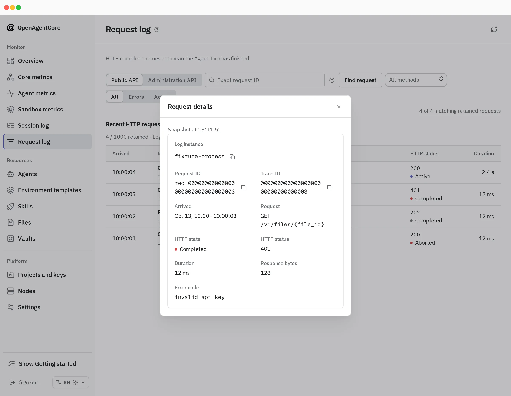

Web is the administrator console of an OpenAgentCore installation: operators sign in with the Core key to watch health and usage, inspect what applications created, and manage Projects, keys, nodes and settings. Applications call `/v1` with Project API keys and never use Web.

## Sign in

[Sign in](../getting-started/install.md#sign-in-to-web) with the deployment's [Core key](../getting-started/operations.md#core-key); the console has no user accounts. The browser keeps only a session cookie, and the [Console server](./console-server.md) sends the Core key to Core on its behalf; [sign-in](./console-server.md#sign-in) describes how long a session lasts.

Signing in opens the Overview. While any step is still to do, its **Getting started** checklist leads through four steps in any order: sandboxes ready, a default model provider, a Project with an active key, and a first Session. An optional tour of the console opens from it.

## Console pages

| Group | Page | Purpose |
| --- | --- | --- |
| Monitor | Overview | Service status, running Sessions, **Sandbox capacity** and work needing attention; 24-hour Session activity; Core and its nodes as a topology, each opening its page; Needs attention: failed Sessions and Sessions waiting for their caller, active in the last 24 hours, each with its one-line reason; usage by Project |
| Monitor | Core metrics | Whether Core can run Turns: execution slots, the Turn queue and its p95 wait, interrupted Turns, connected daemons, database latency, CPU and resident memory against their limits, background jobs; Go heap, goroutines and the database pool under **Diagnostics** |
| Monitor | Agent metrics | Requests, errors, duration, tokens, models, tools, Agents and API keys over 1 h, 6 h, 24 h or 7 d |
| Monitor | Sandbox metrics | Hosted Runtimes across Projects over time, active against total, each with its status (active, suspended, changing state, waiting for allocation or stopped) and its CPU and memory observations; an E2B deployment adds the sandboxes Core holds in E2B's cloud |
| Monitor | Request log | Recent HTTP requests to Core, their status, elapsed time and safe error codes; [scope and retention](../../contracts/agents-api/admin-api.md#request-log) |
| Monitor | Session log | Every Session, and each Session's read-only conversation, trace and Turns with the classified reason of a failure and its next step; a self-hosted Session's page also manages its executor credentials and gives the command that connects a host |
| Resources | Agents, Environment templates, Skills, Files, Vaults | Inspection and permitted deletion, with the Project and the creating key of each resource |
| Platform | Projects and keys | Create, rename and archive Projects; issue and revoke keys; each Project's usage, write history and how to call the API |
| Platform | Nodes | Add, edit and remove microsandbox or Docker nodes; each node's readiness, active and retained limits, host CPU and memory with their history, free disk, and allocations with elapsed time in each compute phase |
| Platform | Settings | **Sandbox and scheduling**, **Workspace storage**, **Models and credentials**, and **Service and deployment**; see [configuration](../configuration.md#runtime-settings-web) |

Missing data is shown as missing (—), never as zero. [Console API usage](./console-api-usage.md) lists what each page reads and how its figures are bounded.

## What administrators do here

| Task | Where |
| --- | --- |
| Choose the sandbox backend (microsandbox, E2B or Docker), the sandbox size and Runtime, or reset the backend | **Settings → Sandbox and scheduling**; see [change the sandbox configuration](../getting-started/nodes.md#change-the-sandbox-configuration) |
| Add, resize or remove execution nodes | **Nodes**: **Add node**, **Edit node** and removal; see [Add and manage nodes](../getting-started/nodes.md) |
| Set the default model of a Harness | **Settings → Models and credentials**; see [default models](../configuration.md#default-models) |
| Create a Project and issue its API keys | **Projects and keys**; see [Projects and API keys](../getting-started/operations.md#projects-and-api-keys) |
| Issue, rotate or revoke a self-hosted executor's credential, or copy its install command | The Session's page in the **Session log**; see [Run self-hosted Sessions](../getting-started/self-hosted.md) |
| Delete a resource, for example a leaked Credential | The resource's row in its list, or its page; Files are deleted from the Files list. The public deletion rules apply |

Web observes and administers the installation. It never starts a Session or sends input; agents run only when applications call `/v1`. Archiving a hosted Session requests cancellation and sandbox reclamation. [Concepts](../concepts.md#what-administrators-can-and-cannot-do) defines what administrators can do.

A new Project key is shown once, together with the calls that use it:

Each Harness's default model is set in **Settings → Models and credentials**:

The deployment's sandbox backend serves hosted Sessions. An application's `self_hosted` Runtime, including one in its own E2B account, is a separate path that the sandbox configuration does not change.

A loopback public address (`local_only`) keeps nodes and remote applications from reaching Core. The console stays reachable at its own address and [warns about it](./console-api-usage.md#provenance-and-monitoring).

## Diagnose a failure

The **Session log** shows a failed Turn with its classified reason and next step; [Session diagnostics](../../contracts/agents-api/session-diagnostics.md) defines the categories. The **Request log** shows the HTTP side, such as a rejected request with status 401.

## More

- [Console server](./console-server.md): request boundary, sign-in, settings and verification.
- [Console API usage](./console-api-usage.md): the Core routes each page uses.
- [Web package](https://github.com/MiniMax-AI/OpenAgentCore/blob/main/apps/web/README.md): developing the console.
- [Core administration API](../../contracts/agents-api/admin-api.md): the `/core/v1` routes behind the console.
