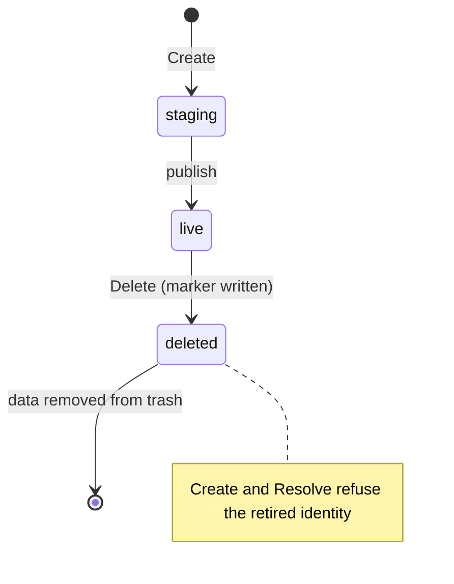

The workspace filesystem protocol connects Core and sandbox nodes to the adapter that owns durable Environment storage. Core creates, observes and deletes storage objects; a node resolves an object to a host directory that its [Sandbox Provider protocol](sandbox-provider.md) attaches to compute. It is for authors of filesystem adapters and Sandbox Providers.

| | |
| --- | --- |
| Caller | Core (`Control`) and the sandbox node (`Resolver`) |
| Implementations | The kernel NFS adapter (`nfs`), registered in `services/core/internal/workspacefs/providers` |
| Code | [`workspacefs.go`](https://github.com/MiniMax-AI/OpenAgentCore/blob/main/services/core/internal/workspacefs/workspacefs.go) |
| Transport | In-process Go interfaces; a `Binding` crosses the [Sandbox node protocol](../contracts/agents-api/node-generation-protocol.md#provider-requests) in `Create` bootstrap and `Resume` requests |

Core selects and validates the combination of a Sandbox Provider and a filesystem adapter before it allocates either resource.

| Sandbox Provider | External workspace storage |
| --- | --- |
| microsandbox | Supported (`host_directory`, `user_xattr`) |
| Docker, E2B | Not supported; the Provider's own Environment disk |

## Implement an adapter

1. Define `Parameters` and the optional credential, and implement `Normalize` ([Identity and configuration](#identity-and-configuration)).
2. Implement `Declaration`, `Check`, `Create`, `Observe` and `Delete` in `Control`, and `Resolve` in `Resolver` ([Operations and outcomes](#operations-and-outcomes)).
3. Declare the attachment kind, user xattr support and quota enforcement ([Capability validation](#capability-validation)).
4. Keep one writer per object and delete only on Core's authorization ([Lifetime and filesystem scope](#lifetime-and-filesystem-scope)).

## Roles

| Party | Owns |
| --- | --- |
| Core | Identities, the persisted `Reference`, configuration and credential, admitted capacity, the lifecycle order and every deletion decision |
| Filesystem adapter | Native storage objects, their receipts, native ownership checks and path resolution |
| Sandbox Provider | Compute, and attaching the resolved directory to it |

## Identity and configuration

`Reference` contains immutable, canonical lowercase, nonzero UUIDs for `TenantID`, `EnvironmentID` and `ObjectID`. Core persists the reference before creation. Object identities are never reused, including after deletion or an unconfirmed mutation. An adapter must verify the entire ownership tuple before exposing or deleting an object.

`Configuration` is an immutable Core database record with its own canonical UUID `ID`, an `Adapter` identifier and adapter-owned JSON object `Parameters`. The database is its only authored home; changing configuration creates a new identity. Core forwards parameters without interpreting native paths. Existing objects remain bound to their original configuration. Parameters are public: they reach nodes and administrator responses.

`ConfigurationRecord` adds the configuration's adapter-encoded private `Credential`, empty when the parameters require none. The credential is part of the immutable configuration. Core seals it with the installation's credential encryption key, bound to the installation ID and configuration ID, and opens it only to construct `Control` in Core. It never appears in a `Binding`, an administrator response, an audit record or a log, and nodes never receive it.

`Attachment` binds an adapter-issued JSON object `Native` to the complete reference, configuration ID and attachment kind. It is internal ownership evidence, not an application-provided host path. Shared validation checks the envelope and expected reference/configuration match; the selected adapter must also validate its parameters, receipt and native ownership. Structural validity alone never authorizes filesystem access. Public Session payloads must not supply attachments, configuration parameters or resolved host directories.

`Binding` carries the configuration and attachment transiently to a node resolver. This transfer does not introduce a second persistent node configuration. `Resolver.Resolve` validates the binding and returns `Directory{Path}` for the local compute attachment. Only the adapter resolves native storage into a clean absolute path; Core never constructs one. A structurally valid directory is not itself ownership evidence.

## Operations and outcomes

An adapter registers one implementation of `Adapter` with three separate, mandatory roles. `Normalize(parameters, credential)` validates and canonicalizes parameters and encodes the credential input without I/O; a missing required credential or a credential the parameters do not use is `ErrInvalid`, and an encoded credential is valid input that encodes to itself, so Core can re-select a retained configuration with its stored credential. `Control(ConfigurationRecord)` constructs the control adapter in Core with the decrypted credential. `Resolver(Configuration)` constructs the node resolver from public configuration only. Construction performs no filesystem or network operation.

Every control adapter implements `Declaration`, `Check`, `Create`, `Observe` and `Delete`. Every node attachment adapter implements `Resolve`. There is no optional side interface, implicit adapter substitution or nil implementation fallback.

| Operation | Required meaning |
| --- | --- |
| `Declaration()` | Describe the selected configuration's verified attachment, user xattr and quota behavior. |
| `Check(ctx)` | Validate configuration and availability without creating an object. |
| `Create(ctx, reference, capacityMiB)` | Create the owned object or converge on its existing attachment without overwriting data; retries and concurrent calls use the same immutable reference and admitted capacity. A positive capacity is enforced, and verified on every retry, before success. |
| `Observe(ctx, reference)` | Return an existing object's bound attachment without creating, repairing or preparing it. |
| `Delete(ctx, reference)` | Converge on terminal deletion of the verified owned object after Core has authorized deletion and confirmed compute stop. |
| `Resolve(ctx, binding)` | Validate native ownership and resolve the attachment for local compute. |

Errors support `errors.Is`. Adapters preserve these outcomes when wrapping errors.

| Error | Condition |
| --- | --- |
| `ErrInvalid` | Invalid input |
| `ErrOwnership` | A reference or configuration mismatch |
| `ErrUnavailable` | Storage is unavailable |
| `ErrUnconfirmed` | The mutation outcome is unknown |
| `ErrNotFound` | The object is missing |
| `ErrUnsupported` | The combination is unsupported |

A missing observation does not prove an earlier mutation settled. A timeout or canceled context ends the caller's wait; it does not prove native stop or rollback. Core retains ownership on unknown outcomes. It may retry `Create` or `Delete` with the same persisted immutable reference and configuration, including after `ErrUnconfirmed`; it must never substitute a new object identity to retry an uncertain operation.

Same-reference retry and concurrent convergence are mandatory adapter guarantees. `Create` preserves any existing object data and returns the attachment for that owned object; it never reinitializes a live object. Repeated and concurrent `Delete` calls converge on the same terminal deletion. Once terminal deletion is recorded, concurrent, delayed or retried `Create` calls must not resurrect the object, and `Resolve` must not expose it. Retained deletion metadata and further cleanup of settled in-flight operations are permitted. These guarantees apply to storage lifecycle operations; they do not establish mutation settlement at timeout or distributed compute fencing.

## Capability validation

`Requirements` declares the compute placement's attachment kind and need for `user_xattr`. `Declaration` reports the filesystem adapter's attachment kind, `UserXAttr` support and `CapacityQuota` enforcement. `ValidateCombination` is the shared pre-allocation admission check. The current attachment kind is `host_directory`; unknown kinds are rejected. A required user xattr capability means the mounted filesystem supports user extended attributes used by Environment preparation.

A zero requested capacity means no quota was requested. A positive capacity in MiB is admitted only when the adapter actually enforces that limit; reporting available space or accepting an unchecked number is insufficient. `CapacityQuota` means the adapter bounds every object created with a positive capacity: the object's allocated bytes, including directory and metadata blocks, and its inodes, not the logical size of its files. Writes beyond the bound fail with an error on write or fsync; nothing is truncated. Adapters cannot claim quota support based only on the Sandbox Provider's compute disk size. No I/O fairness follows from a capacity bound.

Capacity is admitted per object. For a new binding, Core validates the selected configuration's declaration against the deployment's request before binding; the binding transaction then refuses with a retryable conflict if another configuration was selected meanwhile. Core persists the admitted capacity with the reference and passes it unchanged to every `Create`. A retained binding is validated against its own configuration and admitted capacity, so changing the deployment's request or the selection never resizes or rebinds existing storage.

When the [tenant capacity policy](configuration.md#tenant-capacity) is set, a new binding is also admitted against the tenant's committed capacity: the sum of admitted capacities of that tenant's workspaces that are not yet confirmed deleted, across all configurations. Creating, failed or unconfirmed and deleting workspaces count until the adapter confirms deletion. A retained workspace with no admitted capacity counts as unbounded and blocks further admission for its tenant until it is deleted. Under the policy a request without capacity is unsupported, and a request that would exceed it fails as unavailable before any storage or compute is allocated. Existing bindings never re-enter admission, and lowering the policy evicts nothing.

Workspace access is single-writer. Core must serialize compute ownership and confirm the previous writer stopped before attaching a replacement. There is no cross-VM lock capability in this protocol: a guest `flock` is not proof of a host lock or another guest's exclusion. A placement must not advertise concurrent-safe attachment based on guest-local locking.

## Lifetime and filesystem scope

The object contains the whole `/environment` tree, including the workspace, staging files, initialization state, package content and the private native history of a qualified Runtime and Harness. Preparation data remains on the same filesystem so its filesystem operations preserve their semantics. Native history is private state outside the workspace directory; placement and settings are owned by [Runtime resource directories](configuration.md#runtime-resource-directories). Credentials, disposable HOME and other compute-local state have no persistence guarantee. Retained native execution requires the declared capability in the [Core–Runtime protocol](runtime-protocol.md); mounting persistent storage alone does not establish it.

Workspace storage is retained with its Session until explicit Session deletion. Archival, expiration, reset and compute checkpoint deletion do not authorize workspace deletion. Core calls `Delete` only after explicit Session deletion and confirmed compute stop; unresolved compute or storage mutations retain ownership. Failed creation does not authorize deleting storage while its Session is retained. Eligible nonterminal Sessions can survive checkpoint retention expiry and later attach the same object to fresh compute under the [cold replacement lifecycle](sandbox-provider.md#cold-replacement-after-checkpoint-retention). This does not revive archived, reset or deleted execution.

## Attachment

`Bootstrap.Workspace` and `ResumeRequest.Workspace` optionally carry a [workspace filesystem binding](#identity-and-configuration). Absence selects the Provider's owned Environment disk; presence selects the exact external object and never permits a fallback to an owned disk. Providers validate the tenant and Environment against the binding and its configuration receipt before resolving it. `LocalOptions.Workspace` injects the filesystem resolver; Sandbox Providers never interpret filesystem adapter parameters or native receipts.

`DeploymentPolicy.Workspace` declares supported attachment requirements; absence means external storage is unsupported. The derived immutable `DeploymentSpec.Workspace` receipt selects the generation mode and capabilities; its [deployment workflow](../contracts/agents-api/sandbox-deployment.md#resources) never copies filesystem configuration into the generation. Microsandbox requires `host_directory` and `user_xattr`; Docker and E2B reject external attachments. `ValidateWorkspacePolicy` uses the filesystem protocol's combination validator: an external filesystem without an enforced quota rejects a positive `EnvironmentDiskMiB`, while zero requests no quota. Root disk capacity is still required. Without an external declaration, the existing owned disk bounds apply.

Microsandbox resolves each Create and Resume binding, including observation of an interrupted restore, and passes only the local directory and immutable ObjectID to its private helper. The helper binds the whole `/environment`; its retained contents and private native history follow the [workspace filesystem scope](#lifetime-and-filesystem-scope) and [Runtime resource directories](configuration.md#runtime-resource-directories). Private HOME, credentials and the compute root are not a durable history store. Explicit mode, object and path labels qualify native resources; mount shape alone never selects a mode. Checkpoint restore verifies the snapshot's object, remaps `/environment` through SDK `Volumes`, requires strict external mount policy and rejects every restore warning. Partial restore errors retain the exact target identity for cleanup and never establish readiness. Unknown outcomes remain observations of the original operation. Native Bind checkpoint and guest-local flock continuity do not establish fencing against an unknown writer.

## Kernel NFS adapter

The `nfs` adapter uses an operator-premounted Linux kernel NFS filesystem. The supported setup is NFSv4.2 on trusted AUTH_SYS clients with `root_squash`, using the same export and absolute mount path on Core and nodes. The adapter neither mounts exports nor manages NFS credentials or service accounts. Other operating systems return `ErrUnsupported`. [Configuration](./configuration.md#independent-workspace-storage) owns installation steps and selection.

Parameters contain `root`, `namespace_id`, `uid` and, in quota mode, `quota`. `root` is a clean absolute mount path; `namespace_id` is a canonical nonzero UUID; `uid` is the nonzero effective host UID required on both Core and nodes. A Compose installation uses 65532, the UID of Core's container. The operator prepares the mounted root with mode `0700`, owned by this UID, and a regular `.oac-storage-root` file with mode `0600`, owned by the same UID, containing exactly the namespace UUID followed by one newline. Do this on the export's server-side storage as its administrator; root-squashed clients cannot assume privileged ownership changes. The root marker is an assertion of the selected export's identity, not a credential or distributed lock.

Construction validates and canonicalizes JSON without filesystem I/O. `Check` verifies the opened root is kernel NFS, the effective UID and private ownership/modes match, the namespace marker matches, and real file-descriptor `user.*` xattr set/get/remove operations succeed. Every filesystem operation, including opening the root and checking availability, runs within one process-wide budget of 32 in-flight operations. A timed-out caller receives `ErrUnconfirmed`; its slot remains occupied until the kernel call returns. An exhausted budget returns `ErrUnavailable`. Directory-descriptor-relative operations stay anchored to the opened root. An unavailable mount or a local directory at the configured path fails validation; no local fallback is created.

The declaration is `host_directory`, `user_xattr: true` and `capacity_quota` true exactly in quota mode. The native attachment contains only the namespace identity; resolution validates the complete binding against the immutable configuration and filesystem ownership before returning `objects/<ObjectID>/live/data` beneath the root. Only this data directory is exposed to the guest. Neither tenant nor application input supplies a host path.

Without `quota`, the adapter enforces no per-Environment byte or inode quota and requires no credential. One object can exhaust the shared filesystem, preventing writes to other objects and the durable terminal metadata required for safe deletion. Operators must monitor free bytes and inodes and maintain headroom for lifecycle metadata and cleanup.

### Quota mode

Quota mode bounds each object with an XFS project quota enforced by the NFS server's own filesystem. `quota` contains exactly `endpoint` (`host:port` of the storage server's SSH service), `user` (the restricted account) and `host_key` (the server's pinned OpenSSH public host key in authorized-key form; a comment is dropped). The credential is `{"ssh_private_key": "..."}`, one unencrypted OpenSSH private key whose public key the server authorizes only for the `oac-workspace-quota` forced command. [Configuration](configuration.md#quota-mode-storage-server) owns server preparation.

For a positive capacity, `Create` calls the command after claiming the identity and creating the object's empty `staging/` and `trash/`, and before creating a stage or returning an existing `live` object, so every retry re-verifies the bound. The request carries the complete reference, configuration ID, namespace ID, capacity and an inode limit of 256 per MiB; it can name no path, project ID, user or command. The client verifies the pinned host key, keeps the key in memory and runs one bounded session per call. A failure before the request is sent is `ErrUnavailable`; a missing or malformed answer afterwards is `ErrUnconfirmed`, and the same reference converges on retry. `Check` also calls the command, proving reachability, the host key, the namespace marker, the journal and enforcement before selection.

The command runs as root on the storage server. Holding one lock, it opens `objects/<ObjectID>/staging` relative to the configured export without following links, verifies the service UID, private modes, device and the full identity, refuses a deleted object and refuses a project on `objects/` or the object directory. A local SQLite journal on the same XFS filesystem, outside the export, records each object's reference, configuration, capacity, inode limit, staging inode and generation, and a project ID allocated from an operator-reserved range and never reused. The allocation commits before any change; one `FS_IOC_FSSETXATTR` then sets the project ID and inheritance on the still-empty staging directory, and the server sets bytes and inodes hard limits with zero soft limits and reads them back. Stages inherit the project; `live` and retired trash keep it through rename. The identity, deletion marker, object directory and `trash/` parent stay outside the project, so a full object can still be marked deleted and removed. Removal releases the data allocation; the retained `staging/` inode remains charged to the project. A journal for another filesystem or namespace, disabled enforcement, an exhausted range, existing user data, a foreign or inherited project, a replaced staging inode, a changed reference, configuration or capacity, and changed or lost limits on a ready object are refused rather than repaired. A project without a dquot reads as zero limits, never as an unused ID.

The bound is authoritative when `Create` succeeds; `Resolve` does not re-attest it, so resuming a ready workspace does not depend on the storage server's SSH service. A storage administrator who later disables quotas or clears limits defeats enforcement until the supported procedure restores them. Project IDs and limits live in the XFS filesystem, so quota mode requires the [block-level backup](getting-started/operations.md#back-up) described for it.

Each object owns `objects/<ObjectID>/identity`, `staging/`, `live/`, `trash/` and, after deletion begins, `deleted-marker`. The permanent identity binds the tenant, Environment and object UUIDs. Create prepares and syncs a private unique staging envelope before atomically publishing its nonempty directory as `live`; replay cannot overwrite existing live data. Delete first records a durable object-local terminal marker, retires live data to unique object-local trash and removes data before its ownership markers. Concurrent deleters converge. Minimal identity and deletion metadata remain intentionally; deletion does not mean every metadata file disappears. Create and Resolve refuse the retired identity. A late in-flight Create can leave empty controlled metadata requiring a repeated Delete after its syscall settles; it cannot authorize a new writer or reuse the object identity. Cleanup examines only that object's staging and trash, without a namespace-wide sweep or background service.

NFS storage does not supply compute fencing or automatic distributed failover. Guest `flock` is not a cross-VM writer lock. The single-writer and explicit-deletion requirements above remain mandatory. Confirmed release can permit a fresh VM on another compatible node to attach the same object, but an offline node or an unknown Create, Kill or snapshot-cleanup result never proves that the old writer stopped. Native history and database behavior require qualification of the selected Runtime, Harness and filesystem combination; file persistence alone is not a guarantee of native Session recovery, cross-node memory restore or arbitrary crash durability.

Core requires the selected Harness profile to support `retained_native_history` when the selected deployment generation uses external workspace storage. Creation validates that generation while holding the deployment lock, before committing the Session or compute reservation. Existing Sessions use their immutable workspace binding for Runtime admission and the final execution check. Owned workspace storage does not require this capability.

## Conformance

The shared validators and the combination check are covered by `services/core/internal/workspacefs/workspacefs_test.go`, and the kernel NFS adapter by the tests in `services/core/internal/workspacefs/nfs`. `make check-core-packages` runs them.
