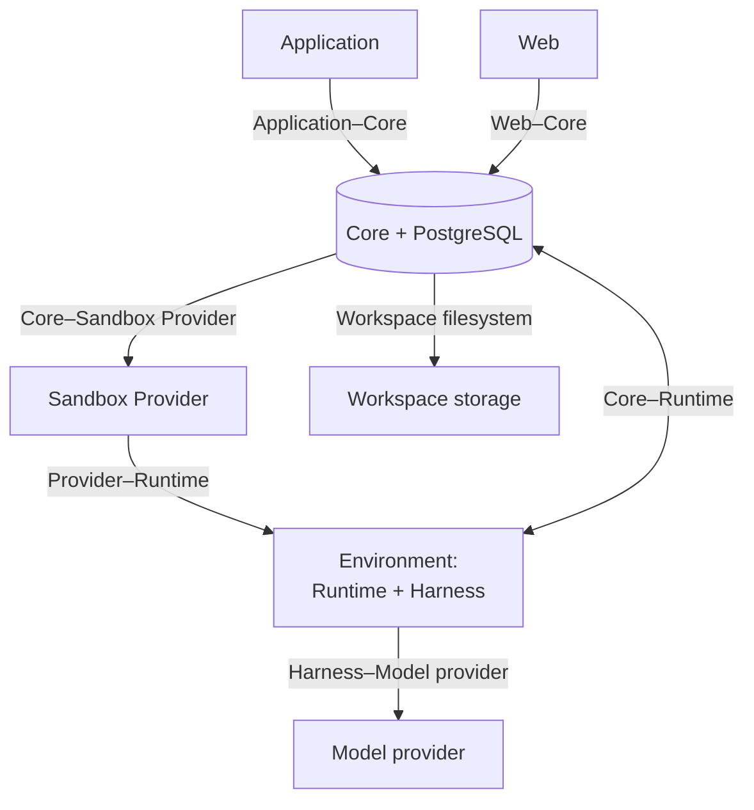
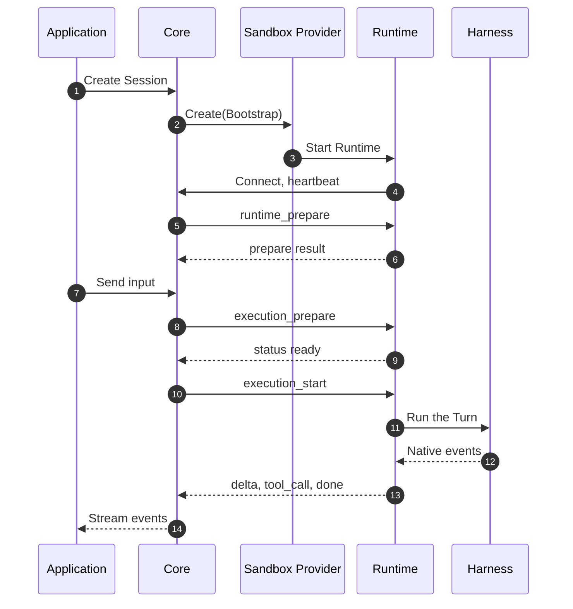

OpenAgentCore 是 Agent 运行平台，通过可替换的协议实现统一组织 Harness、模型、工具、Session 和执行环境。它将编排、计算资源和原生执行分开。Core 负责 API 和持久状态。沙箱提供商管理计算资源。独立工作区文件系统 adapter 通过单独的协议管理 Environment 持久存储。Runtime daemon 准备 Environment 并运行选定的 Harness；Harness 的原生 SDK 或协议负责模型与工具循环。

推荐的自部署方案是 microsandbox 配合 kernel NFS 工作区存储。E2B 提供托管计算。Docker 运行在没有检查点或外部存储的节点上。它们使用相同的 Core 编排和能力检查。计算和文件系统 adapter 声明其支持的组合；部署选择不会引入独立的 Agent 执行流程。[沙箱提供商协议](./sandbox-provider.md)和[工作区文件系统协议](./workspace-provider.md)定义其契约和支持的能力。

Runtime daemon 主动向 Core 发起经过认证的 WebSocket 连接。[API 命名空间和凭据](api/index.md) 说明应用、运维和机器命名空间；[协议边界](https://github.com/MiniMax-AI/OpenAgentCore/blob/main/AGENTS.md#protocols-at-every-boundary) 列出各协议的代码和所属文档。

## 组件职责 {#component-responsibilities}

| 组件 | 职责 | 参考 |
| --- | --- | --- |
| Core | 认证调用方，解析并冻结配置，调度 Turn，处理取消和待处理交互，将资源与执行事实持久化到 PostgreSQL | [Core 服务](https://github.com/MiniMax-AI/OpenAgentCore/blob/main/services/core/README.md) |
| 沙箱提供商 | 创建、观察、续期和回收计算资源；提供 Runtime 启动输入 | [沙箱提供商协议](sandbox-provider.md)、[Runtime 引导](runtime-bootstrap.md) |
| Workspace filesystem adapter | 创建、观察和删除 Environment 持久存储；验证并解析计算资源所需的挂载 | [工作区文件系统协议](workspace-provider.md) |
| Sandbox node | 运行 Docker 或 microsandbox 主机，协调分配给它的 generation 与 allocation | [Sandbox node 协议](../../contracts/agents-api/zh/node-generation-protocol.md) |
| Runtime | 准备工作区和能力，管理 Session Executor，执行 Turn 并报告事件与回执 | [Core–Runtime 协议](runtime-protocol.md) |
| Harness adapter | 验证原生配置，调用上游 SDK 或协议，转换事件并确认原生清理完成 | [Harness 协议](../../contracts/agents-api/zh/harness-onboarding.md) |
| 模型提供商 | 提供 Harness 选定的模型协议 | [模型执行](../../contracts/agents-api/zh/model-execution.md) |
| Web | 让管理员通过服务端 Core API 连接配置与观察安装实例 | [控制台服务端](web/console-server.md) |

Harness 负责原生 Agent loop 和上下文管理。应用负责业务工作流、Reviewer 策略和质量评估；这些能力不会成为 Core 执行路径。

[仓库地图](development.md#repository-map) 标出这些组件的位置。[概念](concepts.md) 解释项目边界、管理员权限和工具隔离。

## Session 的完整流程 {#a-session-end-to-end}

应用通过 Agents API 创建 Session，Core 解析其配置与执行位置。托管 Session 通过选定的沙箱提供商获取计算资源。自托管 Session 等待用户运行安装命令，由该命令代替步骤 2 和 3 启动 Runtime。`environment: none` 的 Session 使用已连接的执行设备，不提供工作区。[应用指南](api/public-agent-api.md#create-a-session) 说明这些选项。

daemon 连接后，Core 检查可用 Harness 和请求的能力。Runtime 准备工作区 Environment 及其能力快照，然后准备或复用 Session Executor。Core 持久化输出、工具交互和回执，供应用读取和接收事件。完成或取消使 Turn 结算；健康的 Executor 可以在同一 Environment 中执行下一个 Turn。

对于支持检查点的计算资源，Core 自动挂起空闲工作，并在确认快照捕获及源计算停止后释放活跃计算容量。新工作在符合条件的兼容节点上恢复保留的内存；独立工作区存储始终属于同一 Environment 标识。[检查点生命周期](./sandbox-provider.md#suspension)负责空闲准入、唤醒与保留规则，[检查点转移](./sandbox-provider.md#checkpoint-transfer)定义共享存储和兼容性要求。仅凭节点失联不能授权替代写入者。

执行、计算资源和独立工作区存储拥有不同的生命周期。关闭 Executor 本身不会删除存储。[工作区文件系统契约](workspace-provider.md#lifetime-and-filesystem-scope) 负责持久存储保留及显式删除规则；计算快照到期不授权回收工作区存储。准备、连接和执行就绪具有不同状态。[Environment 契约](../../contracts/agents-api/zh/environments.md) 负责准备规则，[Core–Runtime 协议](runtime-protocol.md) 负责顺序、回执和故障处理。
