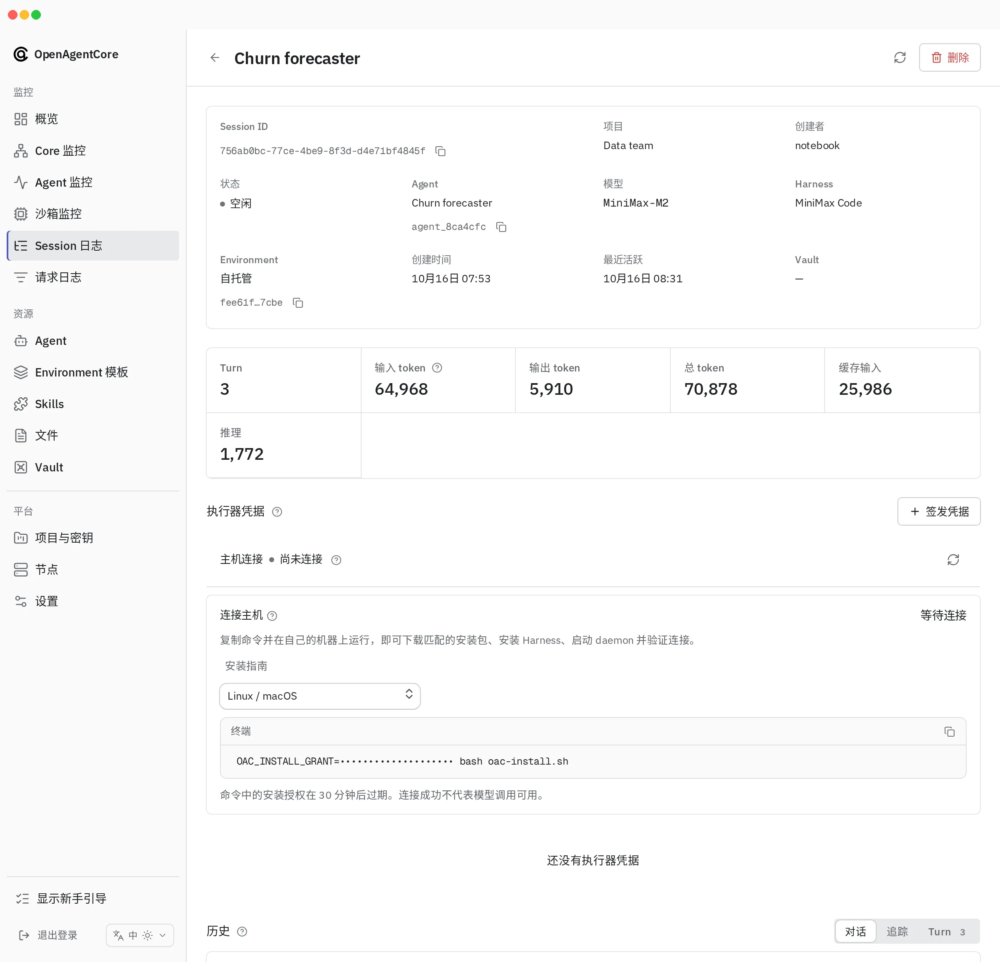

`self_hosted` Session 在应用拥有的机器上运行，例如工作站、虚拟机或容器，而不是 Core 管理的沙箱。本指南面向用 `oac-daemon` 连接此类机器并保持其运行的应用开发者。

应用通过 `/v1` 创建 Session，并获得安装 `oac-daemon`、启动它并连接 Core 的命令。Web 在 Session 页面展示同一命令；Web 是可选的。Core 不创建、停止或回收这台机器。

> [!WARNING]
> 守护进程不是沙箱。工具以启动守护进程的账号权限运行，能访问该账号可访问的所有资源。需要隔离时，请使用容器或虚拟机；参阅 [Runtime 与外层隔离](../concepts.md#runtime-and-outer-isolation)。

Session 自带模型提供商；安装默认模型不适用（[原因](../../../contracts/agents-api/zh/model-execution.md#saved-defaults-and-precedence)）。机器获得的执行器凭据仅适用于这一个 Environment。

## 平台 {#platforms}

| 平台 | Codex | Claude Code | MiniMax Code |
| --- | --- | --- | --- |
| Linux amd64 | 支持 | 支持 | 支持 |
| macOS arm64 | 支持 | 支持 | 支持 |
| Windows amd64 | 支持 | 支持 | 不支持 |

安装程序自带固定版本的 Node.js 和 Harness（Harness 版本见 [Harness 目录](https://github.com/MiniMax-AI/OpenAgentCore/blob/main/contracts/agents-api/harness-catalog.md)，Node.js 见 [`scripts/build-native-installer.mjs`](https://github.com/MiniMax-AI/OpenAgentCore/blob/main/scripts/build-native-installer.mjs)），不修改这些工具的其他安装。在没有匹配安装程序的平台上，命令会失败。

下载量取决于你安装的 Harness。安装程序（9 MiB）和 Node.js（59 MiB）始终需要，再加上 Codex 的 121 MiB、Claude Code 的 99 MiB 或 MiniMax Code 的 23 MiB，因此安装一个 Harness 的 Session 下载 90 到 189 MiB。Runtime 主目录和安装目录所在磁盘需要有空闲空间：

| | 一个 Harness | 全部三个 |
| --- | --- | --- |
| 高峰时所需空闲空间 | 约 0.7 GiB | 约 1.1 GiB |
| 安装后占用，每台机器每个版本一份 | 约 560 MiB | 约 940 MiB |

组件按机器和版本只安装一份，位于 Runtime 主目录的 `components/<version>` 中，这台机器上该版本的所有 Session 共用。它们是只读的，可防止意外改动；所有 Session 都以同一账号运行，因此 `start` 会校验这些组件，并拒绝已被改动的组件。同一发行版的另一个 Session 只需下载 9 MiB 的安装程序，不再安装任何组件，只增加自己的小目录。高峰为安装后占用加上正在解包的归档（Codex 为 121 MiB）；每个归档在其组件安装完成后即删除。

机器需要：

- 通过 HTTP 或 HTTPS 访问 Core，以及访问发布下载主机；如果 Core 已有本平台安装程序的离线副本，则无需后者（离线安装只带有 Linux amd64 的安装程序）；
- 用于环境设置和 MiniMax Code 工具的 Bash；Windows 上需要 Git Bash，Claude Code 也要求它；
- Session 的软件包需要时，安装 Python 和 pip；
- 环境设置所需的系统软件包。守护进程不运行 apt、sudo 或其他提权命令，请通过主机的常规管理方式安装。

不需要管理员权限或 Docker。Unix 下载命令还使用 `curl`、`tar`、`gzip` 和 SHA-256 工具。Windows 需要系统自带的 `tar.exe`，命令会在下载前检查。Runtime 主目录必须允许执行文件。如果 Unix 挂载点设为 `noexec`，请先用 `OAC_RUNTIME_HOME` 指定另一个允许执行的绝对目录，再运行命令。

## 连接机器 {#connect-a-machine}

1. 在目标机器上选择绝对工作区路径。使用该路径和应用的项目 API 密钥创建 Session：

   ```python
   import os
   from openai import OpenAI

   client = OpenAI()  # reads OPENAI_BASE_URL and OPENAI_API_KEY
   session = client.beta.agents.sessions.create(
       environment={
           "type": "self_hosted",
           "workspace_directory": os.environ["EXECUTOR_WORKSPACE"],
       },
       extra_body={
           "agent": {"model": os.environ["MODEL_NAME"], "x_agents_core": {"harness": "codex"}},
           "x_agents_core": {"model_provider": {
               "protocol": "responses",
               "base_url": os.environ["MODEL_BASE_URL"],
               "api_key": os.environ["MODEL_API_KEY"],
           }},
       },
   )
   installation = session.model_dump()["x_agents_core"]["installation"]
   print(installation["commands"]["posix"])  # use "powershell" on Windows
   ```

2. 在目标机器上，以应运行工具的账号执行命令。命令下载与 Core 匹配的安装程序、验证校验和、询问要安装哪些 Harness 以及安装位置、下载 Node.js 和所选 Harness、完成安装、按需创建工作区、启动守护进程并检查连接。
3. 发送一个 Turn。机器已连接只证明认证成功；第一个 Turn 才会检查 Harness 和模型。

在 Web 中打开 Session，复制 **连接主机** 下的命令。



请保密该命令：它包含短期[安装授权](../../../contracts/agents-api/zh/environment-executor-credentials.md#installation-grant)，用于领取机器凭据。命令通过环境变量 `OAC_INSTALL_GRANT` 传递授权，从不放在参数中。在 Linux 和 macOS 上，命令以空格开头，会忽略空格开头命令的 shell 不会把它记入历史。PowerShell 没有这条规则：它的历史文件（`ConsoleHost_history.txt`）会把整条命令连同授权一起保存，直到你清除它，不过授权在 30 分钟后就会失效。过期后重新读取 Session，或从 Web 复制新命令。

安装程序报告三个结果：

| 结果 | 含义 |
| --- | --- |
| **Installation** | 所选 Harness 已通过就绪检查 |
| **Daemon connection** | Core 已确认守护进程的认证连接 |
| **Model configuration** | 未检查；第一个 Turn 使用 Session 的模型提供商 |

<details>
<summary>下载中断时</summary>

安装程序在下载 Harness 之前先检查授权，因此过期的命令只会下载 9 MiB 的安装程序。每个归档的下载在连接重置后会续传，只在传输停滞（60 秒没有数据）时失败，最多尝试五次；重新执行命令即可从中断处继续。未完成的归档保存在 Runtime 主目录的 `native-download/<version>` 中，直到之后的运行将其完成；其他版本的下载会被删除。这台机器上已安装的组件不会再次下载。同一台机器上的安装轮流安装组件：后到的会输出等待提示，10 分钟后失败。如果某个共享组件被修改，`install` 和 `start` 会失败并指出它的目录：停止使用它的安装，删除该目录（文件是只读的：`chmod -R u+w <directory> && rm -rf <directory>`，在 PowerShell 中用 `Remove-Item -Recurse -Force <directory>`），再重新执行安装命令。下载、解压和复制组件前会检查磁盘空间。如果下载或安装被中断，重新执行命令：它清理未完成的临时副本，同时保留已完成的组件、凭据和工作区。命令过期时，从 Session 复制新命令。

</details>

如果 45 秒内未确认连接，安装程序输出守护进程日志路径。守护进程继续重连。修复原因后，以同一安装目录重新执行安装命令；如果命令已过期，从 Web 复制新的。已完成的组件和凭据会保留，已运行的守护进程会复用。不要删除工作区或 Session 来重试。

### 自动化选项 {#options-for-automation}

在命令后追加这些选项：

| 选项 | 效果 |
| --- | --- |
| `--non-interactive` | 不提示；缺少输入时失败 |
| `--harness codex,claude,minimax` | 要安装的 Harness，以逗号分隔。必须包含 Session 的 Harness |
| `--install-dir ABS` | 安装目录。它必须不存在、为空，或已包含一个安装；其他非空目录会被拒绝。默认是 `~/.oac` 下的 `environments/<environment-id>`；设置了 `OAC_RUNTIME_HOME` 时则在该目录下 |
| `--capability-directory ABS` | [能力快照](#local-capability-directories)存储位置。默认是安装目录中的 `capabilities` |
| `--tool-env-file ABS` | 为工具和 MCP 服务器提供字符串变量的 JSON 文件；参阅[显式本地工具环境](../../../contracts/agents-api/zh/environments.md#explicit-local-tool-environment) |

工作区在创建 Session 时固定。使用不同工作区时，创建另一个 Session。

## 管理安装 {#operate-the-installation}

安装的 `bin/oac-daemon` 能定位自己的安装目录。使用它执行：

| 命令 | 效果 |
| --- | --- |
| `oac-daemon start` | 验证已安装的 Harness，并在后台启动守护进程 |
| `oac-daemon status` | 展示本地配置与进程，不表示连接状态 |
| `oac-daemon logs -n 100`、`oac-daemon logs -f` | 输出或持续跟踪守护进程日志 |
| `oac-daemon stop` | 停止守护进程 |
| `oac-daemon uninstall` | [移除机器](#remove-a-machine) |

已安装的 `bin/oac-daemon` 忽略 `OAC_RUNTIME_HOME`，始终操作自己所在的安装。重启机器后没有任何东西会自动拉起守护进程：再次运行 `bin/oac-daemon start`，安装、凭据和历史都保留。在 Web 的 Session 页面 **主机连接** 下检查连接，或使用[连接状态](../../../contracts/agents-api/zh/environment-executor-credentials.md#connection-status)。

添加 Harness 时，以同一安装目录重新执行安装命令，并指定要添加的 Harness（命令过期时从 Web 复制新的）。安装程序检查已有内容、只添加缺失组件，并保留已安装的 Harness。之后重启正在运行的守护进程，让它发现新的 Harness。

停止守护进程、取消 Turn 或删除 Session，都不会删除机器的工作区、原生历史或能力快照。安装程序拒绝其他守护进程版本的安装，以及文件已被修改的安装。程序不升级、修复或迁移它们。要在新目录上使用该 Session，请[重新连接](#reconnect-an-existing-session)。

## 轮换或撤销 {#rotate-or-revoke}

在 Web 中，Session 的 **执行器凭据** 列出机器凭据：

| 操作 | 效果 |
| --- | --- |
| **轮换** | 凭据获得新密钥；旧密钥立即失效。已撤销凭据的操作为 **恢复** |
| **撤销** | 凭据立即失效 |

轮换后重新连接时，通过 `oac-daemon stop` 停止守护进程，用新凭据替换已配置的凭据文件路径中的 JSON，然后运行 `oac-daemon start`。不要再次对已有安装运行 `install`；轮换现有凭据，而非签发第二个凭据，后者[无法连接](../../../contracts/agents-api/zh/environment-executor-credentials.md#revoked-or-rotated-credential)。

已归档项目无法签发或轮换凭据，仍可撤销。运维人员可以使用 Core 密钥管理凭据；参阅[凭据协议](../../../contracts/agents-api/zh/environment-executor-credentials.md#core-key-routes)。

## 重新连接已有 Session {#reconnect-an-existing-session}

安装命令只能认领一次 Session 的机器凭据，再次认领会以 `This Session's machine credential is already claimed by another installation` 结束。在另一个目录、另一台机器上运行命令，安装目录丢失，或目录中是其他 Core 版本或其他 Session 的安装（安装程序拒绝修改）时，都会出现这种情况。在原目录中重新运行命令始终可行。

没有原目录时，轮换该 Session 的凭据，并用已解压的发行包安装到新目录：

1. 在 Web 中打开该 Session，在 **执行器凭据** 中选择 **轮换**，保存返回的凭据 JSON。
2. 下载 `<base>/<platform>.tar.gz`，以及 `node` 和你要安装的每个 Harness（`codex`、`claude` 或 `minimax`）的 `<base>/<platform>-<component>.tar.gz`，并解压到同一个目录。`<base>` 是安装命令中的第一个 URL（以 Core 版本结尾），`<platform>` 是 `linux-amd64`、`darwin-arm64` 或 `windows-amd64`，对应[平台](#platforms)表中的各行。
3. 按[从已解压的发行包安装](#install-from-an-extracted-distribution)运行安装程序，使用该 Session 的 `remote_url`、Environment ID、工作区和保存的凭据文件。

或者新建 Session 并运行它的命令。

## 移除机器 {#remove-a-machine}

运行该安装自带的命令：

```sh
"$HOME/.oac/environments/<environment-id>/bin/oac-daemon" uninstall
```

在 Windows PowerShell 中：

```powershell
& "$HOME\.oac\environments\<environment-id>\bin\oac-daemon.exe" uninstall
```

它会停止守护进程，列出将删除的内容并请求确认。它只删除安装目录中属于该安装的条目（`bin`、`daemon`、`capabilities`、`runtime`、`initialization` 和 `packages`，含凭据文件和原生历史），之后若目录中没有其他内容，再删除目录本身。目录中的其他内容会保留，工作区以及安装目录之外的凭据文件或能力目录也会保留；命令会逐一列出保留的路径。Runtime 主目录中的共享组件随该版本在这台机器上的最后一个安装一并删除；否则命令会说明还有多少其他安装在使用它们。手动删除的安装目录会在这台机器上的下一次安装或卸载时被忘记，无人使用的组件也在那时删除。`native-download` 中未完成的下载不会被触碰；如需回收空间，请删除该目录。在没有安装的位置运行时，它会说明这一点并以 0 退出。如果某个文件无法删除，命令会指出它，待其被释放后可再次运行。在 Windows 上，最后的删除会在命令退出几秒后完成。

随后在 Web 中打开该 Session，在 **执行器凭据** 中选择 **撤销**，或 **删除** 该 Session；在此之前，Core 仍接受这台机器的凭据。

该 Session 的安装命令无法再次连接这台机器：它的凭据在 Core 中仍处于已领取状态。要重新连接该 Session，请选择 **轮换**，并[从已解压的发行包安装](#reconnect-an-existing-session)，或新建 Session。

Session 被删除，或其凭据被撤销或轮换后，由 `start` 启动的守护进程会在 `connect.log` 中写明原因（见 `oac-daemon logs`）并退出，再次启动会打印同样的原因。要重新连接，参阅[轮换或撤销](#rotate-or-revoke)或[重新连接已有 Session](#reconnect-an-existing-session)；要移除，运行 `uninstall`。

## 参考 {#reference}

### 本地能力目录 {#local-capability-directories}

自托管 Session 可以在工作区之外提供 `capability_directories`：

```python
environment = {
    "type": "self_hosted",
    "workspace_directory": os.environ["EXECUTOR_WORKSPACE"],
    "capability_directories": [os.environ["EXECUTOR_CAPABILITIES"]],
}
```

路径使用机器自身语法的绝对路径（Unix、Windows 驱动器或 UNC）；由守护进程而非 Core 检查。守护进程连接前，先准备这些目录。它们是守护进程可见的普通路径；指定路径不会挂载它或创建沙箱。

使用 `x_agents_core.environment` 提供与托管 Session 相同的项目所属 Skills、Plugin 归档、文件、软件包、设置命令或模板：

```python
session = client.beta.agents.sessions.create(
    agent_id=agent_id,
    environment=environment,
    extra_body={"x_agents_core": {
        "model_provider": model_provider,
        "environment": {"environment_template_id": template_id},
    }},
)
```

同一扩展也支持 `environment={"type": "openai_hosted"}`。不要在 `environment` 和扩展中重复指定同一个字段。设置过程使用守护进程账号权限。部署的模型密钥不会发送到你的机器。

第一个 Turn 之前，守护进程将这些来源复制成快照。即使来源之后被修改，重连仍复用快照；新的 Session 获取新快照。[准备协议](../../../contracts/agents-api/zh/environments.md#runtime-capability-preparation)列出字段、合并规则、快照行为和失败情况。

### 从已解压的发行包安装 {#install-from-an-extracted-distribution}

同一安装程序也接受已解压的发行包和运维人员签发的凭据文件，无需安装命令：

```sh
./oac-daemon install --non-interactive --harness codex \
  --install-dir "$HOME/.oac/my-runtime" \
  --remote 'wss://core.example/api/v1/agent-daemon/ws' \
  --environment-id '11111111-2222-4333-8444-555555555555' \
  --workspace "$HOME/workspace" \
  --credential-file "$HOME/executor-credential.json"
"$HOME/.oac/my-runtime/bin/oac-daemon" start
```

使用 Session 的 `remote_url` 和 Environment ID。发行包即[重新连接已有 Session](#reconnect-an-existing-session) 中描述的目录：平台归档中的 `oac-daemon` 和 `bundle.json`，以及 `node` 和每个所选 Harness 的归档中的 `components/`。这台机器上尚未安装的组件会从发行包复制，已安装的则直接使用。两处都缺少的组件会失败，并指出需要解压的归档；此模式从不下载。在 PowerShell 中，以原生绝对路径运行 `.\oac-daemon.exe`。安装目录必须不存在、为空，或已包含一个安装。此模式要求工作区已存在，且在运行 `start` 前不会启动守护进程。
