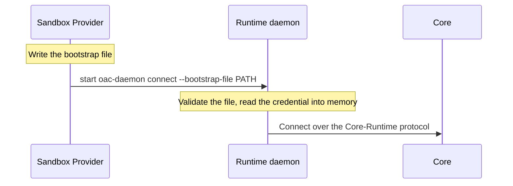

Runtime 引导协议连接沙箱提供商与其启动的托管 Runtime。提供商向 Runtime 交付一个引导文件，该文件是此次启动中 Runtime 唯一的认证输入，也是其 Environment 绑定的唯一来源。

| 属性 | 内容 |
| --- | --- |
| 调用方 | 沙箱提供商。Go 提供商使用 [`runtime_bootstrap.go`](https://github.com/MiniMax-AI/OpenAgentCore/blob/main/services/core/internal/sandbox/runtime_bootstrap.go) 中的 `sandbox.Bootstrap.RuntimeConnection()` 构造输入；SDK helper 原样转发序列化对象。 |
| 实现方 | Runtime，以及[参考实现](#reference-implementations)中列出的提供商 |
| 代码 | [`internal/runtimebootstrap`](https://github.com/MiniMax-AI/OpenAgentCore/blob/main/internal/runtimebootstrap/bootstrap.go)：类型与验证器 |
| 传输 | 一个 JSON 文件，其绝对路径传给 `oac-daemon connect --bootstrap-file` |
| 版本规则 | 精确的 `version`（[启动输入](#launch-input)） |

## 职责与就绪状态 {#responsibilities-and-readiness}

| 参与方 | 拥有 | 绝不 |
| --- | --- | --- |
| 沙箱提供商 | 账户、挂载和工作区；交付该文件；Runtime 的资源与 Environment 绑定配置；以无特权 Runtime 账户启动 daemon | 读取或写入 Runtime 的私有认证存储 |
| Runtime | 验证输入、认证和连接 | 为同一次启动接受第二个认证来源 |

启动成功仅证明交付完成：经过认证的连接、已准备的能力和执行就绪是 [Core–Runtime 协议](runtime-protocol.md) 下的独立观测；[沙箱提供商协议](sandbox-provider.md#four-distinct-readiness-facts) 列出各自证明的事实。

自托管执行器和运维人员供应的设备通过其他方式获取 daemon 身份，其 Environment 绑定来自注册以及 `oac-daemon connect --workspace` 或原生安装；[机器连接 API](../../contracts/agents-api/zh/machine-api.md#credentials) 列出所有凭据来源。它们都进入同一 Runtime 执行循环。

## 启动顺序 {#startup-order}



## 启动输入 {#launch-input}

将一个 JSON 对象交付到普通文件中，该文件仅允许 Runtime 账户和可信资源供应进程读取（托管 Linux 上权限为 0600），并传入其绝对路径：

```sh
oac-daemon connect --bootstrap-file /home/runtime/runtime-bootstrap.json
```

| 字段 | 含义 |
| --- | --- |
| `version` | 精确的引导版本 `runtimebootstrap.Version` |
| `core_url` | 以 `/api/v1` 结尾的 HTTP(S) 机器 API 基址，不含凭据、查询或片段 |
| `device_id` | Core 签发的 daemon 身份的规范非零 UUID |
| `credential` | Core 签发的非空 daemon 凭据，不含空白或 NUL |
| `environment_id` | Runtime 所服务 Environment 的规范非零 UUID |
| `session_id` | Runtime 保存其原生历史的 Session 的规范非零 UUID |
| `workspace` | 工作区的干净绝对目录；打包的 Runtime 布局中为 `runtimebootstrap.RuntimeWorkspace`。Runtime 将其作为 `runtimebootstrap.PublicWorkspace`（`/workspace`）提供，这是应用与 Core 使用的路径 |
| `suspend_control` | 必填布尔值。当且仅当提供商声明[检查点支持](./sandbox-provider.md)时，Core 将其置为 true，提供商原样转交 |

解码器拒绝未知、重复、缺失和大小写别名字段，拒绝其他版本及超过 `runtimebootstrap.MaxBytes`的文档。错误不包含提交的值。文件缺失或格式错误时，daemon 在连接前失败。

该文件是此次启动唯一的认证输入：daemon 拒绝将其与自托管注册选项组合使用，并将凭据读入内存而不保存到存储的 profile。凭据不进入命令参数、环境变量或回执。提供商为进程重启保留该文件，仅在明确清理自己拥有的资源时删除。

## 挂起控制 {#suspend-control}

`suspend_control` 为 true 时，daemon 在 `runtimebootstrap.SuspendControlFile` 发布其挂起控制并为挂起而停放。Core 的唤醒命令 `oac-daemon resume --control-file` 读取该文件。声明检查点支持的提供商在启动 daemon 前准备该文件所在目录：仅 Runtime 账户可访问（权限 0700，属主 UID 1000）。`suspend_control` 为 true 而 `oac-daemon connect` 无法发布该控制时，连接失败；没有任何其他设置可以启用该控制。

## 超时与限制 {#timeouts-and-limits}

| 数值 | 适用对象 | 超出时 |
| --- | --- | --- |
| 16 KiB（`runtimebootstrap.MaxBytes`） | 引导文档 | 解码器拒绝该文档，daemon 在连接前失败。 |

## 参考实现 {#reference-implementations}

| 提供商 | 交付方式 |
| --- | --- |
| Docker | 将文件写入 Runtime 拥有的 home volume。 |
| microsandbox、E2B | 在启动同一命令之前交付文件。 |

## 验证 {#verification}

`go test ./internal/runtimebootstrap ./apps/daemon/internal/cli` 覆盖输入契约、凭据来源互斥规则和重启行为。提供商测试验证交付与文件权限，不依赖 Runtime 的私有存储。
