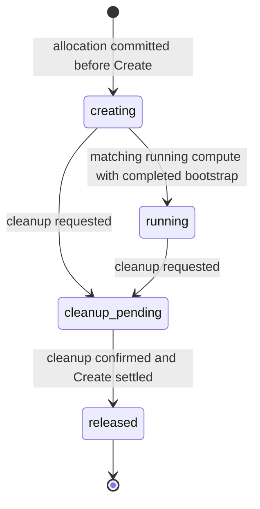
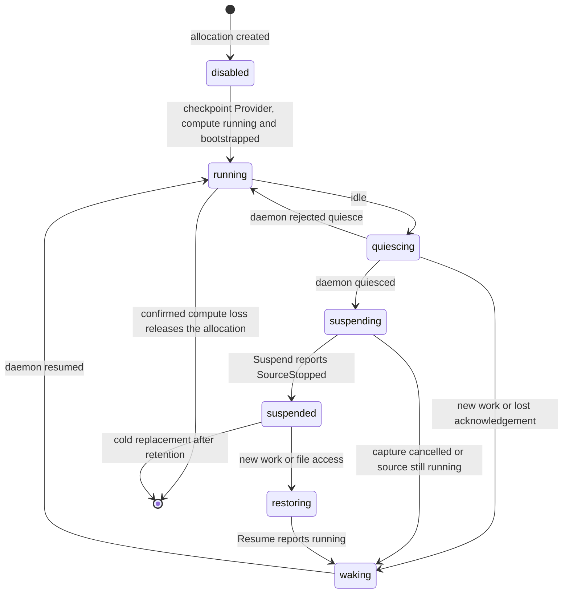
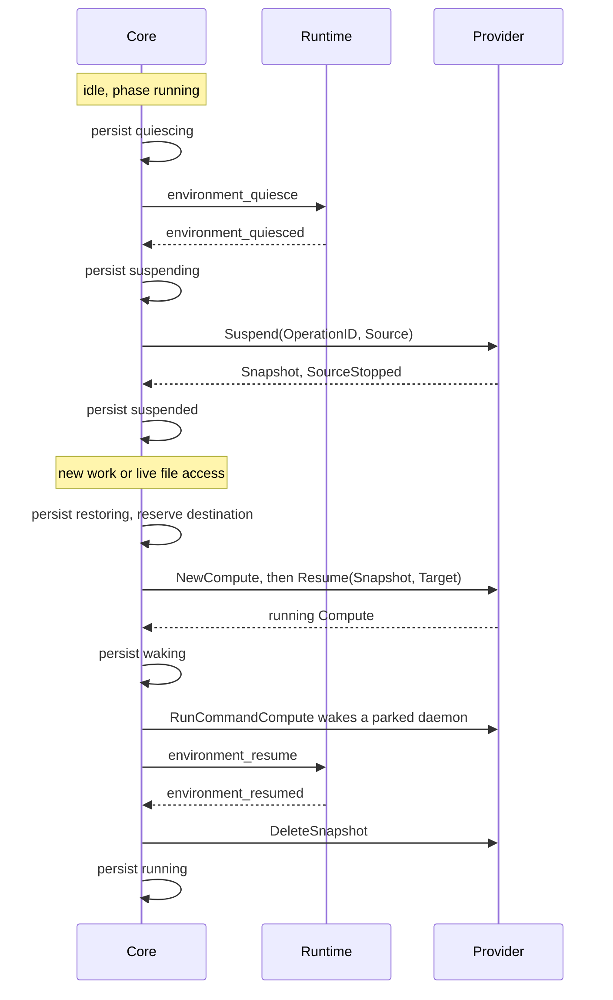

沙箱提供商协议连接 Core 与为 Core 管理的（`openai_hosted`）Environment 提供计算资源的 adapter，并由该 adapter 运行启动 Runtime daemon 的有界引导流程。本页面向 adapter 作者：说明提供商必须实现什么，以及可以依赖 Core 做什么。Docker、microsandbox 和 E2B 实现了该协议。

| | |
| --- | --- |
| 调用方 | Core 的 runtime manager 与 execution Worker |
| 实现 | Docker 和 microsandbox（node adapter），以及 E2B（direct adapter）；见[参考 adapter](#reference-adapters) |
| 代码 | `sandbox_provider.go` 中的 [`SandboxProvider`](https://github.com/MiniMax-AI/OpenAgentCore/blob/main/services/core/internal/sandbox/sandbox_provider.go)，以及 setup 阶段的 `ConfigurationAdapter` |
| 传输 | direct adapter 在进程内被调用。node adapter 运行在沙箱节点上，通过[沙箱节点协议](../../contracts/agents-api/zh/node-generation-protocol.md#provider-requests)接收同样的调用 |
| 版本规则 | 进程内接口没有 wire 版本。沙箱节点协议和各 helper 协议要求精确版本匹配 |

| 术语 | 含义 |
| --- | --- |
| Environment | Core 拥有的持久执行场所；参见 [Environment 与模板](../../contracts/agents-api/zh/environments.md) |
| Allocation | Core 为 Environment 拥有的一份计算资源租约，由 `Reference` 标识 |
| Deployment | 整个部署唯一的提供商选择；参见[沙箱部署](../../contracts/agents-api/zh/sandbox-deployment.md) |

## 实现提供商 {#implement-a-provider}

1. **阅读契约。** 实现每个方法，支持必需操作，并按[实现接口](#implement-the-interface)对其余每项操作声明决定。
2. **编写 adapter 包**，放在 `services/core/internal/sandbox/<kind>`：包括原生 SDK 调用、所有权检查、身份转换、私有配置，以及 node adapter 的 node-local 构造。声明 `var _ sandbox.SandboxProvider = (*YourAdapter)(nil)`。进程外 helper 放在 `services/core/tools/<kind>-provider`。
3. **注册 kind** 一次，遵循[注册提供商 kind](#register-the-provider-kind)。注册是明确构造，不是 init 时 plugin registry。
4. **标记所属资源**，使用 [Runtime 名称](https://github.com/MiniMax-AI/OpenAgentCore/blob/main/CONTRIBUTING.md#openagentcore-runtime-names)表中的提供商 ownership label，不接受旧 label 名称作为回退。
5. **运行契约套件** `make check-sandbox-provider-contract`；参见[一致性测试](#conformance)。
6. **对真实计算资源运行原生验收**，再运行 `make check`。
7. **在 adapter 旁编写文档**，参考[参考 adapter](#reference-adapters)。

## 角色 {#roles}

| 参与方 | 拥有 | 从不 |
| --- | --- | --- |
| Core | 持久 Environment、allocation、placement 和 cleanup 状态；lifecycle 串行化；创建、暂停、恢复或释放的每项决定 | 调用提供商声明为不支持的操作，或在离线 node、超时或空读取时释放 allocation |
| 沙箱提供商 | allocation 的计算资源、有界 Runtime 引导、原生身份与所有权检查，以及 Core 观察和清理所需的 receipt | 运行 Environment 初始化、Skill、Plugin、MCP 设置、初始文件、execution 或 Files，或凭裸原生 ID、名称或路径定位资源 |
| Runtime | 通过 [Core–Runtime 协议](runtime-protocol.md)准备能力并执行 Turn，身份由提供商通过 [Runtime 引导](runtime-bootstrap.md)文件交付 | 分配或销毁计算资源 |

隔离属于提供商基础设施，不属于 daemon；参见 [Runtime 与外层隔离](concepts.md#runtime-and-outer-isolation)。使用薄 adapter 封装厂商维护的 SDK。

## 实现接口 {#implement-the-interface}

`sandbox_provider.go` 包含 Core–沙箱提供商协议：负责 allocation、checkpoint 和观测的 `SandboxProvider` 接口及其请求与结果类型，以及 setup 阶段的 `ConfigurationAdapter` 及其类型化错误。Core 在此边界之外也使用的值类型，例如 `DeploymentSpec` 和 `CallFence`，位于同一 package 的独立文件中。每个方法在编译期都必须实现，`ProviderOperations()` 声明提供商支持哪些方法。以下五项操作始终支持：

| 操作 | 用途 |
| --- | --- |
| `Create` | 为 `Reference` 创建计算资源，并运行有界 daemon 引导 |
| `GetInfo` | 观察当前计算资源，不修改它 |
| `Renew` | 延长原生租约；backend 没有租约时仅观察 |
| `Kill` | 回收 allocation 的计算资源与保留资源 |
| `RunCommand` | 在 allocation 的计算资源中运行有界命令 |

Docker 等没有原生可续期租约的 backend 仍遵守 Core 的 hosted expiry 和 cleanup 要求。每个 adapter 都实现 `RunCommand`，测试也执行它，但 Core 编排不调用它；只有 node transport 转发。机密命令输入通过 `Command.Stdin` 传输，不放在参数或日志中；结果保留字节顺序、有界输出和实际退出状态。

`Bootstrap.Workspace` 和 `ResumeRequest.Workspace` 可携带外部工作区绑定；提供商对此的义务见[挂载](workspace-provider.md#attachment)。

### 明确的操作契约 {#explicit-operation-contracts}

每个提供商返回完整的 `ProviderOperations()` 声明，`SandboxProvider` 中除 `ProviderOperations` 本身外的每个方法各占一项。接口的方法集就是操作清单，`sandbox.ValidateOperations` 根据它检查声明。下表中的分组是协议文件中的列表，由测试保证它们与该方法集一致，因此新增方法必须加入其中一组。

| 操作 | 要求 | 职责 |
| --- | --- | --- |
| `Create`、`GetInfo`、`Renew`、`Kill`、`RunCommand` | 支持 | Allocation 生命周期与有界命令 |
| `Observe` | 明确决定 | 检查所有权、只读地观测一个 allocation |
| `Initial`、`NewCompute`、`GetCompute`、`Suspend`、`Resume`、`ResumeCompute`、`KillCompute`、`DeleteSnapshot`、`RunCommandCompute` | 所有 checkpoint 方法决定一致；仅 `nodes` 注册可以支持 | 精确计算实例、捕获与恢复、保留源恢复和清理 |

`Initial` 和 `NewCompute` 构造 compute reference，不分配资源；`ResumeCompute` 在暂停中止后仅解冻同一驻留实例；`RunCommandCompute` 在一个精确 compute incarnation 中运行有界命令。Core 使用 `RunCommandCompute` 在恢复后唤醒 parked daemon（[`runtime_compute_wake.go`](https://github.com/MiniMax-AI/OpenAgentCore/blob/main/services/core/internal/execution/runtime_compute_wake.go)）。

每个声明项为不带 reason 的 `state: supported`，或带 authored reason code 的 `state: unsupported`。缺失、零值、未知或不安全项都会验证失败。给 `SandboxProvider` 添加方法时，必须在每个 adapter 中明确决定并实现；不提供 base type，也不生成笼统的不支持实现。

不支持的方法在任何原生 I/O 前返回 `providercontract.UnsupportedError`。错误指明精确操作和安全 code，不包含原生消息、资源身份、endpoint 或凭据。空结果、nil error、`Unavailable` 或未知 mutation 结果都不能代替 unsupported，五项必需方法不能返回 unsupported。

每个 adapter 拥有一个 `Operations()` 函数，由实例和注册共享。`providers.ValidateBinding` 根据接口并相互对照检查两者，Runtime admission 与 node generation 加载也拒绝不完整提供商。调用方在调用操作前用 `providercontract.Require` 检查声明，从不使用 type assertion。

`Observe` 读取一个 allocation，不续期、启动、准备或停止计算资源；参见 [Runtime 可观测性](../../contracts/agents-api/zh/runtime-observability.md)。

契约测试在未配置原生 client 时调用每个声明不支持的方法，要求匹配错误和零值结果，并拒绝不完整或矛盾的声明。支持的行为仍需要原生和生命周期测试。

### 身份与资源所有权 {#identity-and-resource-ownership}

`Reference` 是精确的 `(TenantID, EnvironmentID, AllocationID)` 元组。Core 在 `Create` 前持久化新的 allocation ID；它不是 Environment ID。adapter 还将资源绑定到安装实例，不按裸原生 ID、display name、猜测路径或未验证 label 定位或授权资源。每次修改、读取和清理验证相同所有权。

Core 串行化生命周期操作，并在任何不确定 mutation 后保留 allocation，因此 adapter 必须保留足够的原生身份和回执供观测与清理。失败调用可以同时返回 `Info` 和 error：保留与 reference 绑定的结算证据，不把失败变成成功。冲突后不得悄悄创建替代资源、覆盖凭据或切换新 allocation。

`Info.ProviderID` 和 `Info.State` 描述计算资源。仅在有匹配 `Reference` 和原生身份时，Core 将计算资源视为 `running`；可以观察其他原生状态，但不声明就绪。`BootstrapComplete` 表示引导到达最终修改步骤。`CreateSettled` 证明原始尝试不能再修改资源，不表示成功：

- `State="absent"` 携带匹配 `Reference` 和 `CreateSettled=true`，是明确的创建不存在回执，不含原生 ID 或已完成引导。
- `ErrNotFound`、空列表、超时或单独成功的 `Kill` 都不能证明进行中的 Create 不会稍后出现。
- Core 也可以依据匹配的 running resource 和已完成 bootstrap 结算创建。取得此类证据或明确回执前，创建保持未知，即使清理尝试看不到资源。

Microsandbox 在返回创建不存在回执前永久关闭初始 Create 准入；其 [helper 协议](https://github.com/MiniMax-AI/OpenAgentCore/blob/main/services/core/tools/microsandbox-provider/README.md#create-and-bootstrap)定义持久化 allocation 锁屏障。普通 `GetCompute` 的不存在观察不关闭准入。

`Kill` 负责清理 allocation 的计算资源和保留资源，包括部分 bootstrap storage；名称冲突时不删除其他租户资源。Core 仅在确认清理和创建已结算后释放持久所有权。关闭 Executor 或取消 Harness 不删除 Environment、工作区或 allocation。

### 操作结果与重试 {#operation-outcomes-and-retries}

每次调用接收有界 context。到期或取消结束调用方等待，不证明回滚、停止、清理或不存在。adapter 或 transport 不得脱离跟踪执行 mutation，也不重放超时命令。

| 操作 | 已确认结果 | 失败或未知结果 | 恢复 |
| --- | --- | --- | --- |
| `Create` | 匹配计算资源与 bootstrap 证据；执行仍需要 Runtime preparation | 无效或外来配置被拒绝；重复返回 `ErrExists`；transport 失败可能隐藏已创建资源 | 观察原 `Reference`。不重放 `Create`，即使使用新凭据。保留部分资源用于所属清理 |
| `GetInfo` | 不修改的当前计算资源观测 | `ErrNotFound` 仅表示缺少观测；error 不是不存在的证明 | 重复有界读取；不将其变成 create、start 或 renew |
| `Renew` | 原生租约已延长，或无租约提供商的观测 | 超时可能隐藏延期；停止或缺失计算资源仍保持原样 | 先观察，再由 reconciler 续期同一 allocation。不复活计算资源或虚构 lease expiry |
| `Kill` | 所属计算资源与保留存储已移除；重复已确认不存在时成功 | error 保留所有权与清理意图；所有权不匹配不删除外来资源 | 未决创建或 mutation 已隔离后重试同一 `Reference` 的清理；不提前释放 owner |
| `RunCommand`, `RunCommandCompute` | 收集到输出和实际 exit code；非零退出是已结算命令失败 | 缺失原生完成为 `ErrCommandUnconfirmed`；部分输出不是成功 | 不重放。无法证明完成时保留 owner，并在复用前回收 |

`ErrInvalid`、`ErrOwnership`、`ErrExists`、`ErrNotFound`、`ErrComputeUnconfirmed` 和 `ErrCommandUnconfirmed` 保持其定义含义。未分类原生或 transport error 表示未知，不授权重试 mutation。Core 不将提供商 diagnostics 读作生命周期事实，也不暴露原生错误文本或凭据；node transport 将错误映射为固定 code，直接 SDK 细节保持私有。

Checkpoint 支持增加 `Compute` generation、name、ID 和 `SnapshotIdentity`；原样持久化 operation ID 与提供商 snapshot provenance。suspend 或 resume 的 `ObserveOnly` 仅观察上次尝试，不启动另一 capture 或 restore。`ResumeCompute` 仅解冻保留源，不冷启动已停止源。清理针对精确 compute incarnation 和 snapshot，不针对当前同名实例。只有所属节点已验证精确 incarnation 不再存在时，`GetCompute` 才返回 `ErrNotFound`；同名但 native ID 不同的实例为 `ErrOwnership`，节点或提供商不可达属于未知结果。`ComputeState.Status` 为 `stopped` 或 `crashed` 表示 adapter 已验证该精确 incarnation 的进程不再存在；其记录或磁盘可保留到 `KillCompute` 将其移除。`paused`、没有 Runtime 连接的 `running` 和未知状态均不证明进程已终止。声明 checkpoint 支持前阅读 [`runtime_compute.go`](https://github.com/MiniMax-AI/OpenAgentCore/blob/main/services/core/internal/execution/runtime_compute.go) 及其失败测试。

### 四个独立就绪事实 {#four-distinct-readiness-facts}

| 事实 | 证据 | 不证明 |
| --- | --- | --- |
| 计算资源可用 | 提供商对所属 allocation 的观测 | 已认证 Runtime 连接或已准备能力 |
| Runtime 已连接 | Gateway 认证和精确 Environment、device 绑定 | preparation 已完成或 Harness 可用 |
| 能力已准备 | 使用固定配置完成公共 Runtime preparation | Turn 已接受或完成 |
| 执行已准入 | 已验证 Harness 能力及 executor、Turn 接受路径 | 输入已完成、取消已完成或计算资源已回收 |

托管和自托管 Environment 使用相同 Runtime preparation；提供商不实现另一套竞争流程。

## 注册提供商 kind {#register-the-provider-kind}

`sandbox/providers/registry.go` 是唯一注册表。每项绑定 adapter 的 specification 与 resource validator、`sandbox.ConfigurationAdapter`、部署模式（`nodes` 或 `direct`）、`sandbox.DeploymentPolicy`（磁盘限制、Runtime 输入，以及 setup 推荐的默认大小）、operation 声明，以及 node-local（`BuildLocal`）或 direct（`BuildDirect`）constructor。`providers.Build` 和 `providers.BuildDirect` 构造 adapter，不分配计算资源。没有 init 时注册或 plugin 加载。

新提供商执行以下步骤：

1. 在 adapter 包中实现 operation 契约，并编写原生契约测试。
2. 添加 specification 和 resource validator。
3. 基于类型化原生配置实现 `sandbox.ConfigurationAdapter`。`DecodeInput` 严格解析请求中独立的公开 `configuration` 与只写 `credential` 对象。`Encode` 生成白名单公开 selector、只读观测和独立 secret bytes，不透传请求 JSON。`Decode` 恢复已存储 selector 并保留对所属资源的访问，不做远程 admission 或新模板验证。`Normalize` 修改前复制输入。`ResolveChange`、`Equal` 和 `WithCredential` 负责继承、身份与凭据组合。`Requirements` 声明是否需要凭据和公开 Core origin，以及支持哪些 setup 操作：`Discovery` 对应 `DiscoverConfiguration`，`SelectionDiscovery` 对应 `DiscoverSelection`，`CredentialVerification` 对应 `VerifyCredential`。`DiscoverConfiguration` 验证 query 并返回安全 catalog，不做 mutation 或 admission decision；Core 保留授权、输入限制与 deadline。`DiscoverSelection` 在提交前解析候选项省略的原生值，`VerifyCredential` 验证凭据对所属资源的访问，不修改资源。两者都接收候选项的 `sandbox.DirectConfig`，原生 client 只为该次调用构造。node 提供商仅接受空公开对象，拒绝凭据，对每项 setup 操作和 credential replacement 返回 Unsupported。
4. node adapter 从自己的包中导出 `BuildLocal` constructor、它解码的类型化 `native` 对象，以及它在共享 node artifact 之外添加的原生文件。node-local 设置（如主机路径）只存放在该对象中；resources 和 Runtime 版本从 node 配置的 `specification` 读取。
5. 在 `providers/registry.go` 中注册 constructor、policy、configuration adapter 和 operation 声明。其键即提供商 kind，也用于标记该提供商的观测；checkpoint 支持读取此项。生成的投影组合每个已注册的部署模式和 deployment policy 与 `sandbox/deployment_contract.go` 中的共享 field bound：installer 从 `deploy/node/node_spec.py` 读取，TypeScript 客户端和 Web 从 `packages/agents-client/src/deployment-contract.ts` 读取，因此 Web 读取这些声明，而不比较提供商 kind。通过 `go run ./services/core/cmd/specification-contract -write` 重新生成两者。
6. 提供 adapter 和 helper 的发行产物，通过已注册 configuration 契约把该提供商交付给运维人员。
7. Web 的 setup 步骤、部署摘要和客户端投影会指名每个提供商。在协议声明配置字段之前，把新提供商加入 `apps/web`。

node 配置 `sandbox.NodeConfig` 包含 `provider`、`generation`、`installation_id`、`core_url`、`specification`，以及 adapter 的不透明 `native` 对象。`providers.Build` 验证 `provider`、`generation`、`installation_id` 和 `specification`，并将配置与临时 `sandbox.LocalOptions` 传给 `BuildLocal`，由它严格解码 `native`。调用方通过 `Standalone` 明确选择独立注册或单提供商执行，或通过 `GenerationStateDirectory` 中的规范绝对 node state directory 选择 generation 拥有的执行。context 缺失或混合时拒绝。adapter 负责 generation 特有的原生 preparation 和 readiness 检查。Microsandbox 将 helper lease 绑定到安装实例、generation 和 specification digest，然后在平台、容量和 artifact readiness 后检查固定 image。

### 注册验证 {#registration-validation}

`providers.ValidateRegistration` 是唯一 wiring 检查。lookup、constructor binding 和生成的投影在任何 configuration callback 或 constructor 前运行它。未知提供商名称 保持为无效输入；格式错误的注册返回安全 `providercontract.ErrContract`，不包含提交的配置或原生诊断。

- `nodes` 注册仅有 `BuildLocal`，`direct` 注册仅有 `BuildDirect`；缺失、混合或未知 mode 被拒绝。
- specification 和 resource validator、configuration adapter 与完整 operation 声明都是必需项，因此不完整注册不能发布部分投影。声明的默认大小必须通过 adapter 的 resource validator。
- Runtime input policy 要么接受固定 Runtime，要么给出 adapter 拒绝它的固定原因，不能两者兼有。
- Checkpoint 仅准入 `nodes` 注册，因为公共 lifecycle 只暂停 node allocation；声明 checkpoint 的 `direct` 提供商会被注册拒绝。注册不携带 suspension 数值：Core 对每个声明 checkpoint 支持的提供商应用同一个 [suspension policy](#suspension)。

configuration adapter 必须非 nil，包括其具体值。每个 `ConfigurationRequirements` 字段都需要明确有效的决定：`Credential` 和 `PublicOrigin` 为 `Required` 或 `NotRequired`，`Discovery`、`SelectionDiscovery` 和 `CredentialVerification` 使用共享 supported 或 unsupported 声明并携带安全 reason。新增 requirement field 需要明确更新验证，不继承已有决定。要求凭据不承诺支持 `VerifyCredential` 操作。这些检查证明注册完整，不证明原生 SDK 行为正确；constructor 和 adapter 契约测试仍然适用。

### 配置存储与构造 {#configuration-storage-and-construction}

预览和持久化使用 `providers.Normalize` 与 `providers.Describe`。`providers.DiscoverSelection` 在提交前解析省略的原生值，持久化时再次验证完整 specification。`providers.ResolveChange` 负责配置继承，比较使用 normalized selector，使预览、重试和提交共享默认值。store 负责事务、凭据加密、generation fencing、资源所有权和通用对象存储：仅 adapter 解释 `provider_config` 与 `provider_metadata`，`provider_credential` 保存绑定到安装实例与 generation 的密文。保留 generation 保持原公开配置和 metadata，通过 adapter 组合当前凭据，因此替换凭据不重写保留 selector。数据库约束检查对象结构，不检查注册列表。

具有凭据的 direct adapter 在替换 key 前验证全部保留 generation 与 allocation reference。公共 `sandbox.CallFence` 排除原生调用并等待 helper 完成，包括调用方已超时的调用；execution 调用已准备的 verification 和 fencing callback，不按厂商分支。

厂商部署验证和 SDK setup 留在构造边界，构造不创建 Environment。node-local adapter 的 `sandbox.Built` 返回提供商、probe、installation identity、backend fingerprint 和 specification digest；helper 可能比调用方存活更久时，还返回 `Quiescent` 检查，generation 回收会等待它。factory 还返回 close 函数。`execution.RuntimeProvider` 将 adapter 绑定到 kind、installation ID、backend fingerprint、generation、mode 和 node ownership；选择由数据库负责，内存副本不构成另一权限来源。Docker 与 microsandbox 在 node 上运行，E2B 直接构造。node proxy 仅对注册声明支持 checkpoint 的 backend 暴露 checkpoint 操作，公共 lifecycle 通过 checkpoint 声明准入 suspension，不通过提供商名称。

backend fingerprint 标识原生资源命名空间，不表示容量。Core 保留部署 generation，使所属 allocation 继续解析到原 backend；不要将保留 allocation 重新指向替代 backend。

### 发行产物与进程路径 {#distribution-artifacts-and-process-paths}

每个 node adapter 注册负责其类型化 `NodeArtifacts` 声明，即共享 node artifact 加上其包导出的原生文件：逻辑发行路径、release filename suffix 和安装角色（`node`、`runtime`、`policy` 或 `image`）。注册拒绝缺失声明、不安全路径和未知角色。`go run ./services/core/cmd/provider-artifacts -write` 生成共享 Web catalog 和 Python projection。不带 `-write` 运行可检查是否最新。发行打包、Web availability 和 node 安装读取此投影；添加提供商 payload 不在这些消费者中增加按提供商名称的分支。

launcher 从[派生进程环境](configuration.md)提供 `sandbox.ProcessPaths`。Core 读取这些路径一次，并传给 direct construction 和 setup 操作。它们是固定发行属性，不是部署设置或用户可选 helper 路径。每个 adapter 解析自己的相对 helper 和 state 位置；E2B 使用 `e2b/oac-e2b-provider` 和 `e2b/`。root 缺失或不是绝对路径时，在执行 helper 前失败。提供商构造与发现不读取进程环境变量。

## Core 对提供商的保证 {#what-core-guarantees-to-a-provider}

adapter 不实现这些行为，但依赖它们。代码层面的机制见 [Core implementation constraints](https://github.com/MiniMax-AI/OpenAgentCore/blob/main/services/core/IMPLEMENTATION.md#hosted-sandboxes)。

- Core 在调用 `Create` 之前提交 allocation、其 daemon 凭据摘要和 Session 绑定。只有新的 allocation receipt 才允许 `Create`；重试和 Core 重启只观察同一个 `Reference`，不重放 `Create`，也不轮换凭据。
- 每个 node 有一个串行 lifecycle worker，同一 node 的调用从不并发；E2B allocation 共用一个 worker。某个 node 上卡住的提供商不会阻塞其他 node。
- Core 从不根据引擎或提供商名称推断引导完成；由 adapter 通过 `Info.BootstrapComplete` 声明。
- Core 只在撤销 device 权限、结清待处理 input 并请求取消之后才调用 `Kill`。临时提供商故障、未知的 `Create` 结果和已停止的计算资源都不证明永久失败。
- Core 只有在确认清理 allocation 的计算资源与 volume，并证明原始 `Create` 已结算后才释放 allocation。在此之前它保留清理归属，包括观察到资源不存在之后，有界扫描继续捕获迟到的资源，不再次 `Create`。公开删除 Session 之后同样适用。
- Core 从不在离线 node、超时或空读取时释放 allocation，也不对不[在线](../../contracts/agents-api/zh/node-generation-protocol.md#connection)的 node 执行 lifecycle 操作。保留的归属需要精确的提供商证据：socket 路径、实例缺失或空列表都不证明已清理，也不授权替代。
- Placement 是自动的，调用方不能选择 node。活动 allocation 即使离线也保留原 node。确认释放后，符合条件的保留 Session 可以再次预约兼容容量，包括在其他 node 上。释放 active 容量前必须确认 source 已拆除，未知操作保留其预约。等待、排序和 generation 选择由[部署契约](../../contracts/agents-api/zh/sandbox-deployment.md#generation-ownership-and-rollout)负责。
- 在 Turn 之间，Core 观察已连接的计算资源仍是其 Session 的 running allocation。该检查不改变任何状态。运行中的计算资源从不到期，没有[确认](#confirmed-compute-loss)的不可达、已停止或缺失实例不授权丢弃保留的工作区或历史，也不授权选择替代计算资源。
- Core 在一个[暂停策略](../../contracts/agents-api/zh/sandbox-deployment.md#suspension-policy)下，暂停每个声明 checkpoint 支持的提供商的空闲 allocation。
- 禁用提供商会停止新的托管准入和引导，但从不阻塞既有 Session 的取消、函数结果或 input 重试结果。

当 Session 被删除或归档、Environment 失败或到期，或管理员重置部署时，allocation 进入 `cleanup_pending`。`released` 要求 `CreateSettled`；参见[身份与资源所有权](#identity-and-resource-ownership)。

## 检查点生命周期 {#checkpoint-lifecycle}

声明了 checkpoint 操作（`Initial`、`NewCompute`、`GetCompute`、`Suspend`、`Resume`、`ResumeCompute`、`KillCompute`、`DeleteSnapshot`、`RunCommandCompute`）的提供商，使 Core 能把空闲 allocation 暂停为快照，并在同一或另一个兼容 node 上恢复。Core 记录 allocation 的 `compute_phase`；未声明 checkpoint 支持的提供商为 `disabled`，其余阶段按下图变化。删除、归档、重置和保留期到期会在完成[Core 对提供商的保证](#what-core-guarantees-to-a-provider)中描述的清理后，从任意阶段释放 allocation。

暂停与唤醒流程按下列顺序调用提供商。Core 在每个效果发生之前先持久化相应阶段。

### 暂停 {#suspension}

Core 在初始化完成、没有 root 或 Subagent Turn 处于排队、进行中或等待状态、没有待处理的 input 或文件操作，并且真实活动已空闲达到策略的空闲超时之后暂停 allocation。Session 不必运行过 Turn。存在兼容的等待需求时，容量压力可以在[超时与限制](#timeouts-and-limits)所列的无活动宽限期之后，提前暂停已经空闲的 node allocation。它从不打断活动 Turn，也不会在常规 quiesce、capture 和 source-stop 证明完成之前释放容量。如果暂停无法让容量可用，等待中的请求保留原有期限。

提供商依赖以下规则：

- Core 在效果发生之前持久化 quiesce、capture 和 restore 意图，只有新的 receipt 才执行 capture 或 restore。恢复流程用 `ObserveOnly` 观察精确的 attempt，从不重试结果未知的创建、capture 或 restore。
- 确认计划暂停之前，daemon 关闭准入，并排空原生 cleanup、输出 receipt 和文件工作。quiesce 确认丢失时可以通过 `ResumeCompute` 解冻同一 source，但不授权 capture。
- 排队工作和实时 Environment file access 唤醒 suspended Environment；history 和已发布 Artifact read 不唤醒。通过 `RunCommandCompute` 发送、受 PID 与 start-time fencing 的本地 control signal 唤醒 parked daemon，daemon 在准入工作前重新认证。
- 保留的检查点在原 node 仍具资格时优先恢复，也可以按[检查点转移](#checkpoint-transfer)在其他符合条件的 node 恢复。Core 负责 snapshot retention deadline，daemon 没有相应 timer。
- 已消费的 snapshot 从不让运行中的 generation 回滚。已消费的 artifact 和旧计算资源会被删除，因此多次暂停不会形成可写磁盘链。
- 删除、撤销和保留期到期优先于唤醒，直到最后的数据库 compare-and-swap。未知的清理身份一直保留，直到确认所属资源已不存在。

### 检查点转移 {#checkpoint-transfer}

支持检查点的 generation 报告 `CheckpointCompatibility`，包含不透明的 `ArtifactDomain` 与 `ExecutionClass` token。每个已验证 `SnapshotIdentity` 携带同样的资格。Core 只比较这些值，不解释 CPU 特性、文件系统路径或存储实现。恢复目标必须在线、对 allocation 的不可变 deployment generation 已就绪、两个 token 均匹配，并有 active 容量；跨 node 时还需 retained slot。allocation、Device 和 Session 身份保持不变。Session 与 deployment 事务先提交目标路由、placement 和精确 restore intent，再执行目标侧原生操作。没有容量或兼容目标时，保留快照的所有权一直持续到配置期限。目标必须已持有该精确 generation；Core 不会在新节点自动准备历史 generation。升级期间应保留符合条件的节点及其 generation 提供商，直到检查点保留义务结束。

`Suspend` 只有在持久发布已验证的完整归档、停止精确 source compute，并结清 source 本地 capture 与 cleanup 义务后，才能报告 `SourceStopped`。Core 先持久化快照，再标记 suspended；仅原生资源不存在并不足够。`Suspend.ObserveOnly` 可以为同一 operation 已验证的快照完成归档发布和源清理，但不能重新捕获快照，也不能停止已经恢复 running 的源。此前已发布的归档缺失或损坏时，`ObserveOnly` 可以返回其精确持久 ownership receipt，标记 `Status: unknown` 和 `SourceStopped: false`，供清理使用；该 receipt 不证明归档当前可用，也不证明源不存在。`Resume` 仍在执行前验证归档。完成源结清屏障后，source node 不可用不再阻止恢复。删除和正常到期可以将空闲 suspended allocation 的清理路由转给同一 artifact domain 内的在线 node；删除不要求 execution class 匹配。清理目标必须已提供同一不可变 generation，且有 retained 容量。没有这样的 node 时，清理保持 pending，不释放所有权；运维需恢复符合条件的 node 或其容量。未知 running 或 restoring writer 不会仅因 node 不可达而迁移。

恢复用 `Resume.ObserveOnly` 观察已持久化的 target 与 operation。`RestoreAttemptClosed` 是精确 operation ID，不是通用 absence 标志：adapter 只有在持久关闭从未进入原生执行的 attempt，并隔离该 ID 的所有迟到请求后才能返回。如果 adapter 能证明当前调用在派发原生恢复之前失败，也可以关闭已持久 admitted 的 attempt。microsandbox adapter 仅在 fresh 请求的 wire deadline 于原生派发之前到期时执行这种关闭；归档损坏、资格错误和不透明 SDK 失败都不授权自动重试。Core 随后先持久化新的 operation ID，再尝试执行。一旦已派发原生恢复，结果未知的 attempt 保留相同 target、所有权与原始 retention deadline；原生列表缺失、helper 死亡或超时都不授权重放。这种恢复可能一直不可用，直到显式删除或正常保留期到期；等待中的 input 可能达到其公共 deadline。用户删除仍需精确原生 settlement，之后才能释放资源与所有权。

microsandbox adapter 要求显式的私有 `checkpoint_root`，位于所有 guest 可访问文件系统之外。目录权限为 `0700`，私有 namespace marker 标识真实归档存储。默认安装创建 node 本地私有 store。跨 node 恢复要求运维为参与 node 挂载同一个私有 store，挂载路径可以不同。Runtime state 目录与 workspace binding 都不用于推导该 root。adapter 在恢复前再次验证归档、外部文件系统身份和原生 execution class。恢复 RAM 与文件描述符不保证外部 TCP 连接连续，也不保证应用副作用可安全重放。

### 检查点保留期后的冷替换 {#cold-replacement-after-checkpoint-retention}

快照保留期限制计算资源，不限制符合条件的保留 Session 的生命周期。到期后，只有独立文件系统对象已就绪、初始化已完成、Session 与 Environment 均未终结，且此前已认证 Runtime 的 `retained_native_history` 声明已持久化时，Core 才能在不终结 Session 的情况下清理 allocation。能力及原生恢复义务由 [Core–Runtime 协议](runtime-protocol.md)定义。仅保留文件系统并不足够。

容量压力不会缩短检查点保留期。在配置的期限到达前，已挂起的 allocation 保留快照并继续占用 retained slot；容量不足或节点不兼容不允许降级为冷替换。等待请求保持原有的输入期限。保留期到期后，常规 expiry cleanup 必须确认资源已删除，其他 allocation 才能预留该 slot；文件与已验证的原生历史继续保留。

Core 在释放 allocation 和 placement 归属前，确认原始创建已结算且所属计算资源与快照均已清理。替代计算资源准入前撤销旧 device 的权限。Create、Kill 或 DeleteSnapshot 的结果尚未确认时，Core 保留归属，不准入替代写入方。可恢复的 Session 与 Environment 保持断连，保留同一文件系统对象和初始化结果。归档、重置和删除优先，唤醒请求不能撤销它们。

新 input 或实时 Environment 文件访问会在兼容 node 上预约新 allocation，并引导新的 Runtime device。准备流程复用同一文件系统和已完成的初始化，不重放初始化。验证替代 Runtime 的声明后，执行从保留历史续接同一原生 Session。原生历史缺失或无效时明确失败；Core 不替换为新的原生 Session，也不重放已完成的 input。读取历史和已发布 Artifact 不预约计算资源。此路径不保留 VM 内存、后台进程或开放连接，也不为未声明能力的 Runtime、Harness 或文件系统组合提供资格。它同样不提供 node 级 drain、从不可达写入方 failover、并发写入方、多活 Core、自动扩缩容或快照复制。

### 已确认的计算资源丢失 {#confirmed-compute-loss}

正在运行的计算资源没有保留期限，因此主机崩溃或重启后，其 allocation 原本会无限期保持归属。所属节点重新上线后，对于计算阶段为 `running` 且支持检查点的 allocation，只有同时满足以下条件时，`GetCompute` 对已持久化的精确 incarnation 返回 `ErrNotFound` 或已验证的 `stopped`、`crashed` 状态才会释放该 allocation：原始创建已结算，该 incarnation 有 native ID，未记录 capture、restore 或 rollback 意图，allocation 的 device 没有已认证的 Runtime 连接，且 Session 满足[冷替换](#cold-replacement-after-checkpoint-retention)条件。随后 Core 对该精确 incarnation 调用 `KillCompute`。只有其结果得到确认，才允许一次持有 Session 锁的提交：重新检查计算 revision 与上述条件，撤销 device，并释放 allocation 和 placement。Session、Environment、等待中的 input、原生 Session 身份和文件系统均保留，新 input 或实时文件访问按冷替换续接。

其他观察结果均保留归属及其诊断：`paused`、`running` 或未知原生状态、身份不匹配、超时或传输错误、未知创建、已记录的 restore、存在 Runtime 实时连接、自带工作区存储、初始化未完成、Session 已终结，或缺少 `retained_native_history` 声明。`KillCompute` 失败时不做任何修改，并发的归档、删除或计算阶段变更优先。节点离线时 Core 从不执行此操作，因为没有节点就无权停止计算资源。续接保留文件系统并使用已记录的原生 Session ID；Harness 恢复出错时执行失败，不创建另一个原生 Session。Core 不重放已中断或已完成的输入。[OpenAI 兼容性](../../contracts/agents-api/zh/index.md)记录已通过资格验证的续接场景，包括完成确认后立即崩溃。任意崩溃受损原生历史的完整性仍未通过资格验证；身份检查无法检测已截断但仍可解析的历史尾部。

## 超时与限制 {#timeouts-and-limits}

| 值 | 适用于 | 到期或超出时 |
| --- | --- | --- |
| 有界 context | 每个提供商调用 | 结束调用方的等待，不证明已回滚、停止、清理或不存在。adapter 从不分离未跟踪的 mutation，也不重放已超时的命令 |
| 空闲超时与快照保留期 | 支持检查点的 allocation，由[暂停策略](../../contracts/agents-api/zh/sandbox-deployment.md#suspension-policy)设定 | 空闲超时到达时 Core 开始[暂停](#suspension)。保留期结束时 Core 清理快照，并对符合条件的 Session 通过[冷替换](#cold-replacement-after-checkpoint-retention)替换计算资源 |
| 15 s | 空闲 node allocation 在容量压力暂停之前的无活动时间 | 存在兼容的等待需求时，Core 可以早于空闲超时暂停它 |
| 50 MiB 加 32 字节（`MaxCommandInputBytes`） | `Command.Stdin` | 命令无效 |

在线窗口和其他节点计时器见[沙箱节点协议](../../contracts/agents-api/zh/node-generation-protocol.md#timeouts-and-limits)。

## 一致性测试 {#conformance}

installer 与 Go adapter 的 E2B 模板和 endpoint validator 消费共享 [selector fixture](https://github.com/MiniMax-AI/OpenAgentCore/blob/main/services/core/internal/sandbox/e2b/testdata/configuration-selectors.json)。任何验证修改都扩展这些 case，使两处入口接受相同 selector。

开发时运行 `make check-sandbox-provider-contract`。它通过真实 adapter 边界和受控原生失败运行共享 [`contracttest`](https://github.com/MiniMax-AI/OpenAgentCore/tree/main/services/core/internal/sandbox/contracttest) 套件，以及 adapter 和 node transport 测试；`make check` 包含相同 package。使用 native-side fixture 调用公开 failure runner，不使用假的 `SandboxProvider`，保留外来 ownership、未知 mutation result、cancellation、不自动 replay、failed cleanup 和 reference-bound settlement 测试。

node 测试单独覆盖 disconnect、reconnect fencing，以及 Create response 丢失后的 cleanup。helper protocol 和 [sandbox node 协议](../../contracts/agents-api/zh/node-generation-protocol.md)要求精确版本匹配；直接进程内接口没有独立 wire version。

原生验收证明 fixture 无法证明的事实：creation、lease 行为、所属 partial cleanup、声明的 isolation 与 limit，以及支持时的 snapshot。显式启用的 Docker lifecycle 和 recovery 测试使用 `AGENTS_RUNTIME_DOCKER_TEST_IMAGE`；SDK helper 使用 `make check-e2b-provider` 和 `make check-microsandbox-provider`。mock compute 不能证明 reclamation 或 isolation。

## 参考 adapter {#reference-adapters}

| Kind | Adapter | Helper 与 adapter 规则 | 运维指南 |
| --- | --- | --- | --- |
| Docker (node) | [`sandbox/docker`](https://github.com/MiniMax-AI/OpenAgentCore/tree/main/services/core/internal/sandbox/docker) | [`sandbox/node`](https://github.com/MiniMax-AI/OpenAgentCore/tree/main/services/core/internal/sandbox/node) 中的 node proxy | [Docker adapter](#docker-adapter) |
| microsandbox (node) | [`sandbox/microsandbox`](https://github.com/MiniMax-AI/OpenAgentCore/tree/main/services/core/internal/sandbox/microsandbox) | [`tools/microsandbox-provider`](https://github.com/MiniMax-AI/OpenAgentCore/blob/main/services/core/tools/microsandbox-provider/README.md) | [Node](getting-started/nodes.md) |
| E2B (direct) | [`sandbox/e2b`](https://github.com/MiniMax-AI/OpenAgentCore/tree/main/services/core/internal/sandbox/e2b) | [`tools/e2b-provider`](https://github.com/MiniMax-AI/OpenAgentCore/blob/main/services/core/tools/e2b-provider/README.md) | [沙箱部署](../../contracts/agents-api/zh/sandbox-deployment.md#e2b-configuration)；应用管理的模板见 [`deploy/e2b`](https://github.com/MiniMax-AI/OpenAgentCore/blob/main/services/core/deploy/e2b/README.md) |

## Docker adapter {#docker-adapter}

Docker 沙箱提供商（[`sandbox/docker`](https://github.com/MiniMax-AI/OpenAgentCore/tree/main/services/core/internal/sandbox/docker)）对所有 Runtime image 使用相同 container setting，无论服务哪个 Harness（[`container_options.go`](https://github.com/MiniMax-AI/OpenAgentCore/blob/main/services/core/internal/sandbox/docker/container_options.go)）：

- user 1000:1000、只读 root filesystem、移除全部 capability、`no-new-privileges`、[seccomp profile](#seccomp-profile) 和 AppArmor `unconfined`；
- node 配置的 network 和 extra host（[node 配置](configuration.md#docker-node-configuration)）；
- deployment specification 中的 CPU 和 memory，128-process limit 和 128 MiB `/tmp` tmpfs；
- 两个 named volume，label 包含 installation、tenant、Environment 和 allocation：`<name>-home` 挂载到 `/home`，`<name>-environment` 挂载到 `/environment`，后者的 `workspace` 子目录也挂载到 `/workspace`。Docker Engine 必须支持 volume subpath mount；
- 配置 `nested_sandbox` option 时，解除 Docker `/proc` mask（`/sys/firmware` 和 `/sys/devices/virtual/powercap` 保持 mask），container 运行 init process。

Create 拒绝复用没有 container 的保留 volume。它将 [Runtime 引导](runtime-bootstrap.md)文件复制到 `/home/runtime/runtime-bootstrap.json`（mode 0600、UID 1000），并将 `/environment` workspace、staging、initialization 和 package directory 放入 container，然后启动 `oac-daemon connect --profile default --bootstrap-file /home/runtime/runtime-bootstrap.json`。创建的 container 不具备配置的 CPU、memory 和精确 image 时，Create 返回 error 和 `CreateSettled`。Docker 没有 lease，因此 Renew 仅读取 container state。Kill 在删除前检查 container 和两个 volume 的 ownership label，再确认三者都已不存在。

node 使用 [提供商配置](configuration.md#docker-node-configuration)中的明确 Unix socket，忽略 `DOCKER_HOST`。不将 Docker socket、host home 或 Core credential 挂载进 Runtime。

### Seccomp profile {#seccomp-profile}

[`seccomp.json`](https://github.com/MiniMax-AI/OpenAgentCore/blob/main/services/core/deploy/codex/seccomp.json) 是 [revision 65adc7e](https://github.com/moby/profiles/blob/65adc7e022c97f55e45c054ff012988027733b87/seccomp/default.json) 的 Moby default profile（Apache-2.0，参见 [seccomp.LICENSE](https://github.com/MiniMax-AI/OpenAgentCore/blob/main/services/core/deploy/codex/seccomp.LICENSE)；上游文件 SHA-256 为 `785b2429264afba4d594320337cb17f144f3c7d51585f9805eef72e28f4f9334`），追加一条允许 `clone`、`unshare`、`setns`、`mount`、`umount2` 和 `pivot_root` 的规则。发行包将此文件作为 `runtime/seccomp.json` 交付每个 Docker node。
