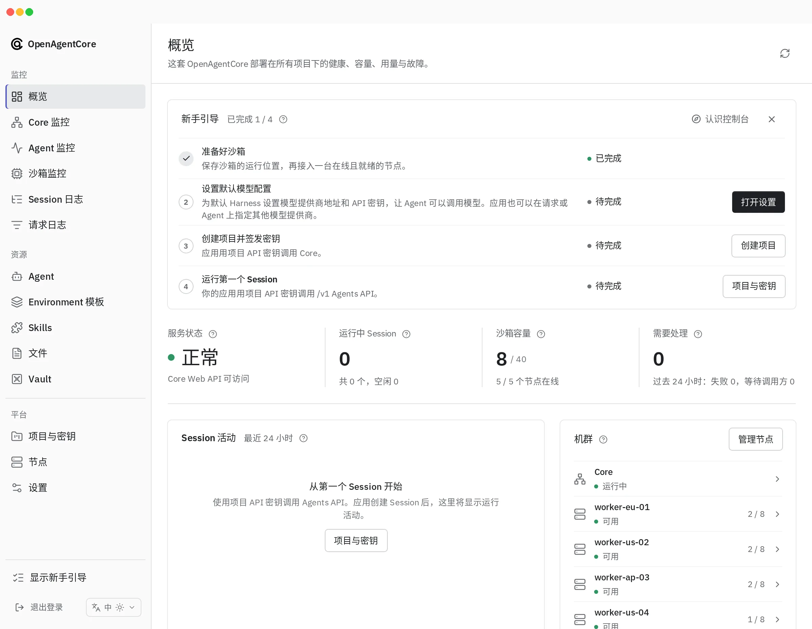
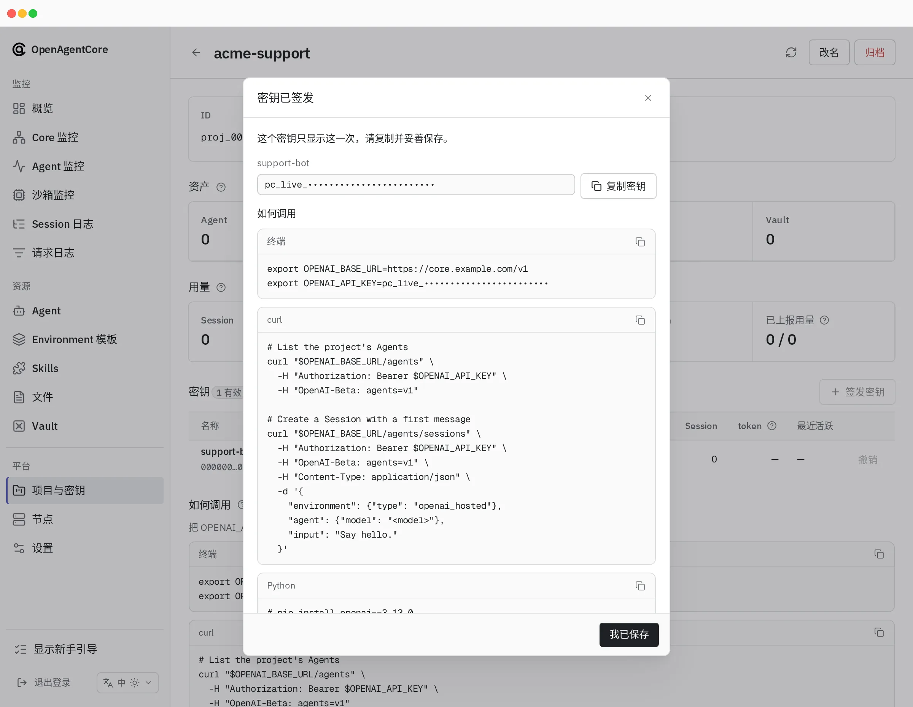
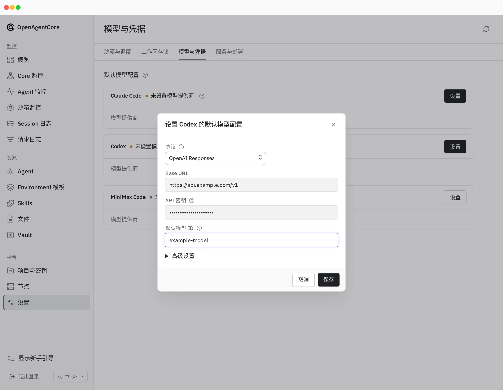
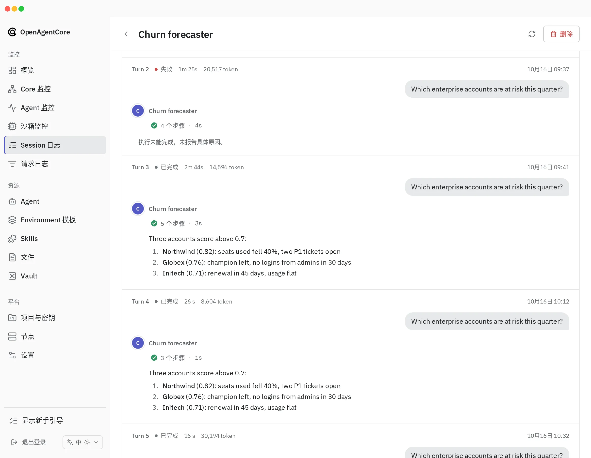
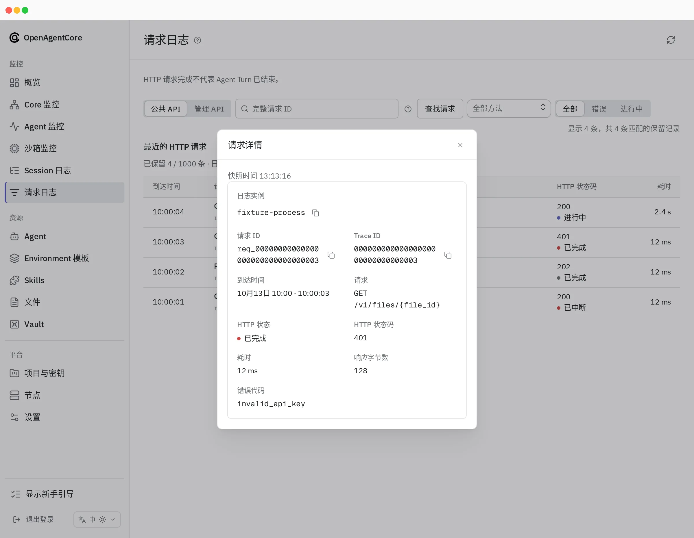

Web 是 OpenAgentCore 安装的管理员控制台：运维人员用 Core 密钥登录，查看健康状态和用量，检查应用创建的内容，并管理项目、密钥、节点和设置。应用使用项目 API 密钥调用 `/v1`，不使用 Web。

## 登录 {#sign-in}

使用部署的 [Core 密钥](../getting-started/operations.md#core-key)[登录](../getting-started/install.md#sign-in-to-web)；控制台没有用户账号。浏览器只保留会话 cookie，[控制台服务器](console-server.md)代它向 Core 发送 Core 密钥；[登录](console-server.md#sign-in)说明会话有效期。

登录后打开 **概览**。仍有未完成步骤时，**新手引导** 清单引导完成四步，顺序不限：沙箱就绪、默认模型提供商、具有活动密钥的项目、首个 Session。可从清单启动可选的控制台导览。

## 控制台页面 {#console-pages}

| 分组 | 页面 | 用途 |
| --- | --- | --- |
| 监控 | 概览 | 服务状态、运行中的 Session、**沙箱容量**和待处理工作；24 小时 Session 活动；以拓扑展示 Core 与节点，各自打开对应页面；需要处理：过去 24 小时内活跃的失败或等待调用方的 Session，每行附一行原因；按项目统计的用量 |
| 监控 | Core 监控 | Core 能否运行 Turn：执行槽位、Turn 队列及其 p95 等待时间、被中断的 Turn、已连接守护进程、数据库延迟、CPU 与常驻内存及其限制、后台任务；Go 堆、goroutine 和数据库连接池位于 **诊断** |
| 监控 | Agent 监控 | 1 小时、6 小时、24 小时或 7 天的请求、错误、耗时、token、模型、工具、Agent 和 API 密钥 |
| 监控 | 沙箱监控 | 各项目托管 Runtime 随时间的变化，显示活跃数量与总数，以及各自的状态（活跃、已挂起、切换中、等待分配或已停止）和 CPU、内存观测；E2B 部署还显示 Core 在 E2B 云中持有的沙箱 |
| 监控 | 请求日志 | 到达 Core 的近期 HTTP 请求、状态、耗时和安全错误码；[范围及保留方式](../../../contracts/agents-api/zh/admin-api.md#request-log) |
| 监控 | Session 日志 | 全部 Session；各 Session 的只读对话、跟踪、Turn、失败分类原因及下一步操作；自托管 Session 页面还管理执行器凭据并提供主机连接命令 |
| 资源 | Agent、Environment 模板、Skills、文件、Vault | 检查和允许的删除操作，显示各资源所属项目及创建密钥 |
| 平台 | 项目与密钥 | 创建、重命名和归档项目；签发与撤销密钥；各项目的用量、写入历史和 API 调用方法 |
| 平台 | 节点 | 添加、编辑和移除 microsandbox 或 Docker 节点；各节点的就绪状态、活跃与保留上限、主机 CPU 与内存及其历史、可用磁盘，以及分配及其在各计算阶段的已用时间 |
| 平台 | 设置 | **沙箱与调度**、**工作区存储**、**模型与凭据** 和 **服务与部署**；参阅[配置](../configuration.md#runtime-settings-web) |

缺失数据展示为缺失（—），不会当作零。[控制台 API 使用](console-api-usage.md)列出各页面读取内容及统计边界。

## 管理员在此执行的任务 {#what-administrators-do-here}

| 任务 | 位置 |
| --- | --- |
| 选择沙箱提供商（microsandbox、E2B 或 Docker）、规格和 Runtime，或重置沙箱提供商 | **设置 → 沙箱与调度**；参阅[修改沙箱配置](../getting-started/nodes.md#change-the-sandbox-configuration) |
| 添加、调整或移除执行节点 | **节点**：**添加节点**、**编辑节点** 和移除；参阅[添加和管理节点](../getting-started/nodes.md) |
| 设置 Harness 默认模型 | **设置 → 模型与凭据**；参阅[默认模型](../configuration.md#default-models) |
| 创建项目并签发 API 密钥 | **项目与密钥**；参阅 [项目和 API 密钥](../getting-started/operations.md#projects-and-api-keys) |
| 签发、轮换或撤销自托管执行器凭据，或复制安装命令 | **Session 日志** 中的 Session 页面；参阅[运行自托管 Session](../getting-started/self-hosted.md) |
| 删除资源，例如泄露的 Credential | 资源列表行或资源页面；文件从 **文件** 列表删除。适用公开删除规则 |

Web 观察并管理安装。它从不启动 Session，也不发送输入；只有应用调用 `/v1` 时 Agent 才会运行。归档托管 Session 会请求取消并回收沙箱。[概念](../concepts.md#what-administrators-can-and-cannot-do)定义了管理员能做什么。

新项目密钥只显示一次，并附带使用它的调用示例：

每个 Harness 的默认模型在 **设置 → 模型与凭据** 中设置：

部署的沙箱提供商服务托管 Session。应用的 `self_hosted` Runtime（包括它自己 E2B 账号中的 Runtime）是独立路径，修改沙箱配置不会影响它。

回环公开地址（`local_only`）使节点和远程应用无法访问 Core。控制台仍可通过自己的地址访问，并[展示警告](console-api-usage.md#provenance-and-monitoring)。

## 诊断故障 {#diagnose-a-failure}

**Session 日志** 展示失败的 Turn 及其分类原因和下一步；[Session 诊断](../../../contracts/agents-api/zh/session-diagnostics.md)定义各个类别。**请求日志** 展示 HTTP 一侧的情况，例如状态为 401 的被拒请求。

## 更多 {#more}

- [控制台服务器](console-server.md)：请求边界、登录、设置和验证。
- [控制台 API 使用](console-api-usage.md)：各页面使用的 Core 路由。
- [Web 包](https://github.com/MiniMax-AI/OpenAgentCore/blob/main/apps/web/README.md)：开发控制台。
- [Core 管理 API](../../../contracts/agents-api/zh/admin-api.md)：控制台背后的 `/core/v1` 路由。
