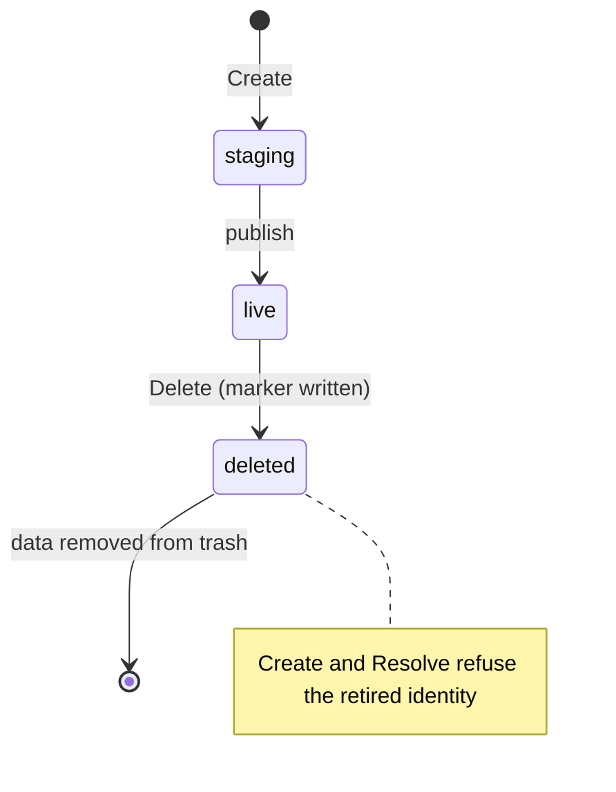

工作区文件系统协议连接 Core 和沙箱节点与拥有 Environment 持久存储的适配器。Core 创建、观察和删除存储对象；节点将对象解析为主机目录，由其[沙箱提供商协议](sandbox-provider.md)挂载到计算资源。本文面向文件系统适配器和沙箱提供商的作者。

| | |
| --- | --- |
| 调用方 | Core（`Control`）和沙箱节点（`Resolver`） |
| 实现 | 内核 NFS 适配器（`nfs`），注册于 `services/core/internal/workspacefs/providers` |
| 代码 | [`workspacefs.go`](https://github.com/MiniMax-AI/OpenAgentCore/blob/main/services/core/internal/workspacefs/workspacefs.go) |
| 传输 | 进程内 Go 接口；`Binding` 通过 `Create` 引导和 `Resume` 请求经[沙箱节点协议](../../contracts/agents-api/zh/node-generation-protocol.md#provider-requests)传递 |

Core 在分配任一资源前，选择并验证沙箱提供商与文件系统适配器的组合。

| 沙箱提供商 | 外部工作区存储 |
| --- | --- |
| microsandbox | 支持（`host_directory`、`user_xattr`） |
| Docker、E2B | 不支持；使用提供商自有的 Environment 磁盘 |

## 实现适配器 {#implement-an-adapter}

1. 定义 `Parameters` 和可选凭据，并实现 `Normalize`（[标识与配置](#identity-and-configuration)）。
2. 在 `Control` 中实现 `Declaration`、`Check`、`Create`、`Observe` 和 `Delete`，在 `Resolver` 中实现 `Resolve`（[操作与结果](#operations-and-outcomes)）。
3. 声明挂载类型、用户扩展属性支持和配额强制执行（[能力验证](#capability-validation)）。
4. 每个对象保持单一写入方，仅在 Core 授权时删除（[生命周期与文件系统范围](#lifetime-and-filesystem-scope)）。

## 角色 {#roles}

| 参与方 | 负责 |
| --- | --- |
| Core | 标识、持久化的 `Reference`、配置和凭据、已准入容量、生命周期顺序以及每个删除决定 |
| 文件系统适配器 | 原生存储对象及其回执、原生归属检查和路径解析 |
| 沙箱提供商 | 计算资源，以及将解析出的目录挂载到计算资源 |

## 标识与配置 {#identity-and-configuration}

`Reference` 包含 `TenantID`、`EnvironmentID` 和 `ObjectID`，均为不可变、规范小写且非零的 UUID。Core 在创建前持久化引用。对象标识永不复用，包括删除后或变更结果尚未确认时。适配器必须在暴露或删除对象前验证完整的归属元组。

`Configuration` 是 Core 数据库中的不可变记录，具有规范 UUID `ID`、`Adapter` 标识和由适配器定义的 JSON 对象 `Parameters`。数据库是其唯一编写来源；更改配置须创建新的标识。Core 转发参数而不解释原生路径。现有对象始终绑定其原始配置。参数是公开的：会发送到节点并出现在管理员响应中。

`ConfigurationRecord` 在配置之上增加由适配器编码的私有 `Credential`；参数不需要凭据时为空。凭据属于不可变配置。Core 使用安装的凭据加密密钥对其加密，并绑定安装 ID 与配置 ID，仅在 Core 中构造 `Control` 时解密。凭据绝不出现在 `Binding`、管理员响应、审计记录或日志中，节点也绝不会收到它。

`Attachment` 将适配器签发的 JSON 对象 `Native` 绑定到完整引用、配置 ID 和挂载类型。它是内部归属凭据，不是应用提供的主机路径。共享验证检查信封结构以及预期引用和配置的匹配；所选适配器还必须验证参数、凭据及原生归属。结构有效本身绝不授权文件系统访问。公开 Session 载荷不得提供挂载凭据、配置参数或解析后的主机目录。

`Binding` 临时携带配置和挂载凭据至节点解析器，不引入第二份持久化节点配置。`Resolver.Resolve` 验证绑定后返回用于本地计算挂载的 `Directory{Path}`。仅适配器负责将原生存储解析为规范绝对路径；Core 不构造路径。结构有效的目录本身不是归属凭据。

## 操作与结果 {#operations-and-outcomes}

适配器注册一个 `Adapter` 实现，其三个角色相互独立且均为必需。`Normalize(parameters, credential)` 在不执行 I/O 的情况下验证并规范化参数、编码凭据输入；缺少必需凭据或提供参数不使用的凭据均为 `ErrInvalid`；编码后的凭据是有效输入且编码结果不变，因此 Core 可以使用已存储的凭据重新选择保留的配置。`Control(ConfigurationRecord)` 在 Core 中使用解密后的凭据构造控制适配器。`Resolver(Configuration)` 仅根据公开配置构造节点解析器。构造过程不执行文件系统或网络操作。

每个控制适配器实现 `Declaration`、`Check`、`Create`、`Observe` 和 `Delete`；每个节点挂载适配器实现 `Resolve`。不得使用可选旁路接口、隐式替换适配器或 nil 实现回退。

| 操作 | 必需语义 |
| --- | --- |
| `Declaration()` | 描述所选配置已经验证的挂载、用户扩展属性和配额行为。 |
| `Check(ctx)` | 验证配置和可用性，不创建对象。 |
| `Create(ctx, reference, capacityMiB)` | 创建归属对象或收敛到其现有挂载凭据，不覆盖数据；重试与并发调用使用同一不可变引用和获准容量。正容量须在成功返回前实际强制执行，并在每次重试时重新验证。 |
| `Observe(ctx, reference)` | 返回现有对象的绑定挂载凭据，不创建、修复或准备对象。 |
| `Delete(ctx, reference)` | Core 授权删除且确认计算资源停止后，收敛到已验证归属对象的终态删除。 |
| `Resolve(ctx, binding)` | 验证原生归属并为本地计算解析挂载。 |

错误支持 `errors.Is`。适配器包装错误时保留这些结果。

| 错误 | 条件 |
| --- | --- |
| `ErrInvalid` | 无效输入 |
| `ErrOwnership` | 引用或配置不匹配 |
| `ErrUnavailable` | 存储不可用 |
| `ErrUnconfirmed` | 变更结果未知 |
| `ErrNotFound` | 对象不存在 |
| `ErrUnsupported` | 不支持的组合 |

观察到不存在不证明先前变更已结束。超时或上下文取消只结束调用方的等待，不证明原生操作停止或回滚。结果未知时 Core 保留归属。Core 可以使用同一持久化不可变引用和配置重试 `Create` 或 `Delete`，包括收到 `ErrUnconfirmed` 后；绝不能通过替换新对象标识重试结果不确定的操作。

同一引用的重试与并发收敛是适配器必须提供的保证。`Create` 保留现有对象数据并返回该归属对象的挂载凭据，绝不重新初始化存活对象。重复或并发的 `Delete` 调用收敛到同一终态删除。一旦记录终态删除，并发、延迟或重试的 `Create` 均不得使对象复活，`Resolve` 也不得暴露该对象。允许保留删除元数据，并在先前进行中的操作结束后继续清理。这些保证适用于存储生命周期操作，不表示超时时变更已结束，也不提供分布式计算隔离。

## 能力验证 {#capability-validation}

`Requirements` 声明计算位置的挂载类型及 `user_xattr` 需求。`Declaration` 报告文件系统适配器的挂载类型、`UserXAttr` 支持和 `CapacityQuota` 强制执行能力。`ValidateCombination` 是共享的分配前准入检查。当前挂载类型为 `host_directory`；未知类型会被拒绝。用户扩展属性能力表示挂载后的文件系统支持 Environment 准备流程使用的用户扩展属性。

请求容量为零表示未请求配额。以 MiB 为单位的正容量仅在适配器实际强制执行该限制时获准；报告可用空间或接受未经检查的数字均不足够。`CapacityQuota` 表示适配器为每个以正容量创建的对象设定上限：限制对象已分配的字节（包括目录和元数据块）及其 inode 数量，而非文件的逻辑大小。超出上限的写入在 write 或 fsync 时报错，不会截断任何内容。适配器不能仅根据沙箱提供商的计算磁盘大小声明配额支持。容量上限不提供任何 I/O 公平性。

容量按对象准入。对于新绑定，Core 在绑定前根据部署请求验证所选配置的能力声明；随后若其他配置在此期间被选中，绑定事务以可重试的冲突拒绝。Core 将获准容量与引用一同持久化，并原样传给每次 `Create`。保留的绑定按其自身配置和获准容量验证，因此更改部署请求或选择不会调整现有存储的大小，也不会重新绑定。

设置[租户容量策略](configuration.md#tenant-capacity)后，新绑定还须按租户已承诺容量准入：即该租户所有尚未确认删除的工作区的获准容量之和，跨所有配置计算。创建中、失败或结果未确认以及删除中的工作区，在适配器确认删除前均计入。没有获准容量的保留工作区视为无上限，在其被删除前阻止该租户的进一步准入。在该策略下，未请求容量的请求不受支持；会超出策略的请求在分配任何存储或计算资源前以不可用失败。既有绑定绝不重新准入，调低策略也不会驱逐任何对象。

工作区仅允许单写入方访问。Core 必须串行管理计算资源归属，并在挂载替代计算资源前确认先前写入方已停止。本协议没有跨虚拟机锁能力：客户机内的 `flock` 不证明主机锁或对其他客户机的互斥。执行位置不得基于客户机本地锁宣称并发挂载安全。

## 生命周期与文件系统范围 {#lifetime-and-filesystem-scope}

对象包含整个 `/environment` 目录树，包括工作区、暂存文件、初始化状态、包内容，以及已具备资格的 Runtime 与 Harness 的私有原生历史。准备数据位于同一文件系统，以保留文件系统操作的语义。原生历史是工作区目录之外的私有状态；位置与设置由 [Runtime 资源目录](configuration.md#runtime-resource-directories)定义。凭据、临时 HOME 和其他计算本地状态不保证持久化。保留原生执行需要 [Core–Runtime 协议](runtime-protocol.md)中的能力声明；仅挂载持久存储并不足以证明支持。

工作区存储随 Session 保留，直至显式删除 Session。归档、过期、重置和删除计算检查点均不授权删除工作区。Core 仅在显式删除 Session 且确认计算资源停止后调用 `Delete`；未解决的计算或存储变更须保留归属。Session 仍被保留时，创建失败不授权删除其存储。符合条件且未终结的 Session 可以在检查点保留期结束后继续保留，并按[冷替换生命周期](sandbox-provider.md#cold-replacement-after-checkpoint-retention)将同一对象挂载到新的计算资源。此流程不会复活已归档、重置或删除的执行。

## 挂载 {#attachment}

`Bootstrap.Workspace` 和 `ResumeRequest.Workspace` 可携带[工作区文件系统绑定](#identity-and-configuration)。未提供时使用提供商自有的 Environment 磁盘；提供时选择精确的外部对象，不得回退到自有磁盘。提供商在解析前校验租户、Environment、绑定及其配置回执。`LocalOptions.Workspace` 注入文件系统解析器；沙箱提供商不解释文件系统适配器参数或原生回执。

`DeploymentPolicy.Workspace` 声明挂载要求；未声明表示不支持外部存储。派生的不可变 `DeploymentSpec.Workspace` 回执选择代次的模式和能力；[部署流程](../../contracts/agents-api/zh/sandbox-deployment.md#resources)不会将文件系统配置复制进代次。Microsandbox 要求 `host_directory` 和 `user_xattr`；Docker 和 E2B 拒绝外部挂载。`ValidateWorkspacePolicy` 使用文件系统协议的组合校验器：不强制容量配额的外部文件系统拒绝正值 `EnvironmentDiskMiB`，零表示不请求配额。根磁盘容量仍为必需。未提供外部声明时，继续使用自有磁盘的容量边界。

Microsandbox 在每次 Create 和 Resume（包括观察中断的恢复）时解析绑定，仅向私有 helper 传递本地目录和不可变 ObjectID。Helper 挂载整个 `/environment`；保留内容与私有原生历史遵循[工作区文件系统范围](#lifetime-and-filesystem-scope)和 [Runtime 资源目录](configuration.md#runtime-resource-directories)。私有 HOME、凭据和计算根磁盘不是持久历史存储。原生资源通过明确的模式、对象和路径标签校验，不根据挂载形状推断模式。检查点恢复校验快照对象，通过 SDK `Volumes` 重映射 `/environment`，要求严格外部挂载策略，并拒绝任何恢复警告。恢复部分失败时保留精确目标身份用于清理，不证明就绪。未知结果继续观察原操作。原生 Bind 检查点及 guest 内 flock 连续性不证明对未知 writer 的隔离。

## 内核 NFS 适配器 {#kernel-nfs-adapter}

`nfs` 适配器使用由运维人员预挂载的 Linux 内核 NFS 文件系统。支持的配置是受信任 AUTH_SYS 客户端上的 NFSv4.2，启用 `root_squash`，Core 和节点使用相同导出和绝对挂载路径。适配器不挂载导出，也不管理 NFS 凭据或服务账户。其他操作系统返回 `ErrUnsupported`。[配置文档](./configuration.md#independent-workspace-storage)负责安装步骤和选择方式。

参数包含 `root`、`namespace_id`、`uid`，配额模式下还包含 `quota`。`root` 是规范的绝对挂载路径；`namespace_id` 是非零规范 UUID；`uid` 是 Core 和节点均须使用的非零有效主机 UID。Compose 安装使用 65532，即 Core 容器的 UID。运维人员将挂载根目录设置为该 UID 所有、权限 `0700`，并准备同 UID 所有、权限 `0600` 的常规文件 `.oac-storage-root`，内容精确为命名空间 UUID 加一个换行符。应由导出服务端管理员在服务端存储上完成此操作；启用 root squash 的客户端不能假定有权变更所有者。根标记声明所选导出的身份，并非凭据或分布式锁。

构造函数只验证并规范化 JSON，不执行文件系统 I/O。`Check` 验证打开的根目录确实位于内核 NFS，有效 UID 与私有所有权和权限匹配，命名空间标记匹配，并且实际文件描述符上的 `user.*` xattr 设置、读取和删除成功。包括打开根目录和可用性检查在内的所有文件系统操作，共享每进程最多 32 个在途操作的预算。调用者超时后收到 `ErrUnconfirmed`；该操作仍占用名额，直到内核调用返回。预算耗尽返回 `ErrUnavailable`。相对于目录描述符的操作始终锚定已打开的根目录。挂载不可用或配置路径只是本地目录时，验证失败，不创建本地回退。

能力声明为 `host_directory`、`user_xattr: true`，且仅在配额模式下 `capacity_quota` 为 true。原生挂载凭据仅包含命名空间标识；解析时根据不可变配置和文件系统所有权验证完整 binding，随后返回根目录下的 `objects/<ObjectID>/live/data`。仅此数据目录暴露给 guest。租户和应用输入都不提供主机路径。

未配置 `quota` 时，适配器不实施按 Environment 划分的字节或 inode 配额，也不需要凭据。单个对象可能耗尽共享文件系统，阻止其他对象写入，也可能阻止写入安全删除所需的持久终态元数据。运维人员必须监测可用字节和 inode，并为生命周期元数据和清理保留余量。

### 配额模式 {#quota-mode}

配额模式通过 NFS 服务端自身文件系统强制执行的 XFS project quota 为每个对象设定上限。`quota` 精确包含 `endpoint`（存储服务器 SSH 服务的 `host:port`）、`user`（受限账户）和 `host_key`（以 authorized-key 格式固定的服务器 OpenSSH 公共主机密钥；注释会被丢弃）。凭据为 `{"ssh_private_key": "..."}`，即一个未加密的 OpenSSH 私钥，服务器仅为 `oac-workspace-quota` 强制命令授权其公钥。服务器准备工作由[配置文档](configuration.md#quota-mode-storage-server)负责。

对于正容量，`Create` 在认领标识并创建对象空的 `staging/` 和 `trash/` 之后、创建任何 stage 或返回现有 `live` 对象之前调用该命令，因此每次重试都会重新验证上限。请求携带完整引用、配置 ID、命名空间 ID、容量以及每 MiB 256 个的 inode 上限；请求无法指定任何路径、project ID、用户或命令。客户端验证固定的主机密钥，仅在内存中保存私钥，每次调用使用一个有界会话。请求发送前失败为 `ErrUnavailable`；发送后缺少或无法解析应答为 `ErrUnconfirmed`，同一引用在重试时收敛。`Check` 同样调用该命令，在选择前证明可达性、主机密钥、命名空间标记、日志库和强制执行状态。

该命令在存储服务器上以 root 运行。它持有一把锁，以不跟随链接的方式相对配置的导出打开 `objects/<ObjectID>/staging`，验证服务 UID、私有权限、设备及完整标识，拒绝已删除对象，并拒绝 `objects/` 或对象目录上的 project。同一 XFS 文件系统上、导出之外的本地 SQLite 日志库记录每个对象的引用、配置、容量、inode 上限、staging inode 及其 generation，以及从运维人员预留范围分配且永不复用的 project ID。分配先于任何变更提交；随后一次 `FS_IOC_FSSETXATTR` 在仍为空的 staging 目录上同时设置 project ID 和继承标志，服务器设置字节和 inode 硬限制（软限制为零）并回读验证。Stage 继承该 project；`live` 和退役的 trash 在重命名后保持该 project。标识、删除标记、对象目录和 `trash/` 父目录不属于该 project，因此已满的对象仍可标记删除并移除。移除会释放数据占用；保留的 `staging/` inode 仍计入该 project。属于其他文件系统或命名空间的日志库、未启用强制执行、范围耗尽、已有用户数据、外来或继承的 project、被替换的 staging inode、变更的引用、配置或容量，以及就绪对象上被修改或丢失的限制，均被拒绝而非修复。没有 dquot 的 project 读作零限制，绝不视为未使用的 ID。

`Create` 成功时上限即具权威性；`Resolve` 不重新证明，因此恢复就绪工作区不依赖存储服务器的 SSH 服务。存储管理员事后禁用配额或清除限制会使强制执行失效，直至按支持的流程恢复。项目 ID 和限制保存在 XFS 文件系统中，因此配额模式需要为其描述的[块级备份](getting-started/operations.md#back-up)。

每个对象拥有 `objects/<ObjectID>/identity`、`staging/`、`live/`、`trash/`，以及删除开始后的 `deleted-marker`。永久标识绑定租户、Environment 和对象 UUID。Create 先准备并同步唯一的私有 staging 封装目录，再原子发布其非空目录为 `live`；重放不会覆盖现有 live 数据。Delete 先持久记录对象本地的终态标记，将 live 数据退役到唯一的对象本地 trash，再先删除数据、后删除其所有权标记。并发删除者收敛。最少量的标识和删除元数据会有意保留；删除不代表所有元数据文件均消失。Create 和 Resolve 拒绝已退役标识。迟到的在途 Create 可能留下空的受控元数据，需要在其系统调用完成后重复 Delete；它不能授权新写入者或复用对象标识。清理只查看该对象的 staging 和 trash，不全量扫描命名空间，也不使用后台服务。

NFS 存储不提供计算 fencing 或自动分布式故障转移。Guest `flock` 不是跨 VM 写入者锁。上述单写入者和显式删除要求仍然必须遵守。确认释放后，可以允许另一兼容 node 上的新 VM 挂载同一对象，但 node 离线或 Create、Kill、快照清理结果未知均不证明旧写入方已停止。原生历史和数据库行为需要对所选 Runtime、Harness、文件系统组合进行资格验证；仅保留文件不保证原生 Session 恢复、跨 node 内存恢复或任意崩溃后的持久性。

所选部署代次使用外部工作区存储时，Core 要求所选 Harness profile 支持 `retained_native_history`。创建流程在持有部署锁时校验该代次，然后才提交 Session 或计算预留。既有 Session 的 Runtime 准入和最终执行检查以不可变工作区绑定为依据。自带工作区存储不要求此能力。

## 一致性测试 {#conformance}

共享校验器和组合检查由 `services/core/internal/workspacefs/workspacefs_test.go` 覆盖，内核 NFS 适配器由 `services/core/internal/workspacefs/nfs` 中的测试覆盖，由 `make check-core-packages` 运行。
